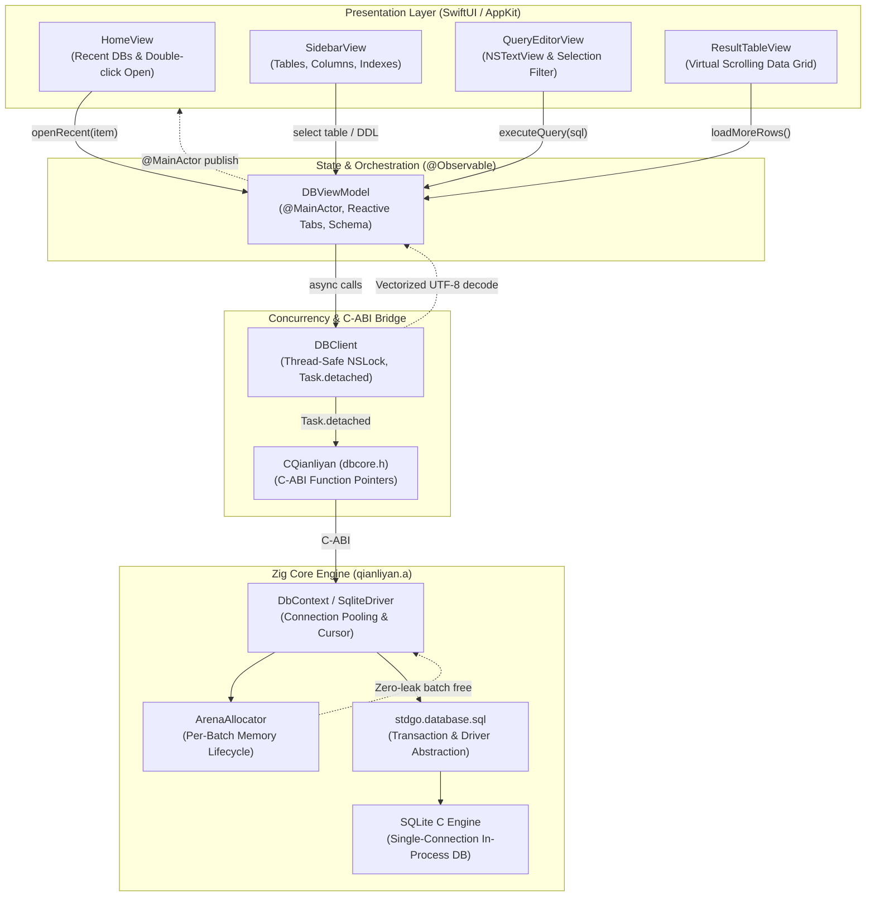
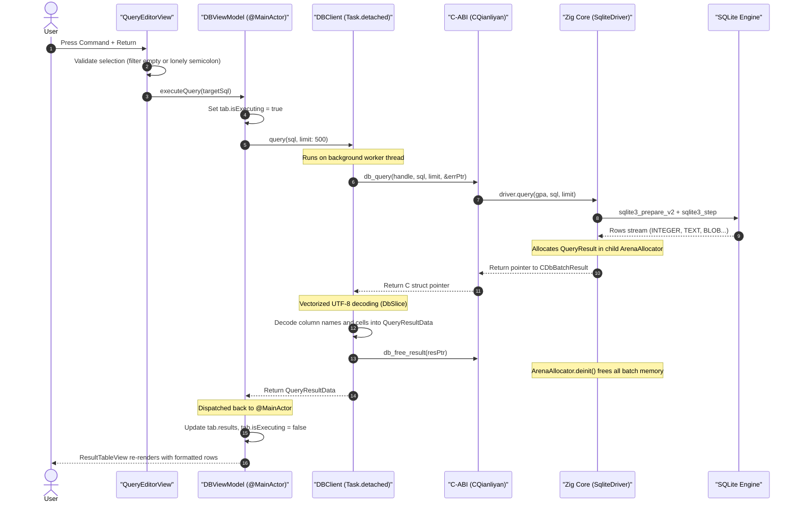
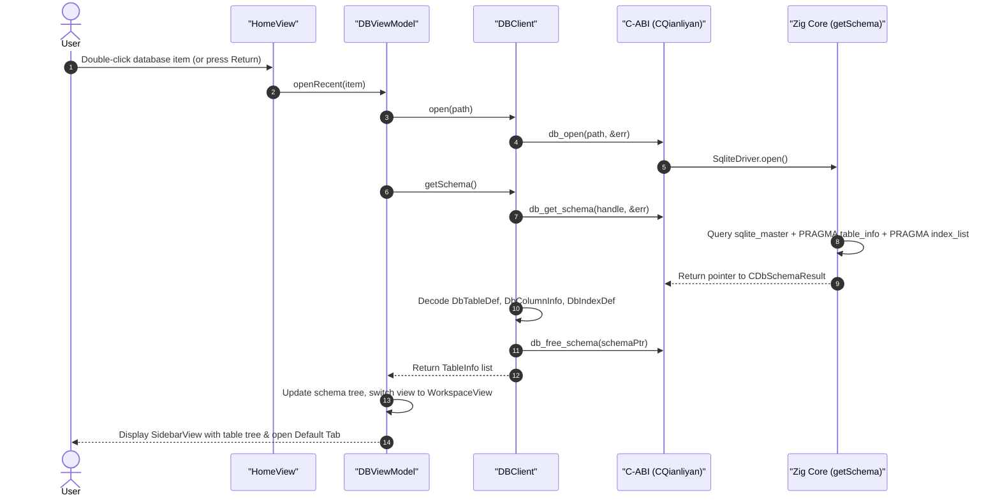
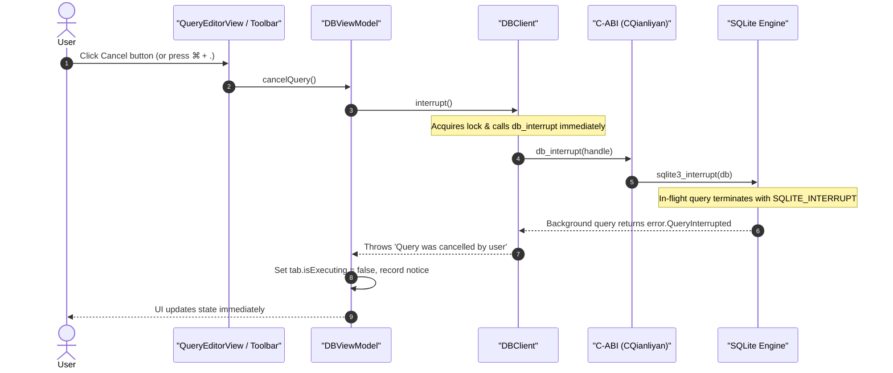
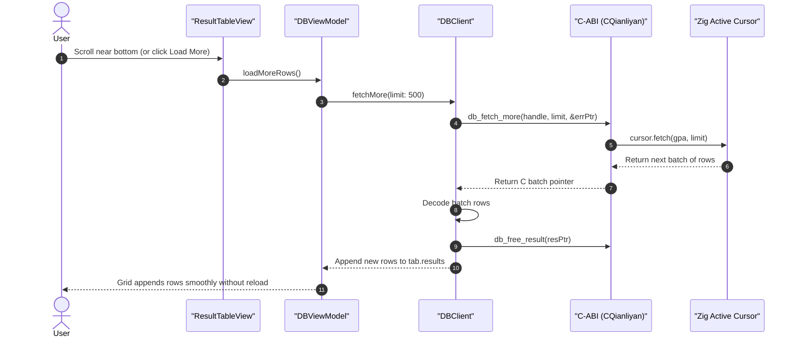

# Qianliyan macOS Client Architecture & Data Flow

This document details the internal architecture, state management, and end-to-end data flow of Qianliyan on macOS.

---

## 1. System Architecture Overview

The macOS client is built using pure **SwiftUI** and **AppKit**, communicating with the **Zig Core** database engine via an in-process **C-ABI bridge** (`CQianliyan`).

---

## 2. End-to-End Query Execution Flow

When a user executes a query (via `⌘ + Return` or the **Run** button), the data flows asynchronously through four layers before rendering in the result grid:

---

## 3. Database Connection & Schema Inspection Flow

Opening a database automatically inspects and caches its table definitions, columns, primary keys, and index metadata:

---

## 4. Query Cancellation Flow

Qianliyan supports responsive, thread-safe cancellation without blocking the UI or leaving orphaned connections:

---

## 5. Streaming Pagination Flow (`fetchMore`)

To handle large tables with hundreds of thousands of rows efficiently:

### Pagination Architecture Details:

1. **Initial Query (`LIMIT 500`)**:
   - `SqliteDriver.query` fetches the first 500 rows and peeks 1 row ahead to detect whether more rows exist (`has_more = true`).
   - If more rows exist, the driver retains the active `Cursor` on the pooled connection.
2. **Scroll Trigger (`loadMoreRows`)**:
   - When the user scrolls near the bottom of `ResultTableView`, `VM.loadMoreRows()` triggers.
   - Calls `DBClient.fetchMore(limit: 500)`.
   - C-ABI executes `db_fetch_more(handle, limit, &err)`.
   - The active cursor pulls the next batch from SQLite into an independent `ArenaAllocator`.
   - `DBClient` decodes the batch and appends the new rows to `tab.results.values`.
   - If `has_more == false`, the cursor is automatically closed and freed by the driver.

---

## 6. Key Memory & Performance Guarantees

| Mechanism                         | Description                                                                                                     | Benefit                                                                                                              |
| :-------------------------------- | :-------------------------------------------------------------------------------------------------------------- | :------------------------------------------------------------------------------------------------------------------- |
| **`DbSlice` Vectorized Decoding** | Uses `String(decoding: UnsafeRawBufferPointer(start: ptr, count: size), as: UTF8.self)` with exact byte length. | Skips C `strlen()` scans and avoids double allocation.                                                               |
| **Symmetric Arena Lifecycle**     | Each batch returned by `db_query` / `db_fetch_more` / `db_get_schema` owns its own `ArenaAllocator`.            | Calling `db_free_result` / `db_free_schema` bulk-frees all strings and values in $O(1)$ time with zero memory leaks. |
| **Lock-Free Cancellation**        | `db_interrupt` routes directly to `sqlite3_interrupt` across threads.                                           | Unblocks long-running analytical queries instantly without deadlocking connection locks.                             |
| **Main-Thread Decoupling**        | All C-ABI operations execute inside `Task.detached` off the main thread.                                        | UI stays responsive at 120 FPS; window resizing and editor typing never stutter.                                     |
