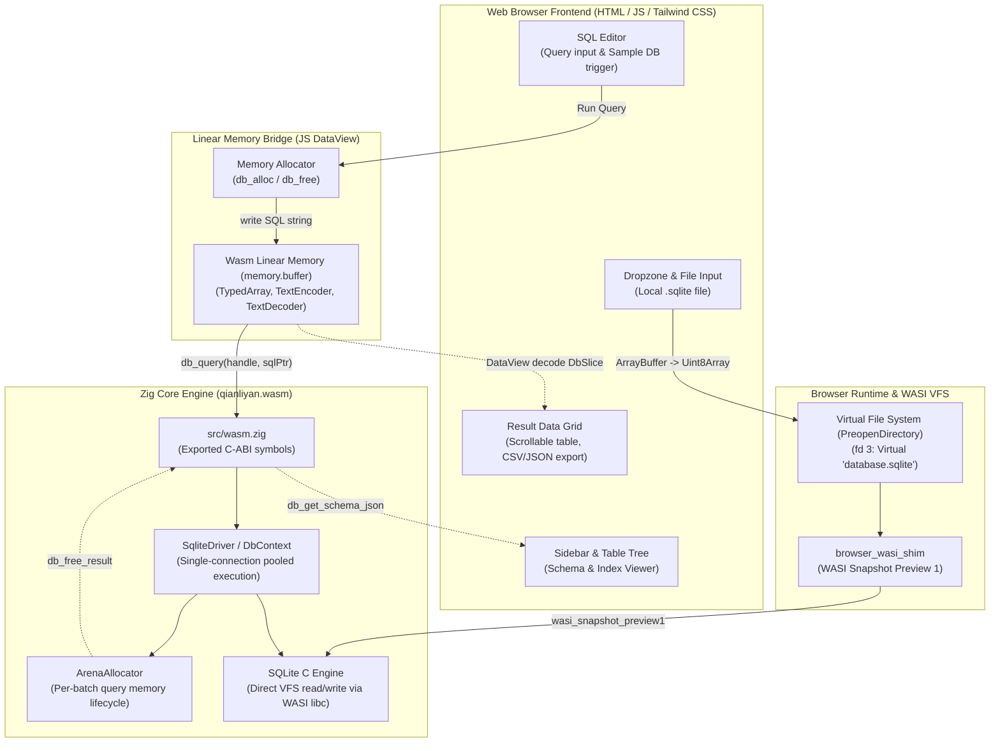
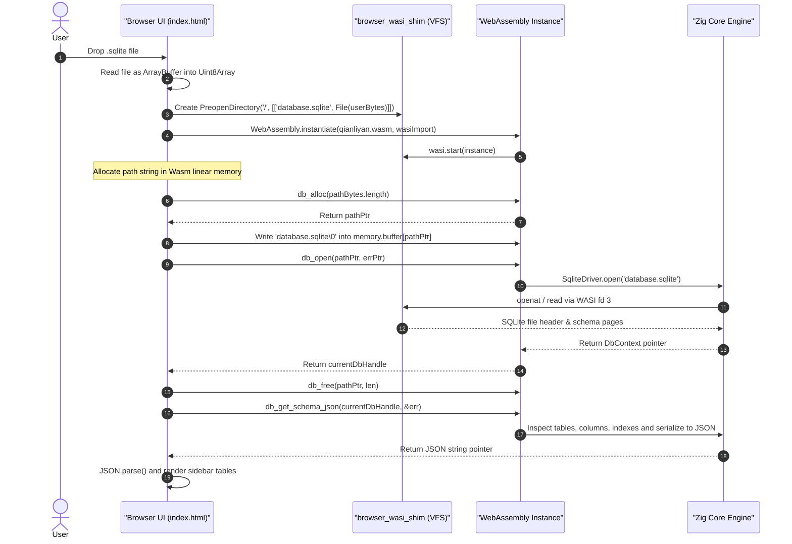
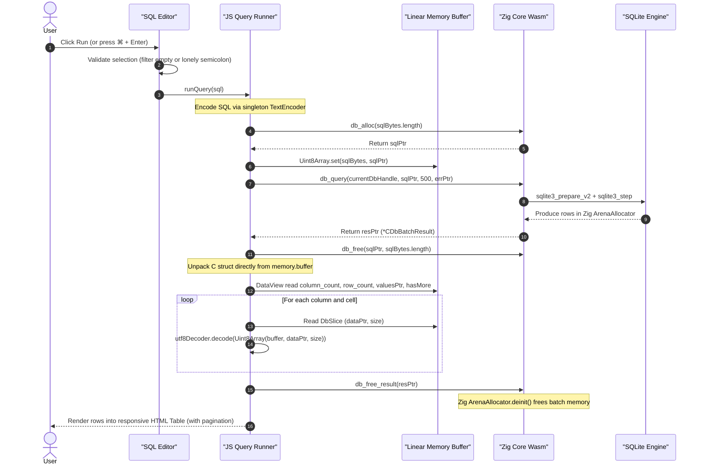
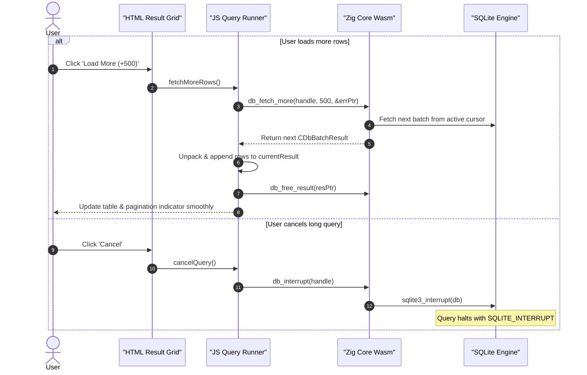

# Qianliyan WebAssembly (WASM) Architecture & Data Flow

This document details the client-side architecture, virtual file system (VFS), and linear memory bridge of Qianliyan WebAssembly.

---

## 1. Architectural Philosophy

Qianliyan Web runs **100% inside the user's browser**. There are zero backend servers, zero database uploads, and zero tracking:

- **Unified Core**: Compiles the exact same Zig database engine (`src/sqlite_driver.zig` + `stdgo.database.sql`) to `wasm32-wasi`.
- **In-Browser WASI VFS**: Leverages a browser-side WASI shim (`@bjorn3/browser_wasi_shim`) to mount user database files into virtual file descriptors.
- **Direct Linear Memory Access**: JavaScript reads typed records and UTF-8 strings directly out of WebAssembly linear memory (`memory.buffer`).

---

## 2. System Architecture Overview

---

## 3. Database Mounting & Opening Flow

When a user selects or drops a SQLite file, it is mounted into the virtual file system without sending any bytes over the network:

---

## 4. Query Execution & Zero-Copy Reading Flow

Queries execute directly against SQLite in browser memory. The frontend reads records using `DataView` and a global singleton `TextDecoder`:

---

## 5. Streaming Pagination & Query Cancellation Flow

To mirror the native macOS experience and avoid WASM linear memory bloat:

---

## 6. Memory Management & Performance Guarantees

| Concern                                   | Solution in Qianliyan WASM                                                                                                                                                                                                       |
| :---------------------------------------- | :------------------------------------------------------------------------------------------------------------------------------------------------------------------------------------------------------------------------------- |
| **Module Precompilation Cache**           | `WebAssembly.compile` is run once at startup. Database switches call `WebAssembly.instantiate(wasmModule, ...)` directly, eliminating JIT re-compilation delay.                                                                  |
| **Zero GC Pressure on Decoding**          | Global singleton `TextDecoder` and `TextEncoder` instances decode all `DbSlice` strings and encode SQL, eliminating thousands of transient object allocations per query.                                                         |
| **Memory Isolation**                      | WebAssembly sandboxing ensures SQLite and Zig cannot access arbitrary browser memory or filesystem outside of preopened descriptors.                                                                                             |
| **Streaming Pagination (`LIMIT 500`)**    | Queries stream in 500-row batches via `db_fetch_more`, preventing large tables from overflowing 32-bit WASM memory.                                                                                                              |
| **Instant Cancellation (`db_interrupt`)** | `db_interrupt` routes directly to `sqlite3_interrupt` to abort runaway queries without crashing the WASM runtime.                                                                                                                |
| **Zero Memory Leaks**                     | Queries run inside a per-execution `ArenaAllocator`. Calling `db_free_result` frees all allocations for that batch in $O(1)$ time.                                                                                               |
| **Linear Memory Buffer Detachment**       | In WebAssembly, when memory grows via `memory.grow()`, old `ArrayBuffer` instances become detached. Qianliyan always re-queries `wasmInstance.exports.memory.buffer` immediately before constructing `DataView` or `Uint8Array`. |
| **In-Memory & Sample DB Support**         | Calling `db_open(0, 0)` invokes SQLite `:memory:` mode directly in WASM RAM, allowing dynamic table generation and ad-hoc experiments without loading files.                                                                     |
