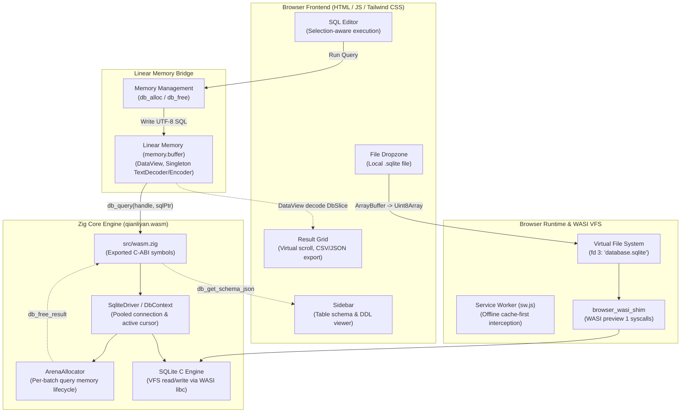
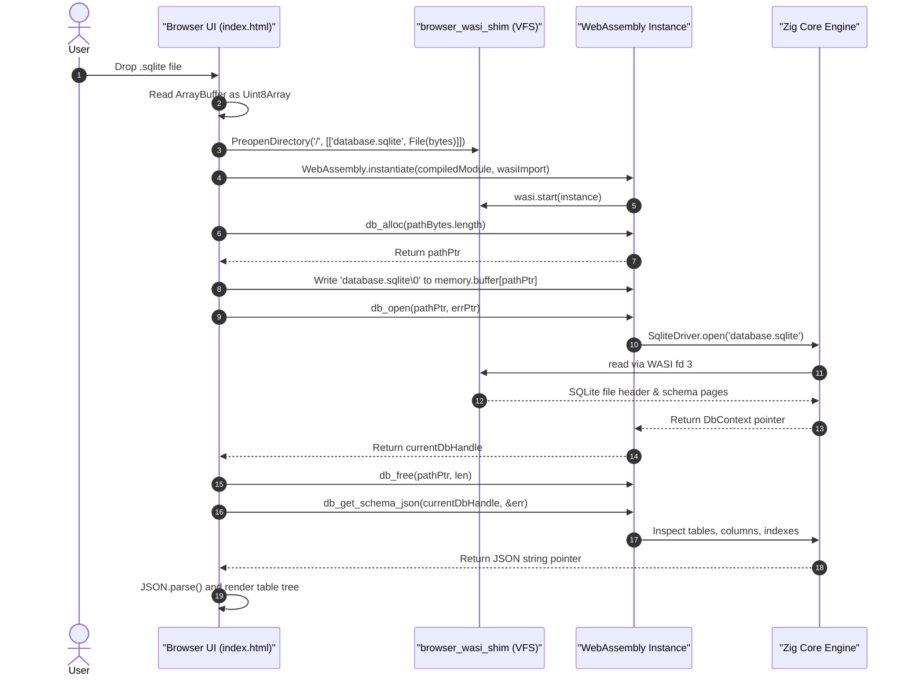
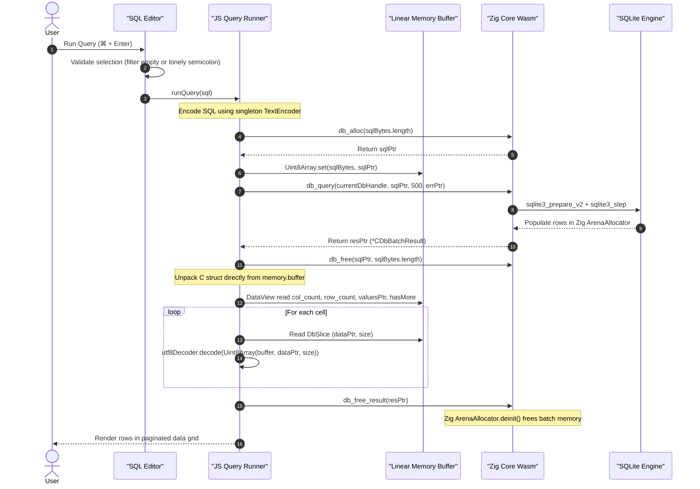
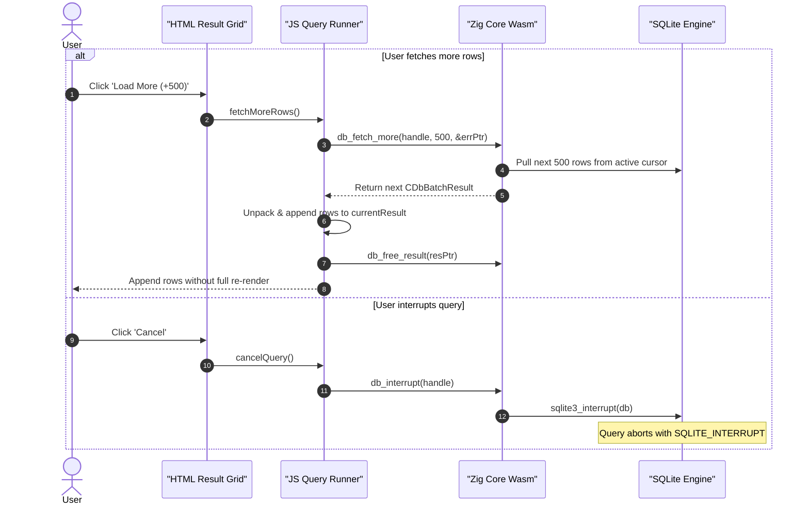

# Qianliyan WebAssembly (WASM) Architecture

Qianliyan Web runs entirely client-side inside the browser. It requires no backend server, uploads no database files, and executes SQLite queries in-process via WebAssembly.

---

## 1. Core Architecture

- **Unified Engine**: Compiles the same Zig database core (`src/sqlite_driver.zig` + `stdgo.database.sql`) to `wasm32-wasi`.
- **In-Browser WASI VFS**: Mounts user databases into virtual file descriptors via `@bjorn3/browser_wasi_shim`.
- **Direct Linear Memory Access**: JavaScript decodes typed records directly from Wasm linear memory (`memory.buffer`) without intermediate serialization.
- **Offline Support**: A Service Worker precaches the Wasm binary and dependencies for complete offline execution.

---

## 2. Architecture Diagram

---

## 3. Database Mounting & Opening Flow

When a user selects or drops a SQLite file, it is mounted into the virtual file system without network transfer:

---

## 4. Query Execution & Memory Decoding Flow

Queries execute against SQLite in browser memory. The frontend extracts records directly using `DataView` and a singleton `TextDecoder`:

---

## 5. Streaming Pagination & Interruption Flow

To prevent Wasm linear memory bloat on large tables:

---

## 6. Technical Guarantees

| Mechanism                    | Implementation                                            | Guarantee                                                                   |
| :--------------------------- | :-------------------------------------------------------- | :-------------------------------------------------------------------------- |
| **Module Precompilation**    | `WebAssembly.compile` runs once during initialization.    | Subsequent database loads skip JIT compilation.                             |
| **Zero-GC Decoders**         | Global singleton `TextDecoder` and `TextEncoder`.         | Eliminates per-cell object allocations on large datasets.                   |
| **64-bit Integer Safety**    | Checks `BigInt` bounds against `Number.MAX_SAFE_INTEGER`. | Prevents Snowflake ID and timestamp precision loss.                         |
| **Streaming Pagination**     | Cursor streams in 500-row batches via `db_fetch_more`.    | Prevents linear memory exhaustion on large tables.                          |
| **Instant Cancellation**     | `db_interrupt` routes directly to `sqlite3_interrupt`.    | Aborts long queries without crashing the Wasm runtime.                      |
| **Deterministic Freeing**    | Per-query child `ArenaAllocator`.                         | Calling `db_free_result` frees batch memory in $O(1)$ time with zero leaks. |
| **Buffer Detachment Safety** | Resolves `memory.buffer` dynamically on each access.      | Avoids detached buffer errors when Wasm memory grows.                       |
| **Offline Execution**        | Service Worker (`sw.js`) precaches binary and assets.     | Operates without network connectivity after initial load.                   |
