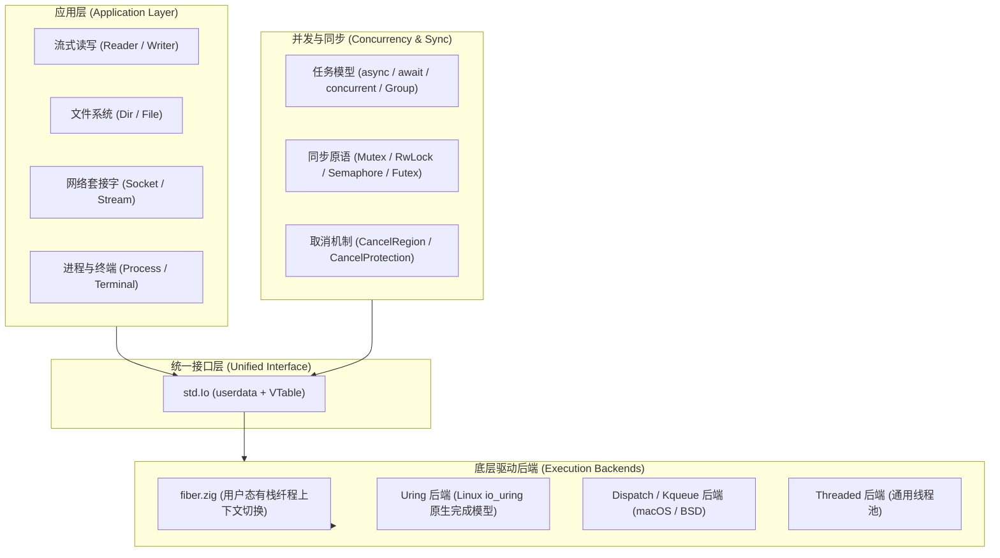

# 前言

输入输出（I/O）与并发处理是系统级编程语言的核心组成部分。

在传统的系统编程实践中，通常面临两种选择：
- 使用 C 风格的系统调用接口，直接管理操作系统提供的阻塞与非阻塞文件描述符，逻辑较为分散；
- 依赖高级语言的运行时系统，例如 Go 的 `netpoller` 与 GMP 调度，或者 Rust 与 C# 的 `async/await` 状态机。这类方案虽然能以同步或扁平形式书写并发逻辑，但带来了函数颜色污染（Function Coloring）、不可裁剪的运行时依赖，或者异步状态机与完成型内核接口之间的所有权借用冲突。

Zig 在其标准库设计中引入了统一的接口抽象：**`std.Io`**。

---

## 架构体系

`std.Io` 将底层系统调用、事件循环后端与上层流式操作分层解耦，其体系结构如下：

---

## 内容结构

全书分为六个部分：

1. **来龙去脉与设计哲学**：分析 Readiness（就绪通知）与 Completion（完成通知）两种模型在系统调用与内存管理上的差异；比较 Push/Pull 推进模型与有栈/无栈协程的技术取舍；对比 Zig、Rust 与 Go 在处理异步并发时的选型逻辑。
2. **核心概念与对象模型**：解析 `std.Io` 的结构体定义与 VTable 动态分发机制；分析完成型模型下的内存固定（Buffer Pinning）问题与 Zig 的取消安全屏障；介绍重构后的 `Reader` 与 `Writer` 内部缓冲与零拷贝机制；说明结构化并发容器 `Group` 的设计。
3. **核心 API 与基础 I/O**：介绍目录与文件操作（`Dir`、`File`）、流式读写（`Reader`、`Writer`）、网络套接字（`net.Socket`、`Server`）、外部子进程与同步原语的使用方式。
4. **运行机制与底层后端**：通过汇编代码解析有栈纤程（`fiber.zig`）的上下文切换；分析 Linux `io_uring` 驱动的具体工作流程；介绍 macOS `Dispatch`、BSD `Kqueue` 模拟层以及通用 `Threaded` 线程池的降级机制。
5. **工程实战**：通过四个实际案例，演示 CLI 文本处理、零拷贝文件复制、网络服务与优雅停机的代码编写范式，并与 Go/Rust 对应实现进行取舍分析。
6. **附录**：提供常用 API 速查表以及从旧版 `std.io` 到新版 `std.Io` 的迁移对照。

---

## 约定

- 正文的技术解析基于 Zig 官方标准库实现（[`lib/std/Io.zig`](https://codeberg.org/ziglang/zig/src/tag/0.17.0/lib/std/Io.zig) 及其关联模块）。
- 配套代码示例位于 `examples/` 目录下，均可通过自动化测试。
