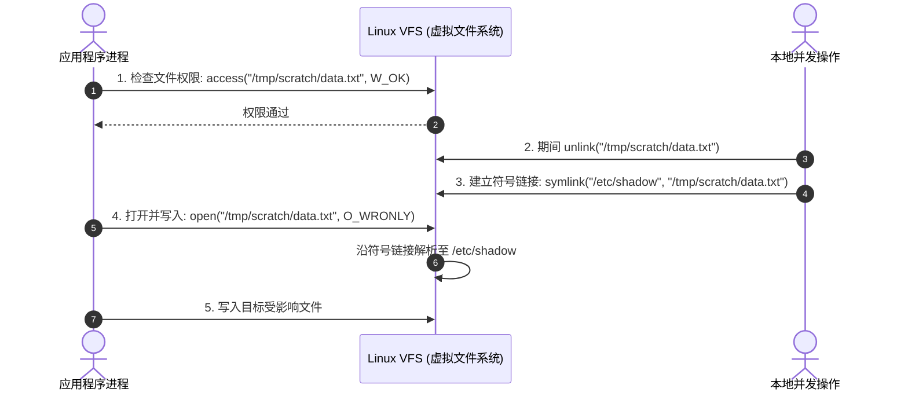
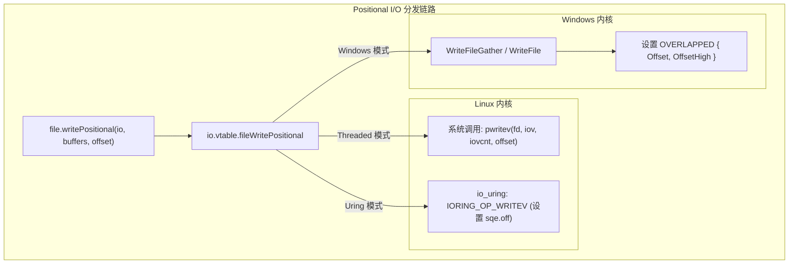

# 文件系统与目录操作：Dir 与 File 底层内核机制

在操作系统中，直接操作绝对路径存在安全与性能考虑，容易引发目录遍历与竞态条件漏洞（TOCTOU: Time-Of-Check to Time-Of-Use）。

Zig 的文件系统 API 采用基于目录句柄的设计：所有文件与子目录操作均围绕 `Io.Dir` 与 `Io.File` 展开。

---

## TOCTOU 竞态漏洞与 Linux `*at` 系统调用防御

以全局绝对路径为中心的 API（如直接打开 `/tmp/app.log`）在多进程环境下存在竞态可能：



### 1. 竞态产生原因
在检查权限（Check）与实际操作（Use）之间存在时间差。在此期间若路径被替换为符号链接，可能导致操作偏离预期目标。

### 2. 基于句柄的 `*at` 系统调用
在源码 [`lib/std/Io/Dir.zig#L13`](https://codeberg.org/ziglang/zig/src/tag/0.17.0/lib/std/Io/Dir.zig#L13) 中，相对路径操作需通过已打开的 `Dir` 句柄进行：

```zig
const std = @import("std");
const Io = std.Io;

pub fn exploreDirectories(io: Io) !void {
    // 获取当前工作目录句柄 (全局进程级句柄)
    var cwd = Io.Dir.cwd();

    // 在指定目录下创建文件夹
    try cwd.createDir(io, "output_dir", .default_dir);

    // 打开子目录句柄
    var sub_dir = try cwd.openDir(io, "output_dir", .{ .iterate = true });
    defer sub_dir.close(io);

    // 递归建立目录
    try cwd.createDirPath(io, "nested/logs/daily");
}
```

- **底层系统调用**：
  在 Linux/POSIX 环境中，`cwd.openDir` 与 `dir.createFile` 映射为 `*at` 系列系统调用：
  - `openat(dir.handle, "data.txt", O_CLOEXEC | O_NOFOLLOW, ...)`
  - `unlinkat(dir.handle, "temp.bin", 0)`
  - `fstatat(dir.handle, "config.json", &stat, AT_SYMLINK_NOFOLLOW)`
  - `renameat(old_dir.handle, "old.txt", new_dir.handle, "new.txt")`
- **解析边界**：
  内核以 `dir.handle` 对应的 inode 为起点解析路径，配合 `O_NOFOLLOW` 标志，遇到符号链接时返回错误，降低路径遍历风险。

---

## Positional I/O 与游标并发行为

查看源码 [`lib/std/Io/File.zig#L12-L26`](https://codeberg.org/ziglang/zig/src/tag/0.17.0/lib/std/Io/File.zig#L12-L26)：

```zig
pub const Handle = std.posix.fd_t;

handle: Handle,
flags: Flags,
```
`File` 结构体包含底层系统句柄与标志位，其读写接口分为两种方式：

### 1. 基于内核游标的流式读写
传统的 `read()` / `write()` 依赖内核 `struct file` 中的全局游标（`f_pos`）。
多个线程或 Fiber 并发读写同一个 `File` 时，内核需要对 `f_pos` 加锁串行化，可能导致读写内容交叉。

### 2. 基于绝对偏移量的 Positional I/O
高并发场景下，推荐使用显式指定偏移量的 `writePositional` 与 `readPositional`：

```zig
pub fn writeConcurrently(io: Io, file: Io.File) !void {
    const chunk_a = "Payload-Block-A";
    const chunk_b = "Payload-Block-B";

    // 显式指定文件绝对偏移量，互不干扰
    _ = try file.writePositional(io, &.{chunk_a}, 0);
    _ = try file.writePositional(io, &.{chunk_b}, 4096);
}
```



- **底层调用**：
  - **Linux/POSIX**：调用 `pwritev(fd, iov, len, offset)`，不改变内核 `f_pos` 游标；
  - **Windows**：调用 `WriteFile` 时填充 `OVERLAPPED` 结构体的 `Offset` 与 `OffsetHigh`；
  - **Linux io_uring**：在 `io_uring_sqe.off` 中填入绝对偏移量提交。

---

## 物理存储持久化：`File.sync` 的底层语义

操作系统通常先将写操作写入页缓存（Page Cache），由内核定时或按策略回写物理磁盘。

需要保证落盘持久化时，调用 `file.sync(io)`：

```zig
pub fn persistToStorage(io: Io, file: Io.File) !void {
    // 将内核脏页与元数据刷入物理介质
    try file.sync(io);
}
```

- **语义差异**：
  - `fsync`：将脏页数据及文件所属的 inode 元数据（大小、修改时间、索引块）同步到持久介质；
  - 在 `io_uring` 中投递 `IORING_OP_FSYNC` 请求，可在等待刷盘期间让出 CPU。

---

## 内存映射文件：`File.MemoryMap` 机制

随机读取大型文件（如只读索引或字典）时，可通过内存映射减少系统调用频次。

源码见 [`lib/std/Io/File/MemoryMap.zig`](https://codeberg.org/ziglang/zig/src/tag/0.17.0/lib/std/Io/File/MemoryMap.zig)：

```zig
pub fn mapEntireFile(io: Io, file: Io.File) !void {
    const file_len = try file.length(io);

    // 建立虚拟内存与文件页缓存的映射
    var mmap = try file.createMemoryMap(io, .{
        .len = file_len,
        .protection = .read_only,
    });
    defer mmap.destroy(io);

    // 直接通过切片访问
    const slice: []align(std.heap.page_size_min) const u8 = mmap.memory;
    _ = slice[0];
}
```

### 过程简述：
1. **建立映射**：底层调用 Linux `mmap` 或 Windows `CreateFileMapping` + `MapViewOfFile`，在进程虚拟地址空间中分配一段地址范围；
2. **缺页加载**：初次访问页面时触发缺页中断（Page Fault），内核将对应的磁盘扇区读入页缓存并建立页表映射；
3. **后续访问**：后续读取直接访问已建立映射的内存页。
