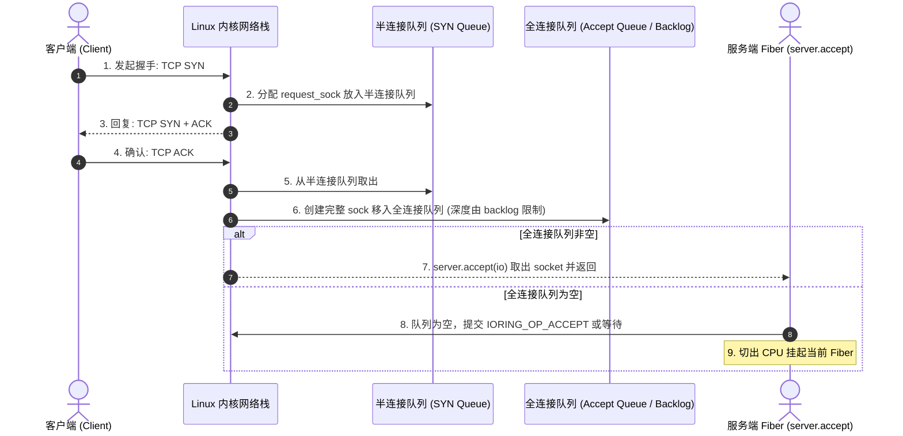

# 网络通信：TCP 套接字、内核全连接队列与异步事件驱动底层剖析

网络套接字（Socket）是网络服务的通信基础。

在高并发场景下，了解 TCP 三次握手队列、内核 Socket 读写缓冲区与非阻塞事件驱动的配合机制，有助于排查连接堆积与内存波动问题。

---

## TCP 握手全流程与内核双队列机制

查看源码 [`lib/std/Io/net.zig#L1551`](https://codeberg.org/ziglang/zig/src/tag/0.17.0/lib/std/Io/net.zig#L1551)，调用 `bind_addr.listen(io, .{ .kernel_backlog = 128 })` 时，内核在底层维护两个核心队列：



### 1. 双队列说明
- **半连接队列（SYN Queue）**：存放收到 SYN 但尚未完成三次握手的连接。遇 SYN Flood 攻击时可开启 `tcp_syncookies` 缓解；
- **全连接队列（Accept Queue）**：已完成三次握手、但尚未被应用通过 `accept()` 摘取的连接。`kernel_backlog = 128` 设定了该队列的大小。若应用处理过慢导致队列溢出，内核通常依据 `tcp_abort_on_overflow` 丢弃后续 ACK 或回复 RST。

### 2. `server.accept(io)` 的异步行为
在 Zig 中，`server.accept(io)` 保持同步调用风格：
```zig
const std = @import("std");
const Io = std.Io;
const net = Io.net;

pub fn runServer(io: Io) !void {
    const addr = try net.IpAddress.parse("127.0.0.1", 9000);
    var server = try addr.listen(io, .{ .kernel_backlog = 128 });
    defer server.deinit(io);

    while (true) {
        // 全连接队列为空时让出 CPU
        var stream = try server.accept(io);
        try handleClient(io, stream);
    }
}
```
- **在 `Io.Uring` 模式下**：驱动向内核提交 `IORING_OP_ACCEPT` 请求，将当前 Fiber 上下文写入 `sqe.user_data`。Fiber 通过汇编切出 CPU。内核全连接队列产生新连接并返回 CQE 时，调度器唤醒该 Fiber；
- **在 `Io.Threaded` 或 `Io.Dispatch` 模式下**：套接字标记为 `O_NONBLOCK`，注册至事件循环中，可读时再调用系统调用。

---

## Socket 读写缓冲区与流式交互

网络套接字是全双工流，具备固定的内核缓冲区：

```mermaid
graph LR
    subgraph ClientHost ["客户端主机"]
        C_App["应用程序"]
        C_SendBuf["内核发送缓冲区 (SO_SNDBUF)"]
        C_App -->|write()| C_SendBuf
    end

    subgraph NetworkFlow ["TCP 网络链路"]
        C_SendBuf -->|IP 报文流传输| Packets["滑动窗口 / 拥塞控制"]
    end

    subgraph ServerHost ["服务端主机 (Zig std.Io)"]
        Packets --> S_RecvBuf["内核接收缓冲区 (SO_RCVBUF)"]
        S_RecvBuf -->|readSliceShort| Z_Reader["Io.Reader 栈缓冲区 (1KB)"]
        Z_Reader --> Z_App["业务解包处理"]
        Z_App -->|writeAll| Z_Writer["Io.Writer 栈缓冲区 (1KB)"]
        Z_Writer -->|flush()| S_SendBuf["服务端内核发送缓冲区"]
    end
```

### 1. 缓冲区与流量控制
- **`SO_RCVBUF`（接收缓冲区）**：远端网卡发来的 TCP 数据存放在此。应用读取缓慢导致缓冲区填满时，TCP 滑动窗口收缩，通知远端暂停发送；
- **`SO_SNDBUF`（发送缓冲区）**：应用调用 `w.writeAll()` 写入内核发送队列。若网络拥塞导致缓冲区填满，写操作在底层挂起当前 Fiber，待 ACK 释放窗口后唤醒继续。

---

## TCP 数据切分与半关闭（Half-Close）

TCP 是字节流协议，应用层报文间没有天然边界。发送端连续写入的数据可能在一次或多次读取中到达。

### 1. 通过 Reader 滑动窗口解包
借助 `Io.Reader` 维护的缓冲区管理数据：
```zig
fn handleClient(io: Io, stream: net.Stream) !void {
    defer stream.close(io);

    var rx_buf: [1024]u8 = undefined;
    var tx_buf: [1024]u8 = undefined;
    var stream_reader = stream.reader(io, &rx_buf);
    var stream_writer = stream.writer(io, &tx_buf);

    const r = &stream_reader.interface;
    const w = &stream_writer.interface;

    while (true) {
        var chunk: [256]u8 = undefined;
        // 短读：返回 0 表示对端发送 FIN 断开
        const n = try r.readSliceShort(&chunk);
        if (n == 0) break;

        // 回写并刷盘
        try w.writeAll(chunk[0..n]);
        try w.flush();
    }
}
```

### 2. TCP 四次挥手与半关闭
当对端调用 `shutdown(SHUT_WR)` 时：
1. 对端发送 `FIN` 报文进入终止状态；
2. 本地内核收到 `FIN` 并回复 `ACK`，在接收队列中记录文件结束标记（EOF）；
3. 本地 `r.readSliceShort` 读完剩余数据后返回 `0` 字节；
4. 本地确认对端停止写入，但仍可通过 `w` 发送数据，发送完毕后调用 `stream.close(io)` 发送己方 `FIN` 彻底关闭连接。
