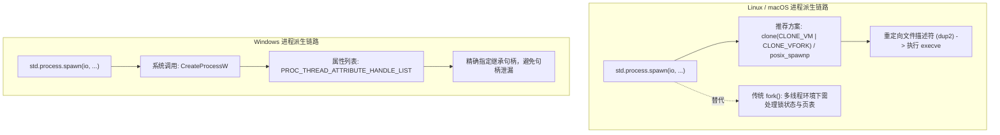
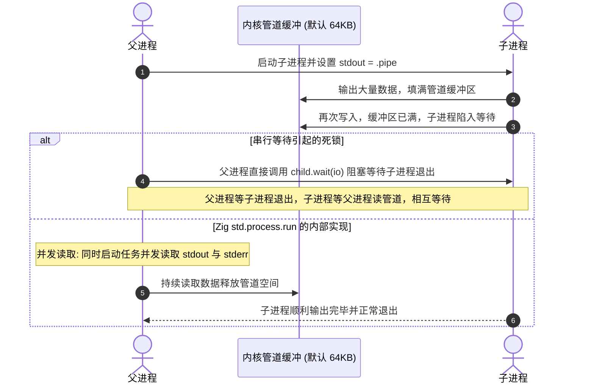

# 子进程、管道与终端交互：Process 与 Terminal 底层机制

在开发构建脚本、CLI 工具或跨进程服务时，控制子进程生命周期、重定向管道输出以及管理终端交互是常见的系统级操作。

Zig 0.17 将进程派生（Process Spawning）、跨进程管道（Anonymous Pipe）与标准错误终端锁定统筹纳管至 `std.Io` 体系中。

---

## 子进程派生机制：POSIX `posix_spawn` vs Windows `CreateProcessW`

跨平台派生外部进程时，操作系统的实现存在差异：



### 1. POSIX 环境的派生选择
在多线程或包含纤程的进程中，直接调用传统 `fork()` 需注意锁状态与页表复制问题。
因此，Zig 在 POSIX 环境下优先使用 **`posix_spawnp`** 或带有 `CLONE_VM | CLONE_VFORK` 标志的 `clone` 系统调用，避免不必要的页表复制，直接加载新可执行镜像。

### 2. Windows 句柄继承控制
在 Windows 上调用 `CreateProcessW` 时，若将 `bInheritHandles` 粗暴设为 `TRUE`，父进程打开的文件或套接字句柄可能被子进程意外继承。
Zig 标准库通过 `STARTUPINFOEXW` 结构体中的 `PROC_THREAD_ATTRIBUTE_HANDLE_LIST` 属性，**显式白名单指定子进程实际使用的 `stdin`、`stdout`、`stderr` 句柄进行继承**。

---

## 跨进程管道（Pipe）与死锁防范

查看源码 [`lib/std/process.zig`](https://codeberg.org/ziglang/zig/src/tag/0.17.0/lib/std/process.zig)，高层提供了便捷的 `std.process.run`：

```zig
const std = @import("std");
const Io = std.Io;

pub fn executeGit(allocator: std.mem.Allocator, io: Io) !void {
    const result = try std.process.run(allocator, io, .{
        .argv = &.{ "git", "status", "--porcelain" },
    });
    defer {
        allocator.free(result.stdout);
        allocator.free(result.stderr);
    }

    std.debug.print("Stdout:\n{s}\n", .{result.stdout});
}
```

### 管道死锁成因与处理：
在 Linux 内核中，匿名管道（Pipe）具备固定容量的环形缓冲区（通常为 64KB）。



`std.process.run` 在底层并发读取 stdout 和 stderr，在子进程运行期间持续将管道数据读入内存，避免缓冲区写满造成的阻塞死锁。

---

## 终端防乱序输出：`Terminal` 与 `lockStderr`

多线程或多个 Fiber 同时向标准错误（`stderr`）写入日志时，可能出现内容混叠。

`std.Io` 提供了互斥锁机制：

```zig
pub fn atomicLog(io: Io, message: []const u8) !void {
    // 1. 获取全局 stderr 互斥锁，配置转义码模式
    var err_buf: [512]u8 = undefined;
    var locked_stderr = try io.lockStderr(&err_buf, .escape_codes);
    defer io.unlockStderr();

    // 2. 写入带格式的日志
    const terminal = locked_stderr.terminal();
    const w = terminal.writer;
    try w.print("\x1b[32m[SUCCESS]\x1b[0m {s}\n", .{message});
    try w.flush();
}
```

- **协程级互斥排队**：
  在 `locked_stderr` 持有期间，其他并发 Fiber 尝试输出时会在等待队列中休眠让出 CPU，保证整行日志完整写入；
- **终端转义码检测**：
  底层调用 `isatty(STDERR_FILENO)` 探测输出目标。若发现标准错误被重定向至管道或日志文件，会自动禁用 ANSI 颜色转义字符，避免生成控制字符乱码。
