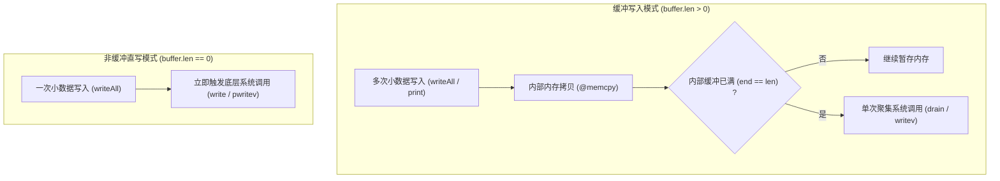
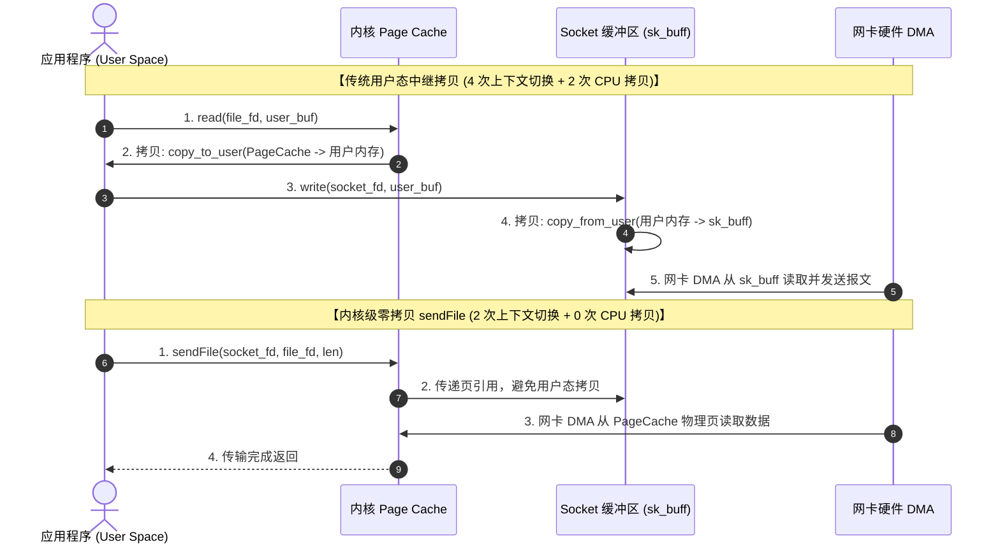
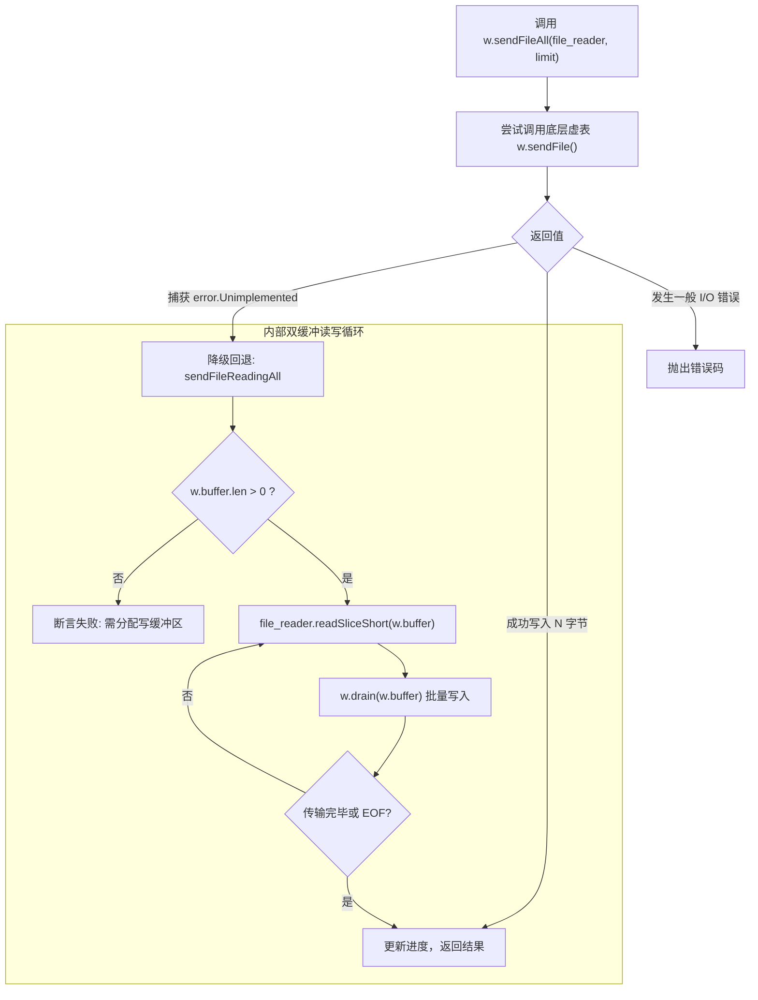

# 高效数据流操作：缓冲聚合、向量化写入与零拷贝底层机制

在处理日志、网络报文与静态文件分发时，直接使用小粒度的系统调用会增加上下文切换频次。

Zig 0.17 将 `Io.File`、内存切片与网络套接字接入 `Reader` 与 `Writer`，提供了缓冲聚合与系统调用降级机制。

---

## 缓冲（Buffered）与非缓冲（Unbuffered）机制

在源码 [`lib/std/Io/File.zig`](https://codeberg.org/ziglang/zig/src/tag/0.17.0/lib/std/Io/File.zig) 中，流式读写器的行为由传入的缓冲区切片长度决定：

```zig
const std = @import("std");
const Io = std.Io;

pub fn setupStreams(io: Io, file: Io.File) !void {
    // 1. 缓冲写入器：在栈上开辟 4KB 聚合缓冲区
    var write_buf: [4 * 1024]u8 = undefined;
    var buffered_writer = file.writer(io, &write_buf);
    const w = &buffered_writer.interface;

    // 2. 非缓冲直接写入器：传入空切片 &.{}`
    var direct_writer = file.writer(io, &.{});
    const direct_w = &direct_writer.interface;
    _ = direct_w;
}
```



### 运行特征：
- **小写聚合**：当 `buffer.len > 0` 时，调用 `w.writeByte` 或 `w.print` 优先写入栈数组并推进 `w.end`。缓冲区填满或显式调用 `w.flush()` 时，才触发系统调用批量刷写，减少系统调用频次；
- **非缓冲直写**：传入 `&.{}` 时，内部缓冲区大小为 0，写操作直接调用底层系统调用，适用于需即时发送的数据。

---

## 内核级零拷贝：`sendFile` 底层调用

在流式数据流转中，传统用户态中继与内核零拷贝的路径差异如下：



### 底层系统调用说明：
- **Linux `sendfile` 与 `splice`**：
  `splice` 在内核管道结构（`struct pipe_inode_info`）中流转页引用。网卡支持分散-聚集 DMA（Scatter-Gather DMA）时，可直接读取页缓存物理页生成报文；
- **Linux `copy_file_range`**：
  若源文件与目标文件在支持的文件系统（如 Btrfs、XFS、ext4）上，内核可在文件系统元数据层面共享数据块（Reflink），减少实际读取开销。

---

## `sendFileAll` 的自动降级机制

异构系统或复杂环境下，零拷贝调用可能受限：
- 目标套接字可能开启了 TLS 加密，内核无法直接直传；
- 源与目标位于不支持 `copy_file_range` 的跨网络挂载卷（如 NFS、CIFS）；
- 容器安全策略可能限制了部分系统调用。

查看源码 [`lib/std/Io/Writer.zig#L1074`](https://codeberg.org/ziglang/zig/src/tag/0.17.0/lib/std/Io/Writer.zig#L1074)，Zig 提供了降级处理：

```zig
pub fn streamFileToSink(w: *Io.Writer, source_file: *Io.File.Reader, max_bytes: u64) !usize {
    // 调用高阶方法 sendFileAll
    // 需保证 w.buffer.len > 0，为降级回退提供缓冲区
    return w.sendFileAll(source_file, .limited(max_bytes));
}
```



### 降级步骤：
1. **优先调用底层**：先尝试内核原生零拷贝调用；
2. **错误拦截**：若底层返回 `error.Unimplemented`，上层方法捕获该错误；
3. **借用写缓冲区**：自动使用 `w.buffer` 作为中继缓冲区，循环调用 `readSliceShort` 与 `drain` 完成常规读写。
