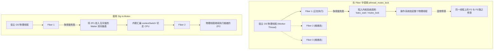
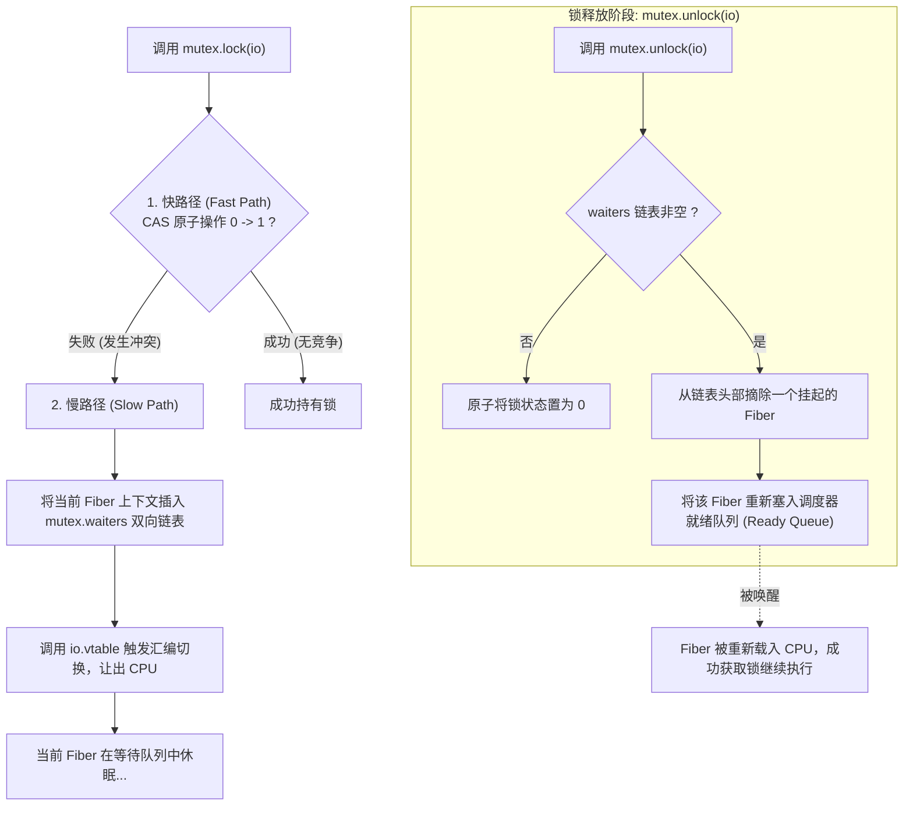

# 并发同步原语：协作型 Mutex、RwLock 与 Futex 状态机底层剖析

在由纤程（Fiber）与事件环驱动的并发程序中，直接使用操作系统级线程锁（如 POSIX `pthread_mutex_t` 或 Win32 `CRITICAL_SECTION`）可能引起其他就绪任务的停滞。

Zig 0.17 在 `std.Io` 中提供了专门为用户态纤程设计的**协作型同步原语族**。

---

## 协作锁与线程锁的区别



- **阻塞影响**：单条 OS 线程上通常承载多个并发 Fiber。若 Fiber 1 调用阻塞式线程锁被操作系统挂起，整条宿主操作系统线程会进入阻塞态，导致其他已就绪的 Fiber 无法继续运行。
- **协作原则**：遭遇锁争用时，**挂起当前 Fiber，而底层的 OS 物理线程保持运行**，切换执行下一个就绪任务。

---

## `Io.Mutex` 底层状态机

查看标准库中 `Io.Mutex` 的实现，其内部围绕原子状态字与等待队列构建：

```zig
const std = @import("std");
const Io = std.Io;

pub const Counter = struct {
    mutex: Io.Mutex = .init,
    value: usize = 0,

    pub fn increment(self: *Counter, io: Io) !void {
        // 获取协作锁：遭遇争用时让出 CPU 挂起当前 Fiber
        try self.mutex.lock(io);
        defer self.mutex.unlock(io);

        self.value += 1;
    }

    pub fn tryIncrement(self: *Counter, io: Io) bool {
        // 非阻塞尝试：纯 CPU 原子 CAS 指令，不需要 io 参数
        if (self.mutex.tryLock()) {
            defer self.mutex.unlock(io);
            self.value += 1;
            return true;
        }
        return false;
    }
};
```



### 为什么 `tryLock()` 不需要 `io`，而 `unlock(io)` 必须传入 `io`？
- **`tryLock()`**：仅包含单条原子 CAS 指令（如 x86 `LOCK CMPXCHG`）。它尝试更新锁状态并立刻返回布尔值，不触发协程挂起或调度，因此无需驱动上下文；
- **`unlock(io)`**：释放锁时若发现等待队列中有休眠的 Fiber，需要通知底层事件驱动将其重新加入就绪队列，因此需传入 `io`。

---

## 读写锁：`Io.RwLock` 的写防饥饿策略

在读多写少的场景下，[`Io.RwLock`](https://codeberg.org/ziglang/zig/src/tag/0.17.0/lib/std/Io/RwLock.zig) 在原子字中同时维护了读者数量与写者等待标记：

```zig
pub fn accessConfig(cache: *ConfigCache, io: Io) !void {
    // 共享读锁：多个 Fiber 可并行读取
    try cache.rwlock.lockShared(io);
    defer cache.rwlock.unlockShared(io);

    // 读取缓存...
}
```

- **读者写者隔离**：若仅有读操作，原子读者计数累加，读 Fiber 并发执行；
- **防写饥饿**：若持续有新读者涌入，可能导致排他写者长时间等待。`Io.RwLock` 支持写优先策略：写者尝试获取锁时立起等待标志，后续新读者排队等待，待现有读者退出后由写者优先更新。

---

## 底层同步基石：Futex（Fast Userspace Mutex）

跨物理线程交互中，`std.Io` 的虚表直接对接操作系统的 Futex 接口（源码见 [`lib/std/Io.zig#L140`](https://codeberg.org/ziglang/zig/src/tag/0.17.0/lib/std/Io.zig#L140)）：

```zig
// 等待某个 32 位整型地址的值，若当前内存值 == expected_val 则挂起，超时为 .none
try io.vtable.futexWait(io.userdata, &atomic_word, expected_val, .none);

// 唤醒最多 1 个在该地址上休眠的物理等待者
io.vtable.futexWake(io.userdata, &atomic_word, 1);
```

### Futex 分工机制：
1. **无争用时（用户态）**：加锁与解锁在用户态通过原子 CAS 完成，无需系统调用；
2. **发生争用时（内核态）**：仅在状态不满足且需要休眠时，才调用 `sys_futex` 将当前线程挂入内核等待队列。
结合了原子指令与操作系统的精准休眠唤醒。
