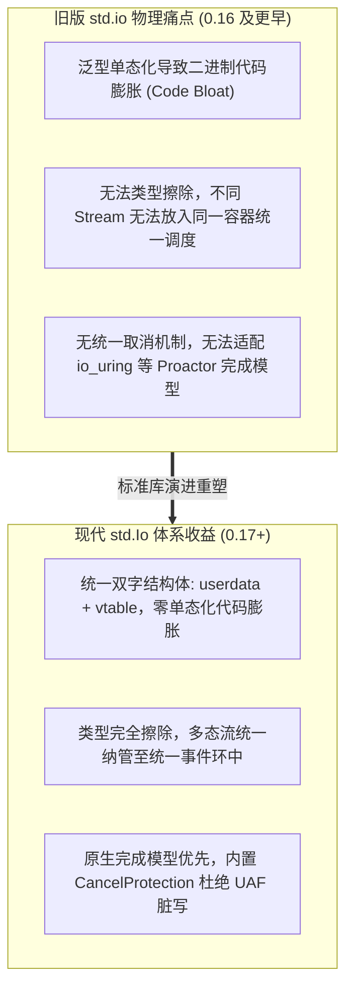

# 从旧版 std.io 到现代 std.Io 深度迁移指南

在 Zig 0.17 标准库中，I/O 体系经历了彻底的重构。原有的基于编译期宏混入的泛型机制（`std.io`）被废弃，全面演进为基于“类型擦除虚表 + 有栈纤程”的统一接口 **`std.Io`**。

本文档剖析这一架构重构背后的底层系统级动因，并提供全场景的迁移代码范例。

---

## 为什么必须重构？底层动因对比



---

## 核心 API 变迁全景对照表

| 场景 | 旧版范式 (0.16 及更早) | 现代新范式 (0.17+) | 架构与微架构影响 |
| :--- | :--- | :--- | :--- |
| **标准库命名空间** | `@import("std").io` (小写) | `@import("std").Io` (大写) | 明确区分命名空间与统一接口类型 |
| **系统能力依赖** | 隐式依赖全局系统调用环境 | **显式接收 `io: std.Io` 实例** | 类似 `allocator` 显式注入，实现确定性测试与能力沙箱隔离 |
| **Reader / Writer 抽象** | `std.io.Reader(Context, Error, readFn)` 泛型混入 | **`std.Io.Reader` 具体结构体** | 内置滑动窗口缓冲游标（`seek`/`end`），消除泛型代码膨胀 |
| **缓冲读写实现** | 外置嵌套包装 `std.io.bufferedReader(file.reader())` | **构造时直接传入内存切片作为内部缓冲** | 零多层结构体嵌套，慢路径直接通过 `readVec` 直击内核 |
| **零拷贝支持** | 缺乏统一抽象，需手工调用各 OS `sendfile` | **`Writer.VTable.sendFile` 虚表方法** | 原生支持 `copy_file_range`/`sendfile`，支持平滑降级 |
| **文件打开与创建** | `std.fs.cwd().openFile(path, .{})` | `dir.openFile(io, path, .{})` | 接受 `io` 驱动，底层强制使用 `openat` 防御 TOCTOU |
| **标准错误/输出** | `std.io.getStdErr().writer()` | `io.lockStderr(&buf, .escape_codes)` | 内建协程级互斥锁，支持防撕裂输出与 ANSI 色彩检测 |
| **并发任务派生** | 语言级关键字 `async`/`await` 或系统裸线程 | **`io.async` / `io.concurrent` / `Io.Group`** | 纯内联汇编切换，结构化并发消除函数颜色传染 |

---

## 典型代码重构范例

### 1. 文件流式读取与缓冲管理

#### 旧版代码 (0.16 及更早：繁琐的外挂包装)
```zig
const std = @import("std");

pub fn readLegacy(path: []const u8) !void {
    var file = try std.fs.cwd().openFile(path, .{});
    defer file.close();

    // 必须手动嵌套一层 bufferedReader 获取缓冲能力
    var buf_reader = std.io.bufferedReader(file.reader());
    var in_stream = buf_reader.reader();

    var buf: [1024]u8 = undefined;
    while (try in_stream.readUntilDelimiterOrEof(&buf, '\n')) |line| {
        _ = line;
    }
}
```

#### 现代重构代码 (0.17+：内存直赋具体结构体)
```zig
const std = @import("std");
const Io = std.Io;

pub fn readModern(io: Io, path: []const u8) !void {
    var cwd = Io.Dir.cwd();
    var file = try cwd.openFile(io, path, .{});
    defer file.close(io);

    // 在创建 Reader 时直接把栈上分配的连续内存作为其内部缓冲
    var buffer: [4096]u8 = undefined;
    var file_reader = file.reader(io, &buffer);
    const r = &file_reader.interface;

    var chunk: [1024]u8 = undefined;
    while (true) {
        const n = try r.readSliceShort(&chunk);
        if (n == 0) break; // 到达流末尾 EOF
        // 直接处理 chunk[0..n]
    }
}
```

---

### 2. 线程安全的高亮终端日志

#### 旧版代码 (无应用级并发互斥，多线程输出交错乱序)
```zig
const stderr = std.io.getStdErr().writer();
try stderr.print("\x1b[31m[ERROR]\x1b[0m Failed with code: {d}\n", .{42});
```

#### 现代重构代码 (自动获取带锁保护的标准错误流并检测 TTY 转义码)
```zig
var err_buf: [512]u8 = undefined;
var locked_stderr = try io.lockStderr(&err_buf, .escape_codes);
defer io.unlockStderr();

const terminal = locked_stderr.terminal();
const w = terminal.writer;
try w.print("\x1b[31m[ERROR]\x1b[0m Failed with code: {d}\n", .{42});
try w.flush();
```
通过上述迁移，代码获得了绝对确定的内存控制权、更快的编译速度与工业级的并发安全性。
