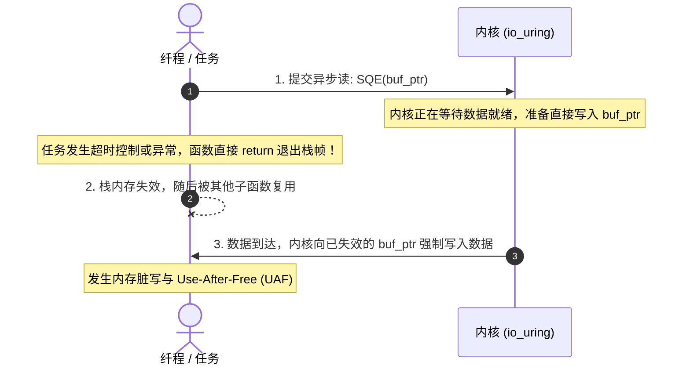

# 内存借出与取消安全：CancelRegion 与生命周期追踪

在完成型（Completion-based）I/O 模型中，缓冲区生命周期管理是影响系统安全性的关键环节。

---

## 核心隐患：在途操作与 Use-After-Free

在就绪型（Readiness-based）模型中，`read` 是一个同步执行的系统调用：在发起调用前，内存尚未写入；在调用返回后，数据拷贝已经结束。如果应用程序在等待就绪期间取消了任务，内核尚未接触到用户态缓冲区，因此不存在内存非法写入的问题。

而在 Linux `io_uring` 等完成型模型中：
1. 应用程序准备一段内存切片，将其指针 `&buffer` 写入提交队列条目（SQE）并递交内核；
2. 系统调用立即返回，**该内存区域已被实质借出给内核**；
3. 内核在后台等待硬件数据就绪，并直接通过内存访问将数据写入该地址；
4. 写入完成后，内核向完成队列（CQ）写入完成条目（CQE）。



如果在操作在途（In-flight）期间，发起请求的协程或函数由于超时、错误返回或外部主动取消，提前退出了包含该缓冲区的栈帧，该内存块就可能被重新分配。随后内核完成写入时，就会覆盖无关的内存数据，导致内存破坏。

---

## 各语言对完成型内存生命周期的取舍

针对这一底层限制，主流系统编程语言采取了不同的应对策略：

### 1. Go 的处理策略
Go 主要依赖基于就绪通知的 `epoll`，数据拷贝始终在同步上下文中执行。即使开启 `io_uring` 实验支持，由于 Go 具备垃圾回收器（GC），数据通常分配在受管堆上。但如果内核 DMA 直接写入尚未固定（Pinner）的 Go 内存，仍可能破坏 GC 的内存屏障与连续栈调整。因此 Go 官方网络库依然选择维持在就绪模型上。

### 2. Rust 的所有权转移取舍
在 Rust 标准生态中，异步 I/O 的核心 trait 是 `AsyncRead`：
```rust
fn poll_read(self: Pin<&mut Self>, cx: &mut Context<'_>, buf: &mut [u8]) -> Poll<Result<usize>>;
```
这里接收的是可变借用 `&mut [u8]`。然而在 Rust 中，任何 `Future` 都可以被随时 `drop` 丢弃。如果在 `poll_read` 提交内核操作后，Future 被外部执行器直接销毁，借出的内存引用就会提前失效。

为了在完成模型（`io_uring`）下保证安全，Rust 的针对性运行时（如 `tokio-uring`、`monoio`）被迫放弃了经典的借用模型，改为**强制转移缓冲区所有权（Buffer Ownership Transfer）**：
```rust
// 必须将整个 Buffer 的所有权（如 Vec<u8>）移交给读写接口
pub async fn read<T: BoundedBufMut>(&self, buf: T) -> (io::Result<usize>, T);
```
用户在发起 I/O 时必须将缓冲区移动进去，待底层返回时再随元组归还。如果操作中途被中断，底层运行时必须强行让该缓冲区泄漏或放入特定的全局延迟回收池，避免内存在内核操作未完结前被释放。

### 3. Zig 的方案：保留切片借用与取消握手机制
Zig 既没有垃圾回收器，也没有 Rust 的编译期生命周期机制。为了在保持简洁切片语法（`[]u8`）的同时保证安全性，`std.Io` 在运行时层面建立了**取消确认握手（Cancel Handshake）**与**取消保护屏障**。

---

## Zig 的取消安全实现细节

### 1. 取消保护屏障：`CancelProtection`
在 [`lib/std/Io.zig#L1451`](https://codeberg.org/ziglang/zig/src/tag/0.17.0/lib/std/Io.zig#L1451) 中，每个上下文都具备取消保护状态：

```zig
pub const CancelProtection = enum {
    cancelable,   // 允许响应取消
    uncancelable, // 临界区保护，禁止突发中断
};
```

在执行关键资源交接或析构清理逻辑时，开发者可通过 [`swapCancelProtection`](https://codeberg.org/ziglang/zig/src/tag/0.17.0/lib/std/Io.zig#L137) 进入保护区：

```zig
// 进入不可取消的临界区
const prev = io.swapCancelProtection(.uncancelable);
defer _ = io.swapCancelProtection(prev);

// 此区间内的执行保证不会被外部取消打断，避免半更新状态
```

### 2. 取消握手机制
当一个在途操作收到取消请求时，Zig 运行时不会直接销毁栈帧，而是执行握手流程：
1. **下发内核取消命令**：向 `io_uring` 提交针对该操作的取消描述符（`IORING_OP_ASYNC_CANCEL`）；
2. **挂起等待确认**：当前纤程暂停执行，等待内核返回取消成功的完成事件；
3. **安全退栈**：只有在内核确认已经停止对该切片的读写后，当前任务才被允许继续展开并退出。

```zig
// 在耗时循环中主动检查是否收到取消请求
try io.checkCancel();
```

通过这一握手机制，Zig 在不破坏切片借用体验的前提下，防范了完成型 I/O 下的非法内存写入风险。
