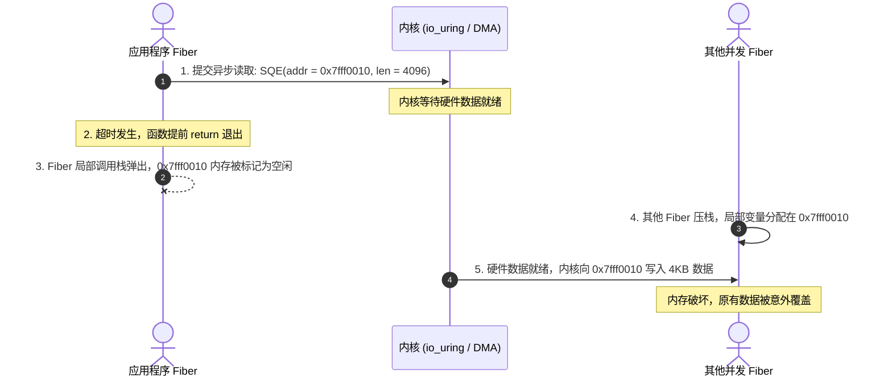
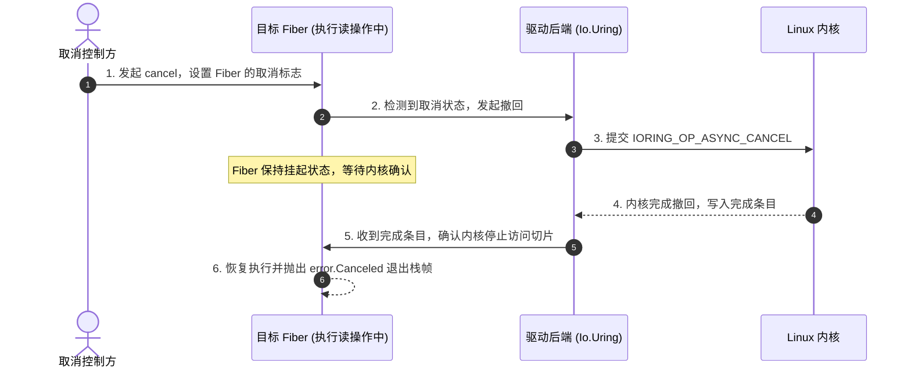

# 内存借出与取消安全：CancelProtection 与生命周期底层追踪

在完成型（Completion-based / Proactor）I/O 架构中，**缓冲区内存生命周期**与**异步任务取消（Cancellation）**直接影响内存安全。

若缺乏底层的时序约束，在途的内核 I/O 可能会在用户缓冲区释放后继续写入，引发 Use-After-Free（UAF）或内存破坏。

---

## 在途操作（In-flight I/O）与栈复用问题

在就绪模型（Linux `epoll`）下，内存由用户态直接控制：
`read(fd, buf, len)` 是一个同步系统调用。调用前内核不持有缓冲区，调用返回后数据拷贝已结束。若协程在等待就绪期间被取消，内核未曾接触过该内存地址，直接释放栈内存是安全的。

但在完成模型（Linux `io_uring` 或 Windows IOCP）中，操作时序不同：



### 过程拆解：
1. **内存质押**：Fiber 在栈上分配局部缓冲区 `var buf: [4096]u8 = undefined`，将其地址写入 SQE 提交给内核；
2. **外部取消与提前展开**：若触发超时控制，函数提前退出当前栈帧；
3. **栈空间复用**：该段内存被系统重新分配给其他逻辑；
4. **内核延迟写入**：随后网络数据到达，内核直接将报文写入该物理地址，覆盖了其他函数的数据。

---

## 跨语言方案取舍

针对该问题，不同语言采取了不同的权衡：

### 1. Rust 的妥协：所有权转移（Owned Buffer）
在 Rust 的同步接口中，读写操作通常使用借用：
```rust
async fn read(&mut self, buf: &mut [u8]) -> io::Result<usize>;
```
但 Rust 的 `Future` 可以被外部随时丢弃（Drop）。Rust 的 `drop(&mut self)` 是同步调用的，无法在析构中进行异步等待。
若在 `poll_read` 提交内核操作后 `Future` 被销毁，借出的内存引用就会提前失效。

因此，面向 `io_uring` 的 Rust 运行时（如 `tokio-uring`、`monoio`）改为**要求转移缓冲区所有权（Buffer Ownership Transfer）**：
```rust
// 要求将拥有独立堆内存的 Buffer（如 Vec<u8>）的所有权移入函数
pub async fn read<T: BoundedBufMut>(&self, buf: T) -> (io::Result<usize>, T);
```
每次发起 I/O 需移入缓冲区，操作完成后随元组返回。若操作中途被丢弃，运行时通常将该缓冲区泄漏或放入全局延迟回收池，直到内核完成事件返回后再释放。

### 2. Zig 的方案：保留切片借用与取消握手

Zig 保留了切片借用语法（直接传递 `[]u8`），其安全性依赖标准库层面的**取消确认握手（Cancel Handshake）**。

---

## Zig std.Io 取消安全机制实现

在 Zig 的设计中：**当内核仍在访问某段内存切片时，发起请求的 Fiber 不能提前退出并释放栈帧。**

### 1. 取消保护屏障：`CancelProtection`
查阅源码 [`lib/std/Io.zig#L1451`](https://codeberg.org/ziglang/zig/src/tag/0.17.0/lib/std/Io.zig#L1451)：
```zig
pub const CancelProtection = enum(u1) {
    unblocked = 0, // 允许响应外部取消信号
    blocked = 1,   // 阻断取消信号，处于保护状态
};
```
在执行状态提交、资源释放等关键操作时，可以通过 `io.swapCancelProtection` 将保护等级设为 `.blocked`：

```zig
// 进入阻断取消的保护状态
const prev = io.swapCancelProtection(.blocked);
defer _ = io.swapCancelProtection(prev);

// 此区间内即使收到取消请求，也会被暂扣，不抛出 error.Canceled
```

### 2. 取消握手流程（Cancel Handshake）

当一个持有局部缓冲区的 Fiber 接收到取消信号时，底层驱动执行以下步骤：



- **第一步：标记状态**：外部调用 `future.cancel(io)` 时，将目标任务标记为已请求取消；
- **第二步：下发内核撤回指令**：驱动向内核提交 `IORING_OP_ASYNC_CANCEL` 请求，指定要撤回的原请求上下文；
- **第三步：等待确认**：
  **目标 Fiber 保持挂起状态**，在调度器中等待内核响应；
- **第四步：安全退栈**：
  内核完成取消处理并写入完成队列（结果通常为 `-ECANCELED`）后，驱动确认内核已终止对该内存切片的访问，此时才唤醒 Fiber 抛出 `error.Canceled` 并展开栈帧。

### 3. 主动检查取消点：`io.checkCancel()`
查阅源码 [`lib/std/Io.zig#L1457`](https://codeberg.org/ziglang/zig/src/tag/0.17.0/lib/std/Io.zig#L1457)：
```zig
pub fn checkCancel(io: Io) Cancelable!void {
    return io.vtable.checkCancel(io.userdata);
}
```
对于纯计算密集型循环，Fiber 不会主动发生 I/O 挂起。可在循环体内调用 `checkCancel()` 检查状态：
```zig
while (hasMoreData()) {
    processChunk();

    // 检查是否收到取消请求；若已取消则抛出 error.Canceled
    try io.checkCancel();
}
```
该函数仅包含标志位读取与条件判断，开销较低。
