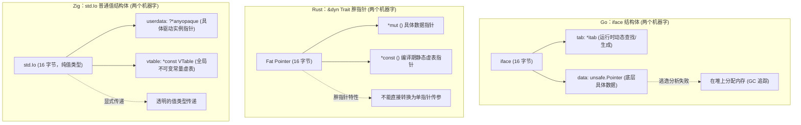
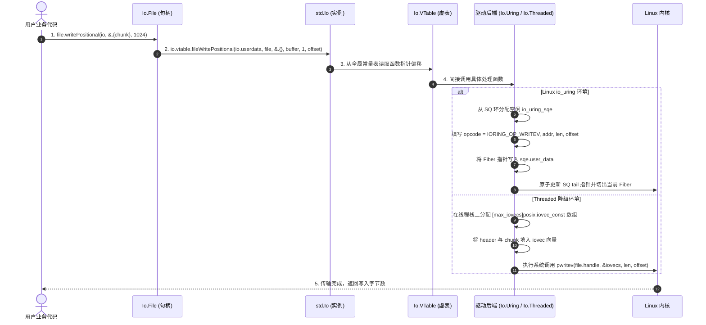

# 统一接口抽象：std.Io 与 VTable 体系底层剖析

在 Zig 中，`std.Io` 是组织文件系统、网络套接字、进程生命周期与异步并发纤程（Fiber）调度的顶层接口。

它的设计与 `std.mem.Allocator` 一致：**通过“上下文指针 + 全局不可变虚函数表（VTable）”实现类型擦除与动态分发**。

---

## 物理内存布局与跨语言动态分发对比

在机器码层面，接口的动态分发机制涉及两个要素：
1. **数据指针指向哪里？**
2. **函数指针从哪里查找？**



### 1. 物理布局差异分析

- **Go 的 `iface` 与运行时开销**：
  Go 的接口变量在底层是一个由两个指针组成的 `iface` 结构体：`tab: *itab` 和 `data: unsafe.Pointer`。
  - **动态查找**：Go 任意类型隐式满足接口。接口赋值在运行时发生时，Go 需要在全局哈希表中查询或动态生成对应的 `itab`；
  - **堆逃逸**：编译器的逃逸分析在跨越动态接口边界时通常较为保守，赋值给 `interface` 的局部变量容易逃逸到堆中分配。
- **Rust 的 Trait Object（`&dyn Trait`）**：
  Rust 的 Trait Object 由两个指针宽的“胖指针”构成：一个指向具体实例的数据指针，另一个指向编译期静态生成的虚函数表。
  - **指针体积翻倍**：胖指针不能当作单一普通指针直接通过 C ABI 传递，无法直接做平实的值类型传递。
- **Zig 的 `std.Io`**：
  查阅源码 [`lib/std/Io.zig#L25-L26`](https://codeberg.org/ziglang/zig/src/tag/0.17.0/lib/std/Io.zig#L25-L26)：
  ```zig
  userdata: ?*anyopaque,
  vtable: *const VTable,
  ```
  `std.Io` 是一个普通结构体，占用两个 64 位机器字（16 字节）。
  - `userdata`：类型擦除的后端实例上下文指针，指向具体的执行上下文（例如 `*Io.Uring`、`*Io.Dispatch` 或 `*Io.Threaded`）；
  - `vtable`：指向该后端在只读数据段中静态分配的函数指针集合。
  不依赖编译器做隐式接口转换，所有的分发关系均显式表达。

---

## 核心虚表 `Io.VTable` 物理定义拆解

在源码 [`lib/std/Io.zig#L51-L300`](https://codeberg.org/ziglang/zig/src/tag/0.17.0/lib/std/Io.zig#L51-L300) 中，`Io.VTable` 定义了操作系统抽象层实现的接口入口。

主要分为四大功能部分：

### 1. 纤程调度与任务管理
```zig
pub const VTable = struct {
    // 异步纤程派生 (非阻塞)
    async: *const fn (
        userdata: ?*anyopaque,
        result: []u8,
        result_alignment: std.mem.Alignment,
        context: []const u8,
        context_alignment: std.mem.Alignment,
        start: *const fn (context: *const anyopaque, result: *anyopaque) void,
    ) ?*AnyFuture,

    // 并行任务派发 (投递至工作线程池)
    concurrent: *const fn (
        userdata: ?*anyopaque,
        result_len: usize,
        result_alignment: std.mem.Alignment,
        context: []const u8,
        context_alignment: std.mem.Alignment,
        start: *const fn (context: *const anyopaque, result: *anyopaque) void,
    ) ConcurrentError!*AnyFuture,

    // 等待异步任务收敛
    await: *const fn (userdata: ?*anyopaque, any_future: *AnyFuture, result: []u8, result_alignment: std.mem.Alignment) void,

    // 取消指定的异步任务
    cancel: *const fn (userdata: ?*anyopaque, any_future: *AnyFuture, result: []u8, result_alignment: std.mem.Alignment) void,
    ...
```
`async` 和 `concurrent` 接收 `context: []const u8` 内存切片与静态函数指针 `start`。调用方直接在调用栈上构造上下文，底层后端将其拷贝至 Fiber 栈中，无需在堆上分配闭包对象。

### 2. 取消安全屏障
```zig
    // 切换当前 Fiber 的取消保护等级
    swapCancelProtection: *const fn (userdata: ?*anyopaque, new: CancelProtection) CancelProtection,

    // 检查当前 Fiber 是否已被外部发出取消信号
    checkCancel: *const fn (userdata: ?*anyopaque) Cancelable!void,
```

### 3. 文件系统与 Positional I/O
```zig
    dirOpenDir: *const fn (userdata: ?*anyopaque, dir: Dir, sub_path: []const u8, options: Dir.OpenOptions) Dir.OpenError!Dir,
    dirCreateFile: *const fn (userdata: ?*anyopaque, dir: Dir, sub_path: []const u8, options: Dir.CreateFileOptions) File.OpenError!File,
    fileReadPositional: *const fn (userdata: ?*anyopaque, file: File, buffers: [][]u8, offset: u64) File.ReadPositionalError!usize,
    fileWritePositional: *const fn (userdata: ?*anyopaque, file: File, header: []const u8, data: []const []const u8, splat: usize, offset: u64) File.WritePositionalError!usize,
    fileClose: *const fn (userdata: ?*anyopaque, files: []const File) void,
```
`fileWritePositional` 接收 `data: []const []const u8` 向量数组、`header: []const u8` 和 `splat: usize`，在底层可直接组装 `iovec` 或提交链式 SQE。

### 4. 网络套接字
```zig
    netListenIp: *const fn (userdata: ?*anyopaque, address: *const net.IpAddress, options: net.IpAddress.ListenOptions) net.IpAddress.ListenError!net.Socket,
    netAccept: *const fn (userdata: ?*anyopaque, socket: net.Socket.Handle, options: net.Server.AcceptOptions) net.Server.AcceptError!net.Socket,
    netConnectIp: *const fn (userdata: ?*anyopaque, address: *const net.IpAddress, options: net.IpAddress.ConnectOptions) net.IpAddress.ConnectError!net.Socket,
    netClose: *const fn (userdata: ?*anyopaque, sockets: []const net.Socket) void,
```

---

## 跨层分发调用链：以 `File.writePositional` 为例

从高层用户代码到底层驱动的完整调用流程如下：



### 1. 高层入口：句柄转发
查看 [`lib/std/Io/File.zig#L537-L539`](https://codeberg.org/ziglang/zig/src/tag/0.17.0/lib/std/Io/File.zig#L537-L539)：
```zig
pub fn writePositional(file: File, io: Io, buffer: []const []const u8, offset: u64) WritePositionalError!usize {
    return io.vtable.fileWritePositional(io.userdata, file, &.{}, buffer, 1, offset);
}
```
`File` 结构体是一个轻量句柄，内部包含系统文件描述符（`fd: i32`）和属性标记（`flags`），不包含虚表指针。相关操作由显式传入的 `io` 转发。

### 2. 汇编寻址
编译后的机器指令形式如下：
```x86asm
# RDI = file
# RSI = io.userdata
# RDX = io.vtable
# RCX = buffer
# R8  = offset

movq 8(%rdx), %rax        # 从 vtable 偏移处载入 fileWritePositional 函数指针
call *%rax                # 执行间接跳转
```

### 3. 具体后端的实现差异
- **`Io.Threaded` 后端**（[`lib/std/Io/Threaded.zig#L10776`](https://codeberg.org/ziglang/zig/src/tag/0.17.0/lib/std/Io/Threaded.zig#L10776)）：
  在当前线程栈上分配 `iovecs` 数组，组装为 `posix.iovec_const`，调用操作系统的 `pwritev` 系统调用；
- **`Io.Uring` 后端**（[`lib/std/Io/Uring.zig`](https://codeberg.org/ziglang/zig/src/tag/0.17.0/lib/std/Io/Uring.zig)）：
  从 `io_uring` 提交环中获取一个 64 字节的 `io_uring_sqe`，填写操作码、文件描述符、内存地址与偏移量，将当前 Fiber 指针写入 `sqe.user_data`，随后调用 `fiber.contextSwitch` 切出 CPU。内核在 CQ 环写入完成条目后，调度器唤醒该 Fiber 继续执行。
