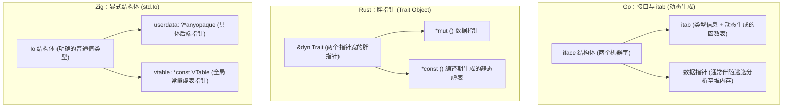

# 统一接口抽象：std.Io 与 VTable 体系

在 Zig 中，`std.Io` 是组织文件系统、网络套接字、进程生命周期与异步并发调度的核心接口。

它的设计与 Zig 中的 `std.mem.Allocator` 保持一致：**通过“上下文指针 + 不可变虚函数表（VTable）”实现类型擦除与动态分发**。

---

## 跨语言动态分发机制对比

为了解耦接口定义与底层实现，不同的语言采用了不同的技术方案：



- **Go 的方案**：Go 的 `interface` 由 `itab` 和数据指针组成。由于接口转换在运行时发生，编译器往往无法证明对象的生命周期边界，容易导致本可在栈上分配的数据逃逸到堆中，增加垃圾回收（GC）负担。
- **Rust 的方案**：Rust 使用胖指针（`&dyn Trait` 或 `Box<dyn Trait>`），指针自身占用两个机器字宽。虚表在编译期针对具体类型静态生成，不经过运行时动态查询，但无法直接按普通单指针值进行紧凑布局。
- **Zig 的方案**：`std.Io` 是一个普通结构体，内部包含两个字段。它不依赖编译器做隐式接口转换，所有的分发关系均在代码中显式表达。

---

## std.Io 结构体与 VTable 定义

查阅 Zig 标准库源码 [`lib/std/Io.zig#L25-L51`](https://codeberg.org/ziglang/zig/src/tag/0.17.0/lib/std/Io.zig#L25-L51)：

```zig
const Io = @This();

userdata: ?*anyopaque,
vtable: *const VTable,
```

- `userdata`：类型擦除的后端实例指针（[`Io.zig#L25`](https://codeberg.org/ziglang/zig/src/tag/0.17.0/lib/std/Io.zig#L25)），指向具体的执行上下文（如 `*Io.Threaded`、`*Io.Uring` 等）；
- `vtable`：指向不可变静态虚函数表 `VTable` 的指针（[`Io.zig#L51`](https://codeberg.org/ziglang/zig/src/tag/0.17.0/lib/std/Io.zig#L51)）。虚表中包含了标准库支持的全部 I/O 与并发操作入口。

### VTable 核心函数分类

`Io.VTable` 包含了系统交互的各个维度：

#### 1. 任务派生与并发控制
```zig
async: *const fn (?*anyopaque, []u8, Alignment, []const u8, Alignment, *const fn (*const anyopaque, *anyopaque) void) ?*AnyFuture,
concurrent: *const fn (?*anyopaque, usize, Alignment, []const u8, Alignment, *const fn (*const anyopaque, *anyopaque) void) ConcurrentError!*AnyFuture,
await: *const fn (?*anyopaque, *AnyFuture, []u8, Alignment) void,
cancel: *const fn (?*anyopaque, *AnyFuture, []u8, Alignment) void,
```
提供在当前事件环上派生非阻塞纤程任务（`async`），或投递至底层线程池并行执行（`concurrent`）的原语。

#### 2. 取消安全与屏障
```zig
swapCancelProtection: *const fn (?*anyopaque, new: CancelProtection) CancelProtection,
checkCancel: *const fn (?*anyopaque) Cancelable!void,
```
支持在敏感硬件调用或析构清理期间建立不可取消的保护屏障。

#### 3. 文件系统与目录
```zig
dirOpenDir: *const fn (?*anyopaque, Dir, []const u8, Dir.OpenOptions) Dir.OpenError!Dir,
dirCreateFile: *const fn (?*anyopaque, Dir, []const u8, Dir.CreateFileOptions) File.OpenError!File,
fileReadPositional: *const fn (?*anyopaque, File, [][]u8, u64) File.ReadPositionalError!usize,
fileWritePositional: *const fn (?*anyopaque, File, []const u8, []const []const u8, usize, u64) File.WritePositionalError!usize,
fileClose: *const fn (?*anyopaque, []const File) void,
```

#### 4. 网络通信
```zig
netListenIp: *const fn (?*anyopaque, *const net.IpAddress, net.IpAddress.ListenOptions) net.IpAddress.ListenError!net.Socket,
netAccept: *const fn (?*anyopaque, net.Socket.Handle, net.Server.AcceptOptions) net.Server.AcceptError!net.Socket,
netConnectIp: *const fn (?*anyopaque, *const net.IpAddress, net.IpAddress.ConnectOptions) net.IpAddress.ConnectError!net.Socket,
netClose: *const fn (?*anyopaque, []const net.Socket) void,
```

---

## 实例的初始化与获取

应用程序通常通过初始化具体的后端驱动来获取 `std.Io` 实例：

```zig
const std = @import("std");
const Io = std.Io;

pub fn main() !void {
    var gpa = std.heap.GeneralPurposeAllocator(.{}){};
    defer _ = gpa.deinit();
    const allocator = gpa.allocator();

    // 初始化通用线程调度后端
    var threaded = Io.Threaded.init(allocator, .{
        .stack_size = 64 * 1024, // 为每个派生的纤程配置 64KB 栈
    });
    defer threaded.deinit();

    // 获取标准抽象接口实例
    const io = threaded.io();

    // 业务代码通过该统一接口执行操作
    try doWork(allocator, io);
}
```

在测试阶段，标准测试框架直接提供了现成的驱动实例：

```zig
test "使用测试 Io 实例" {
    const io = std.testing.io;

    var tmp = std.testing.tmpDir(.{});
    defer tmp.cleanup();

    var file = try tmp.dir.createFile(io, "test.log", .{});
    defer file.close(io);
}
```
