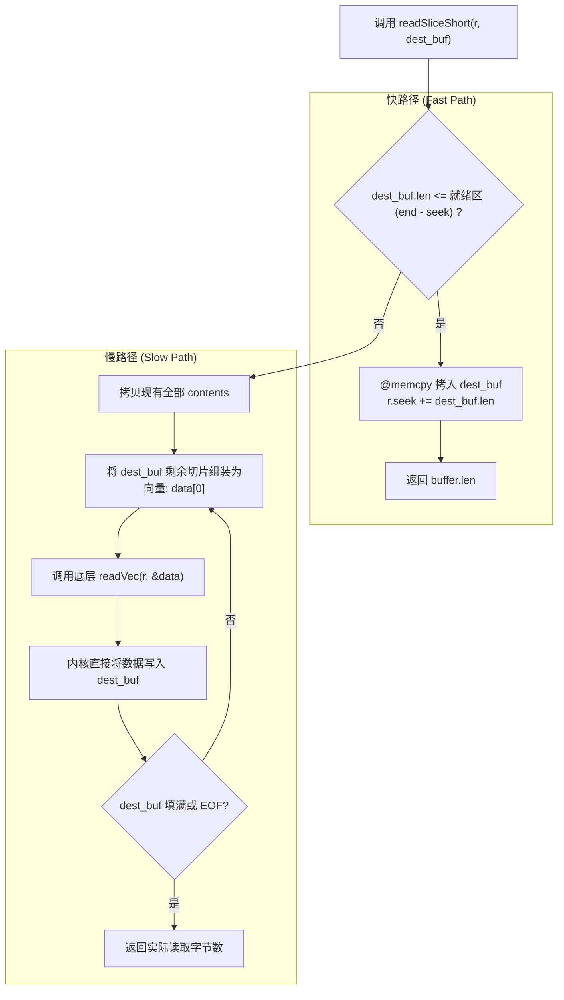
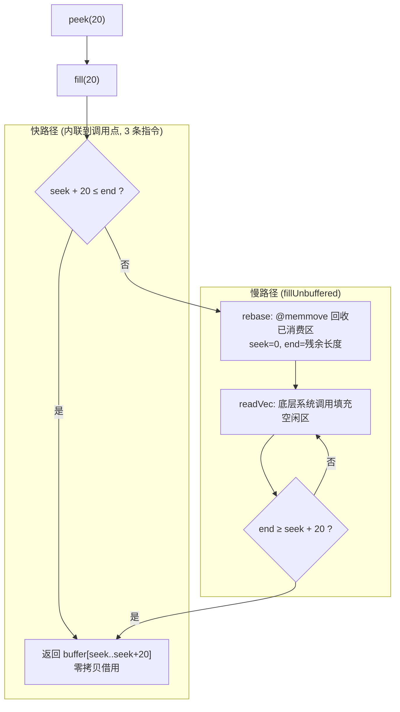
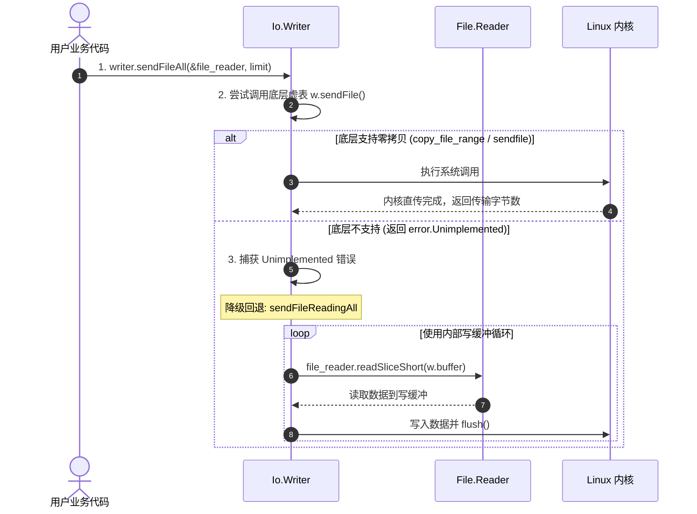

# 现代数据流抽象：Reader 与 Writer 底层架构剖析

传统的流式数据处理常包含两种模式：
1. **外挂缓冲包装（如 Go `bufio` 或 Rust `BufReader<R>`）**：通过泛型嵌套包装原有类型，增加了类型层级与单态化编译开销；
2. **多余的内存中继拷贝**：数据在用户业务缓冲区、包装层内部缓冲区与内核缓冲区之间多次流转。

Zig 现代 I/O 体系废弃了旧版基于宏混入的 `std.io.Reader`，改为直接包含缓冲游标与虚表分发能力的具体结构体：**`Io.Reader` 与 `Io.Writer`**。

---

## Reader 的三指针滑动窗口物理模型

查看源码 [`lib/std/Io/Reader.zig#L16-L21`](https://github.com/jiacai2050/zig/blob/0.17.0/lib/std/Io/Reader.zig#L16-L21)：

```zig
const Reader = @This();

vtable: *const VTable,
buffer: []u8,
seek: usize, // 已消费的字节游标
end: usize,  // 当前已填充的有效数据上界

pub const VTable = struct {
    stream: *const fn (r: *Reader, w: *Writer, limit: Limit) StreamError!usize,
    discard: *const fn (r: *Reader, limit: Limit) Error!usize = defaultDiscard,
    readVec: *const fn (r: *Reader, data: [][]u8) Error!usize = defaultReadVec,
    rebase: *const fn (r: *Reader, capacity: usize) RebaseError!void = defaultRebase,
};
```

其中，`stream` 是 `Reader.VTable` 中**唯一必须由具体实现提供**的核心虚表入口（负责将数据从逻辑源端直传到目标 Writer），其余三个方法（`discard`、`readVec`、`rebase`）标准库均已提供了开箱即用的默认实现。

---

## 虚表归约设计：三个默认实现源码剖析

为什么自定义 `Reader` 只需实现单个 `stream` 函数即可接入全套流式生态？其核心在于标准库将丢弃、向量读取等高层操作通过栈上轻量适配器**全部归约（Reduce）到了 `stream`**。

### 1. `defaultDiscard`：丢弃归约为向黑洞 Writer 流式传输

查看源码 [`lib/std/Io/Reader.zig#L196-L213`](https://github.com/jiacai2050/zig/blob/0.17.0/lib/std/Io/Reader.zig#L196-L213)：

```zig
pub fn defaultDiscard(r: *Reader, limit: Limit) Error!usize {
    assert(r.seek == r.end); // 仅在内部缓冲已耗尽时被调用
    r.seek = 0;
    r.end = 0;
    // 构造一个只推进计数、吞噬实际内容的丢弃写入器
    var d: Writer.Discarding = .init(r.buffer);
    var n = r.stream(&d.writer, limit) catch |err| switch (err) {
        error.WriteFailed => unreachable,
        error.ReadFailed, error.EndOfStream => |e| return e,
    };
    // 若底层 stream 绕过 writer 直接填充了 r.buffer，将尽可能多的缓冲数据标为已丢弃
    const remaining = @backingInt(limit) - n;
    const buffered_n_to_discard = @min(remaining, r.end - r.seek);
    n += buffered_n_to_discard;
    r.seek += buffered_n_to_discard;
    assert(n <= @backingInt(limit));
    return n;
}
```

- **实现机制**：当就绪区数据不足以满足丢弃量时，`defaultDiscard` 在栈上初始化一个非分配的 `Writer.Discarding`，直接调用 `r.stream(&d.writer, limit)`。底层读取到的数据被丢弃写入器直接忽略，无需额外的丢弃专用系统调用支持。

### 2. `defaultReadVec`：向量读取归约为直写目标切片

查看源码 [`lib/std/Io/Reader.zig#L450-L474`](https://github.com/jiacai2050/zig/blob/0.17.0/lib/std/Io/Reader.zig#L450-L474)：

```zig
pub fn defaultReadVec(r: *Reader, data: [][]u8) Error!usize {
    const first = data[0];
    // 策略 A：目标切片容量 >= Reader 内部空闲缓冲区容量
    if (first.len >= r.buffer.len - r.end) {
        var writer: Writer = .{
            .buffer = first,
            .end = 0,
            .vtable = &.{ .drain = Writer.fixedDrain },
        };
        const limit: Limit = .limited(writer.buffer.len - writer.end);
        return r.vtable.stream(r, &writer, limit) catch |err| switch (err) {
            error.WriteFailed => unreachable,
            else => |e| return e,
        };
    }
    // 策略 B：Reader 内部空闲空间更大，优先填充内部缓冲区
    var writer: Writer = .{
        .buffer = r.buffer,
        .end = r.end,
        .vtable = &.{ .drain = Writer.fixedDrain },
    };
    const limit: Limit = .limited(writer.buffer.len - writer.end);
    const n = r.vtable.stream(r, &writer, limit) catch |err| switch (err) {
        error.WriteFailed => unreachable,
        else => |e| return e,
    };
    r.end += n;
    return 0; // 返回 0 表示数据已被暂存进内部缓冲区，后续通过内部切片消费
}
```

- **实现机制**：`defaultReadVec` 根据目标切片与内部缓冲区的剩余容量进行**动态容量仲裁**：
  - 若调用方传入的切片更大，直接将该切片用 `Writer.fixedDrain` 包装为轻量栈上 `Writer`，直传 `stream` 写入目标内存，消除中继拷贝；
  - 若内部缓冲区更大，则向内部缓冲区执行 `stream` 填充并递增 `r.end`，返回 `0` 告知外层继续从就绪区提取。

### 3. `defaultRebase`：原地内存整理

查看源码 [`lib/std/Io/Reader.zig#L1432-L1439`](https://github.com/jiacai2050/zig/blob/0.17.0/lib/std/Io/Reader.zig#L1432-L1439)：

```zig
pub fn defaultRebase(r: *Reader, capacity: usize) Error!void {
    assert(r.buffer.len - r.seek < capacity);
    const data = r.buffer[r.seek..r.end];
    @memmove(r.buffer[0..data.len], data); // 重叠内存安全搬运至起始点
    r.seek = 0;
    r.end = data.len;
    assert(r.buffer.len - r.seek >= capacity);
}
```

- **实现机制**：纯内存整理操作。利用 `@memmove` 将处于 `[seek .. end]` 区间的残留有效数据前移到 `0` 偏移处，使原本已被消费的 `[0 .. seek]` 空间重新变为空闲待写区，完全不产生系统调用。

---

在内存中，`buffer` 被 `seek` 与 `end` 划分为三个区域：


- **`0 .. seek`（已消费区）**：调用方已经取走的数据，在后续整理或重新填充前不再使用；
- **`seek .. end`（就绪有效区）**：已从内核读入但尚未被消费的数据，大小为 `end - seek`。调用 `reader.peek()` 可直接获取该切片；
- **`end .. len`（空闲待写入区）**：尚未填充数据的空间。当就绪数据耗尽时，底层系统调用可直接将该区间作为目标地址发起读取。

---

## 缓冲与直击读取：`readSliceShort` 实现剖析

查看源码 [`lib/std/Io/Reader.zig#L685-L704`](https://github.com/jiacai2050/zig/blob/0.17.0/lib/std/Io/Reader.zig#L685-L704)：

```zig
pub fn readSliceShort(r: *Reader, buffer: []u8) ShortError!usize {
    // 1. 获取当前内部就绪数据
    const contents = r.buffer[r.seek..r.end];
    const copy_len = @min(buffer.len, contents.len);

    // 2. 从内部缓存拷贝
    @memcpy(buffer[0..copy_len], contents[0..copy_len]);
    r.seek += copy_len;

    // 快路径：内部数据已满足目标需求
    if (buffer.len - copy_len == 0) {
        @branchHint(.likely);
        return buffer.len;
    }

    // 慢路径：内部数据耗尽，直接读取到用户目标缓冲区
    var i: usize = copy_len;
    var data: [1][]u8 = undefined;
    while (true) {
        data[0] = buffer[i..];
        i += readVec(r, &data) catch |err| switch (err) {
            error.EndOfStream => return i,
            error.ReadFailed => |e| return e,
        };
        if (buffer.len - i == 0) return buffer.len;
    }
}
```



### 运行特征：
1. **快路径内存复制**：内部缓冲区有足够数据时，直接通过 `@memcpy` 复制并推进 `seek` 游标；
2. **慢路径直接传递用户切片**：
   当内部缓冲区不足时，`readSliceShort` 将用户切片的剩余部分 `buffer[i..]` 包装为向量 `data[0]` 传给 `readVec`，底层系统调用（如 `readv` 或 `io_uring_prep_readv`）直接将数据读入用户内存，跳过了中间临时缓冲区的二次拷贝。

---

## 零拷贝借用：`peek` / `toss` / `take` 机制剖析

`readSliceShort` 将数据**拷贝到调用方提供的缓冲区**，适合需要持久持有数据的场景。但在协议解析中（如扫描 HTTP 头部的 `\r\n\r\n`），往往只需要**临时查看**缓冲区内的数据而不拷贝。

Zig Reader 为此提供了 `peek` 系列方法，直接返回内部 `buffer` 的子切片引用，实现真正的零拷贝读取。

### `peek`：借用但不消费

查看源码 [`lib/std/Io/Reader.zig#L520-L523`](https://github.com/jiacai2050/zig/blob/0.17.0/lib/std/Io/Reader.zig#L520-L523)：

```zig
pub fn peek(r: *Reader, n: usize) Error![]u8 {
    try r.fill(n);                    // 确保就绪区至少有 n 字节
    return r.buffer[r.seek..][0..n];  // 直接返回内部切片引用
}
```

返回的 `[]u8` 是 `buffer` 的子切片——**不是拷贝，是借用**。调用方拿到的指针直接指向 Reader 的内部缓冲区。

### `toss`：消费已借用的数据

查看源码 [`lib/std/Io/Reader.zig#L554-L557`](https://github.com/jiacai2050/zig/blob/0.17.0/lib/std/Io/Reader.zig#L554-L557)：

```zig
pub fn toss(r: *Reader, n: usize) void {
    r.seek += n;              // 仅移动游标，O(1)
    assert(r.seek <= r.end);
}
```

`toss` 不涉及任何内存操作，仅推进 `seek` 游标。被 `toss` 掉的区域在下一次 `rebase` 前仍然存活（内存不会被覆盖），但逻辑上已被视为"已消费"。

### `take`：`peek` + `toss` 的组合

```zig
pub fn take(r: *Reader, n: usize) Error![]u8 {
    const result = try r.peek(n);
    r.toss(n);
    return result;
}
```

### 实际应用：HTTP 头部解析

`peek` + `toss` 模式在协议解析场景中尤为高效：

```zig
// 扫描 HTTP 头部终止符 \r\n\r\n
const data = try reader.peekGreedy(4); // 至少 4 字节，尽量多拿
if (std.mem.indexOf(u8, data, "\r\n\r\n")) |end_pos| {
    const header = data[0..end_pos]; // 直接在 buffer 上操作，零拷贝
    parseHttpHeader(header);          // 解析
    reader.toss(end_pos + 4);         // 消费 header + \r\n\r\n
} else {
    try reader.fillMore();            // 数据不够，继续填充
}
```

整个过程中，HTTP 头部的解析在 Reader 内部缓冲区原地完成，没有任何额外的内存分配或拷贝。

### `fill` 的快慢路径分离与内联优化

`peek` 的核心依赖是 `fill`——确保缓冲区有足够的就绪数据。

查看源码 [`lib/std/Io/Reader.zig#L1127-L1147`](https://github.com/jiacai2050/zig/blob/0.17.0/lib/std/Io/Reader.zig#L1127-L1147)：

```zig
pub fn fill(r: *Reader, n: usize) Error!void {
    if (r.seek + n <= r.end) {   // 缓冲区已有足够数据？
        @branchHint(.likely);     // 告诉编译器：此分支大概率命中
        return;                   // 快路径：直接返回
    }
    return fillUnbuffered(r, n);  // 慢路径：需要从底层读取
}

fn fillUnbuffered(r: *Reader, n: usize) Error!void {
    try rebase(r, n);                // 整理缓冲区，腾出空间
    var bufs: [1][]u8 = .{""};
    while (r.end < r.seek + n)
        _ = try r.vtable.readVec(r, &bufs);  // 从底层读取填充
}
```

标准库源码中专门将 `fill` 与 `fillUnbuffered` 拆成两个函数，并附有注释说明原因：

> *如果合并在一起，`fill` 函数体积过大，LLVM 不愿意内联它，导致 `takeInt` 等高频调用每次都必须经过一次函数调用开销。拆开后，快路径（3 条指令）被内联到调用点，最受影响的 benchmark 性能差了 5 倍以上。*

### `rebase`：回收已消费区域

当 `fill` 发现缓冲区尾部空间不足时，`rebase` 负责将就绪数据搬到 `buffer` 起始位置，为新数据腾出空间。

查看源码 [`lib/std/Io/Reader.zig#L1432-L1439`](https://github.com/jiacai2050/zig/blob/0.17.0/lib/std/Io/Reader.zig#L1432-L1439)：

```zig
pub fn defaultRebase(r: *Reader, capacity: usize) Error!void {
    const data = r.buffer[r.seek..r.end];
    @memmove(r.buffer[0..data.len], data);  // 将残余数据移到开头
    r.seek = 0;
    r.end = data.len;
}
```

完整的 `peek(20)` 调用链路如下：



---

### 与 Go `io.Reader` / `bufio.Reader` 的设计对比

Go 生态中实现类似能力需要两层抽象的组合：

| 能力 | Zig `std.Io.Reader` | Go `io.Reader` | Go `bufio.Reader` |
|:---|:---|:---|:---|
| 零拷贝 peek | ✅ 内建，`peek` 返回 buffer 子切片 | ❌ 无此能力 | ✅ `Peek(n)` 返回内部切片 |
| 调用方无需额外包装 | ✅ Reader 自带缓冲 | ✅ 无缓冲，极简 | ❌ 需显式 `bufio.NewReader(r)` |
| 实现门槛 | 较高：需实现 `stream` 虚表 | 极低：实现一个 `Read` 函数 | N/A（包装层） |
| 内存布局 | 32 字节（vtable + buffer + seek + end） | 16 字节（data + itab） | ~4KB（含 `[]byte` 缓冲） |
| flush 心智负担 | 写端始终需要关注 `flush` | 无缓冲，`Write` 即交付 | 需要 `Flush()` |

Go 的设计哲学是**正交分层**：基础接口 `io.Reader` 极其纯粹（一个函数、无状态），需要缓冲能力时显式包裹一层 `bufio.Reader`。Zig 则是**将缓冲能力直接内建到基础抽象中**，用实现复杂度换取热路径上更少的间接调用与更优的内联机会。

两者不存在绝对的优劣——Go 的分层更适合构建大规模可组合的库生态（几十个模块只需实现一个 `Read` 函数），Zig 的内建缓冲更适合对 memcpy 次数和系统调用频次敏感的底层基础设施。

---

## Writer 的聚集写入（Gather I/O）与 `sendFile`

查看源码 [`lib/std/Io/Writer.zig#L14-L87`](https://github.com/jiacai2050/zig/blob/0.17.0/lib/std/Io/Writer.zig#L14-L87)：

```zig
const Writer = @This();

vtable: *const VTable,
buffer: []u8, // 传入空切片时自动作为非缓冲直写模式
end: usize,   // 当前暂存在内部缓冲区的未刷写字节数

pub const VTable = struct {
    drain: *const fn (w: *Writer, data: []const []const u8, splat: usize) Error!usize,
    sendFile: *const fn (w: *Writer, file_reader: *File.Reader, limit: Limit) FileError!usize = unimplementedSendFile,
    flush: *const fn (w: *Writer) Error!void = defaultFlush,
    rebase: *const fn (w: *Writer, preserve: usize, capacity: usize) Error!void = defaultRebase,
};
```

### 1. 聚集写入与 `splat` 填充
协议编码时常需写入头部元数据、消息体并在尾部补齐填充对齐字节或重复分隔符。
`Writer.VTable.drain` 接收两个参数：
- `data: []const []const u8`：切片向量数组（非空）；
- `splat: usize`：末尾切片（`data[data.len - 1]`）的重复写入次数（可为 0；为 0 时末尾切片不被写入）。

底层驱动在调用 `pwritev` 或构造 SQE 时，可将前 `N-1` 个切片以及重复 `splat` 次的末尾切片在单次系统调用中批量提交，兼顾聚集写入与格式填充。

### 2. 零拷贝 `sendFile` 与降级机制

向网络套接字传输文件时，通常优先使用内核级零拷贝：



- **底层接口**：底层的 `w.sendFile` 对接操作系统零拷贝系统调用（如 Linux `copy_file_range`、macOS `fcopyfile`）。若当前文件系统或套接字类型不支持，驱动返回 `error.Unimplemented`；
- **自动降级（Auto-fallback via `sendFileAll`）**：
  查阅源码 [`lib/std/Io/Writer.zig#L1074`](https://github.com/jiacai2050/zig/blob/0.17.0/lib/std/Io/Writer.zig#L1074)，高层方法 `w.sendFileAll` 会捕获 `error.Unimplemented`，自动调用 `sendFileReadingAll`，借用 `w.buffer` 作为中继缓冲区回退到常规读写循环。
