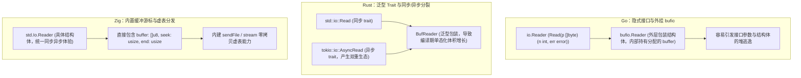

# 现代数据流抽象：Reader 与 Writer 的重新设计

在通用编程语言中，流式数据处理通常是整个 I/O 模块使用频率最高的部分。

本章分析各语言在数据流接口上的设计方案，并介绍 Zig 新一代 `std.Io.Reader` 与 `std.Io.Writer` 的结构与工作原理。

---

## 主流语言流式抽象方案对比



- **Go**：定义了精简的 `io.Reader` 接口。若需要带缓冲读写，必须在外层包装一层 `bufio.Reader`。由于接口动态分发的特点，方法内部的数据切片常因编译器无法推导生存期而逃逸到堆上。
- **Rust**：语言层面存在 `std::io::Read` 与异步运行时的 `AsyncRead` 两种 trait，导致同步库与异步库割裂。缓冲同样依赖外层嵌套泛型 `BufReader<R>`，在中大型项目中容易增加编译耗时与二进制体积。
- **Zig 的设计**：新版废弃了旧有的编译期泛型 mixin 模式，改为具有明确字段的运行时结构体。

---

## 现代 Reader 与 Writer 结构体剖析

在 [`lib/std/Io/Reader.zig#L16`](https://codeberg.org/ziglang/zig/src/tag/0.17.0/lib/std/Io/Reader.zig#L16) 与 [`lib/std/Io/Writer.zig#L14`](https://codeberg.org/ziglang/zig/src/tag/0.17.0/lib/std/Io/Writer.zig#L14) 中，对象自身直接集成了缓冲区与滑动游标：

### 1. Reader 内部布局
详见源码 [`lib/std/Io/Reader.zig#L16-L28`](https://codeberg.org/ziglang/zig/src/tag/0.17.0/lib/std/Io/Reader.zig#L16-L28)：

```zig
const Reader = @This();

vtable: *const VTable,
buffer: []u8,
seek: usize, // 已消费的字节偏移
end: usize,  // 当前已填充的有效数据结束点

pub const VTable = struct {
    stream: *const fn (r: *Reader, w: *Writer, limit: Limit) StreamError!usize,
    discard: *const fn (r: *Reader, limit: Limit) Error!usize = defaultDiscard,
    read: *const fn (r: *Reader, data: [][]u8) ReadError!usize = defaultRead,
};
```

### 2. Writer 内部布局
详见源码 [`lib/std/Io/Writer.zig#L14-L26`](https://codeberg.org/ziglang/zig/src/tag/0.17.0/lib/std/Io/Writer.zig#L14-L26)：
```zig
const Writer = @This();

vtable: *const VTable,
buffer: []u8, // 若长度为 0，则自动作为非缓冲直写模式运行
end: usize,   // 当前暂存在缓冲区内的有效字节数

pub const VTable = struct {
    drain: *const fn (w: *Writer, data: []const []const u8, splat: usize) Error!usize,
    sendFile: *const fn (w: *Writer, file_reader: *File.Reader, limit: Limit) FileError!usize = unimplementedSendFile,
    flush: *const fn (w: *Writer) Error!void = defaultFlush,
};
```

---

## 设计收益

1. **消除外层包装嵌套**：
   无论针对文件还是网络套接字，在创建 Reader 或 Writer 时只需直接传入一段内存（例如栈上的固定大小数组 `var buf: [4096]u8 = undefined;`），结构体内部会自动维护读写游标。当缓冲区数据耗尽或填满时，由内部虚表统一驱动底层数据交换。
2. **内核级零拷贝能力（Zero-Copy）**：
   在 `Writer.VTable` 中，`sendFile` 属于一等公民虚表方法。对于支持 Linux `sendfile` 或 macOS `fcopyfile` 的后端驱动，数据直接在内核空间完成流转，省去了将数据多次搬入搬出用户态的开销。
3. **接口类型统一**：
   由于调用方统一使用 `*Reader` 与 `*Writer` 指针，消除了泛型代码生成带来的膨胀，使编译产物更加紧凑。
