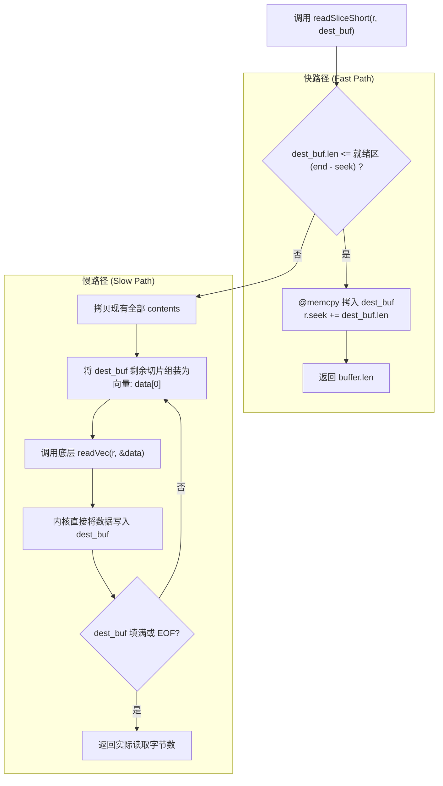
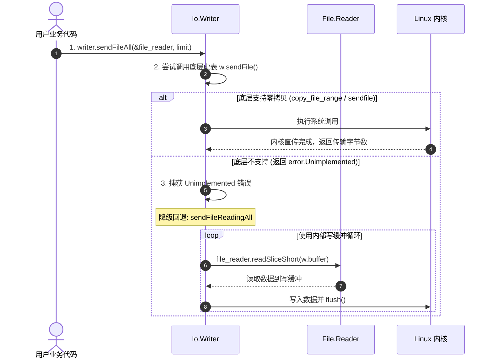

# 现代数据流抽象：Reader 与 Writer 底层架构剖析

在 I/O 编程中，流式数据（Streaming Data）处理是最常用的接口之一。

传统流抽象常包含两种常见模式：
1. **外挂缓冲包装（如 Go `bufio` 或 Rust `BufReader<R>`）**：通过泛型嵌套包装原有类型，增加了类型层级与单态化编译开销；
2. **多余的内存中继拷贝**：数据在用户业务缓冲区、包装层内部缓冲区与内核缓冲区之间多次流转。

Zig 0.17 废弃了旧版基于宏混入的 `std.io.Reader`，改为直接包含缓冲游标与虚表分发能力的具体结构体：**`Io.Reader` 与 `Io.Writer`**。

---

## Reader 的三指针滑动窗口物理模型

查看源码 [`lib/std/Io/Reader.zig#L16-L21`](https://codeberg.org/ziglang/zig/src/tag/0.17.0/lib/std/Io/Reader.zig#L16-L21)：

```zig
const Reader = @This();

vtable: *const VTable,
buffer: []u8,
seek: usize, // 已消费的字节游标
end: usize,  // 当前已填充的有效数据上界
```

在内存中，`buffer` 被 `seek` 与 `end` 划分为三个区域：


- **`0 .. seek`（已消费区）**：调用方已经取走的数据，在后续整理或重新填充前不再使用；
- **`seek .. end`（就绪有效区）**：已从内核读入但尚未被消费的数据，大小为 `end - seek`。调用 `reader.peek()` 可直接获取该切片；
- **`end .. len`（空闲待写入区）**：尚未填充数据的空间。当就绪数据耗尽时，底层系统调用可直接将该区间作为目标地址发起读取。

---

## 缓冲与直击读取：`readSliceShort` 实现剖析

查看源码 [`lib/std/Io/Reader.zig#L685-L704`](https://codeberg.org/ziglang/zig/src/tag/0.17.0/lib/std/Io/Reader.zig#L685-L704)：

```zig
pub fn readSliceShort(r: *Reader, buffer: []u8) ShortError!usize {
    // 1. 获取当前内部就绪数据
    const contents = r.buffer[r.seek..r.end];
    const copy_len = @min(buffer.len, contents.len);
    
    // 2. 从内部缓存拷贝
    @memcpy(buffer[0..copy_len], contents[0..copy_len]);
    r.seek += copy_len;
    
    // 快路径：内部数据已满足目标需求
    if (buffer.len - copy_len == 0) {
        @branchHint(.likely);
        return buffer.len;
    }
    
    // 慢路径：内部数据耗尽，直接读取到用户目标缓冲区
    var i: usize = copy_len;
    var data: [1][]u8 = undefined;
    while (true) {
        data[0] = buffer[i..];
        i += readVec(r, &data) catch |err| switch (err) {
            error.EndOfStream => return i,
            error.ReadFailed => |e| return e,
        };
        if (buffer.len - i == 0) return buffer.len;
    }
}
```



### 运行特征：
1. **快路径内存复制**：内部缓冲区有足够数据时，直接通过 `@memcpy` 复制并推进 `seek` 游标；
2. **慢路径直接传递用户切片**：
   当内部缓冲区不足时，`readSliceShort` 将用户切片的剩余部分 `buffer[i..]` 包装为向量 `data[0]` 传给 `readVec`，底层系统调用（如 `readv` 或 `io_uring_prep_readv`）直接将数据读入用户内存，跳过了中间临时缓冲区的二次拷贝。

---

## Writer 的聚集写入（Gather I/O）与 `sendFile`

查看源码 [`lib/std/Io/Writer.zig#L14-L26`](https://codeberg.org/ziglang/zig/src/tag/0.17.0/lib/std/Io/Writer.zig#L14-L26)：

```zig
const Writer = @This();

vtable: *const VTable,
buffer: []u8, // 传入空切片时自动作为非缓冲直写模式
end: usize,   // 当前暂存在内部缓冲区的未刷写字节数

pub const VTable = struct {
    drain: *const fn (w: *Writer, data: []const []const u8, splat: usize) Error!usize,
    sendFile: *const fn (w: *Writer, file_reader: *File.Reader, limit: Limit) FileError!usize = unimplementedSendFile,
    flush: *const fn (w: *Writer) Error!void = defaultFlush,
};
```

### 1. 聚集写入与 `splat` 填充
协议编码时常需写入头部元数据、消息体并在尾部补齐填充字节。
`Writer.VTable.drain` 接收两个参数：
- `data: []const []const u8`：切片向量数组；
- `splat: usize`：尾部重复单字节填充数量。
底层驱动在调用 `pwritev` 或构造 SQE 时可一次性提交这些分散的数据片段。

### 2. 零拷贝 `sendFile` 与降级机制

向网络套接字传输文件时，通常优先使用内核级零拷贝：



- **底层接口**：底层的 `w.sendFile` 对接操作系统零拷贝系统调用（如 Linux `copy_file_range`、macOS `fcopyfile`）。若当前文件系统或套接字类型不支持，驱动返回 `error.Unimplemented`；
- **自动降级（Auto-fallback via `sendFileAll`）**：
  查阅源码 [`lib/std/Io/Writer.zig#L1074`](https://codeberg.org/ziglang/zig/src/tag/0.17.0/lib/std/Io/Writer.zig#L1074)，高层方法 `w.sendFileAll` 会捕获 `error.Unimplemented`，自动调用 `sendFileReadingAll`，借用 `w.buffer` 作为中继缓冲区回退到常规读写循环。
