# 并发基石：Task、Future 与 Group 协同

在并发编程中，如何管理并发任务的生命周期、收集执行结果并防止资源泄漏，是并发抽象设计的核心目标。

---

## 跨语言并发生命周期管理对比

```mermaid
graph TB
    subgraph GoModel ["Go：非结构化派生与外部协同"]
        G_Go["go func() (语法级非结构化启动)"]
        G_WG["需显式引入 sync.WaitGroup 或 errgroup 协同"]
        G_Leak["若调用方未阻塞等待，容易产生孤儿 Goroutine 泄漏"]
        G_Go --> G_WG --> G_Leak
    end

    subgraph RustModel ["Rust：运行时 Task 与 JoinSet"]
        R_Spawn["tokio::spawn (要求 'static 生命周期，无法直接借用本地栈)"]
        R_Join["JoinHandle / JoinSet (通过容器追踪任务句柄)"]
        R_Cancel["丢弃 JoinHandle 并不自动终止任务，需显式 abort"]
        R_Spawn --> R_Join --> R_Cancel
    end

    subgraph ZigModel ["Zig：结构化并发 (Io.Group)"]
        Z_Group["Io.Group 结构体 (明确的作用域边界)"]
        Z_Await["group.await(io) 强保证所有子任务彻底退出"]
        Z_EarlyFree["子任务结束后即时释放自身纤程资源"]
        Z_Group --> Z_Await --> Z_EarlyFree
    end
```



- **Go**：通过 `go` 关键字派生任务，本身是非结构化的。如果未显式使用 `sync.WaitGroup` 或 `errgroup` 协同，派生的 Goroutine 可能在主函数退出后仍在后台运行，导致“孤儿协程泄漏”。
- **Rust**：通过 `tokio::spawn` 提交任务。由于任务可以在后台独立运行，Rust 类型系统强制要求闭包具有 `'static` 生命周期，无法直接借用当前函数的局部栈变量。若要批量汇聚任务，需要使用 `tokio::task::JoinSet` 容器管理。
- **Zig**：在标准库层面引入了结构化并发容器 `Io.Group`，将任务生命周期显式绑定在具体作用域中。

---

## 异步（async）与并行（concurrent）语义区分

在 `std.Io` 中，任务启动分为两个语义不同的入口：
- **`io.async`**（[`lib/std/Io.zig#L630`](https://codeberg.org/ziglang/zig/src/tag/0.17.0/lib/std/Io.zig#L630)）：将任务包装为轻量有栈纤程（Fiber），在当前线程的事件环上协作调度。适用于 I/O 密集型操作，发生等待时自动让出 CPU，无线程切换开销；
- **`io.concurrent`**（[`lib/std/Io.zig#L673`](https://codeberg.org/ziglang/zig/src/tag/0.17.0/lib/std/Io.zig#L673)）：将任务提交给底层工作线程池，在物理 CPU 核心上并行执行。适用于 CPU 密集型任务，避免长时间占用事件环。

---

## 任务组：`Io.Group` 的运行机制

在源码 [`lib/std/Io.zig#L1338`](https://codeberg.org/ziglang/zig/src/tag/0.17.0/lib/std/Io.zig#L1338) 中，`Io.Group` 专用于管理一组协同并发子任务：

```zig
const std = @import("std");
const Io = std.Io;

fn worker(id: usize, count: usize) Io.Cancelable!void {
    var i: usize = 0;
    while (i < count) : (i += 1) {
        // 执行计算或受控 I/O
    }
    _ = id;
}

pub fn runBatch(io: Io) !void {
    // 1. 初始化结构化任务组
    var group: Io.Group = .init;

    // 2. 将并发任务注册进组中
    try group.concurrent(io, worker, .{ 1, 1000 });
    try group.concurrent(io, worker, .{ 2, 2000 });

    // 3. 阻塞等待组内所有任务收敛执行完毕
    try group.await(io);
}
```

### 核心机制保障

1. **即时资源释放**：
   在 `Io.Group` 中，每个独立子任务在执行结束返回时，其占用的纤程栈和元数据会被**立即回收**，而不需要等待整个组的所有任务都完成。因此，在一个长生命周期的任务组中反复添加任务，不会引发无谓的内存累积。
2. **确定性收敛**：
   调用 `group.await(io)` 可以确保在当前函数退出之前，组内所有派生出的子任务均已执行完毕，不会遗留后台游离任务。
3. **级联取消**：
   若某项任务遇到错误或外部触发中断，调用 `group.cancel(io)` 会向组内全部成员统一广播取消信号，驱动整体安全收敛。
