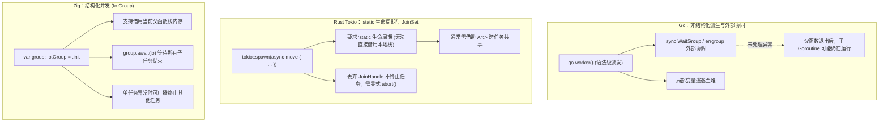
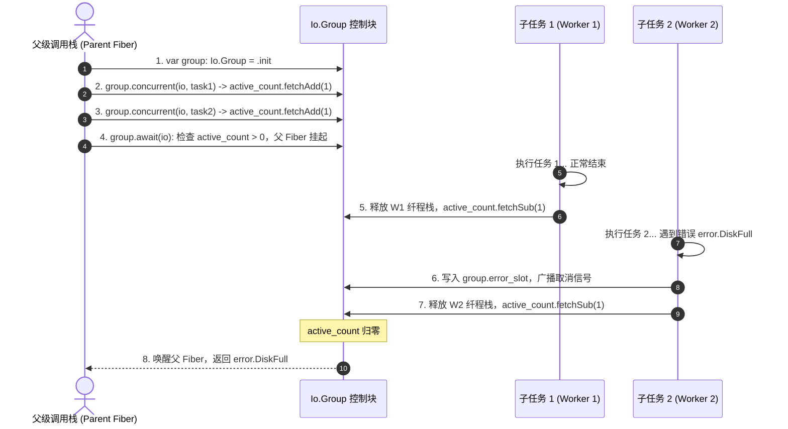

# 并发基石：Task、Future 与 Group 结构化生命周期底层剖析

在并发编程中，任务生命周期管理与异常退出时的资源清理是并发抽象的核心关注点。

非结构化并发（如没有关联父作用域的后台派生）容易在主函数退出后遗留运行中的子任务，引发资源泄漏。

Zig 0.17 在标准库层面支持结构化并发（Structured Concurrency），主要依托 `AnyFuture` 与 `Io.Group` 管理任务生命周期。

---

## 跨语言并发生命周期与内存模型对比

### 1. 差异分析

- **Go 的非结构化派生**：
  `go` 关键字不返回任务句柄。若未配合 `sync.WaitGroup` 或 context，子协程可能脱离调用方生命周期继续运行。由于子协程可能比父函数存活更久，被其引用的局部变量通常会逃逸到堆中。
- **Rust 的 `'static` 约束**：
  `tokio::spawn` 提交的任务可在后台独立运行，因此类型系统要求传入的闭包满足 `'static` 生命周期，不能直接借用父函数的局部栈变量，跨任务共享通常需使用 `Arc<Mutex<T>>`。
- **Zig 的结构化约束**：
  `Io.Group` 将子任务的生命周期绑定在声明它的作用域中。在调用 `group.await(io)` 之前，父函数不会退出，子任务可以安全借用父函数的局部栈内存。

---

## 异步派生（`async`）与并行调度（`concurrent`）

在 `std.Io` 中，任务派发分为两个不同路径的入口：

### 1. 事件环内纤程派生：`io.async`
查阅源码 [`lib/std/Io.zig#L2526`](https://codeberg.org/ziglang/zig/src/tag/0.17.0/lib/std/Io.zig#L2526)：
- **执行方式**：在当前线程绑定的事件环上派生轻量有栈纤程（Fiber）；
- **内存行为**：从纤程预分配池中获取栈内存，将上下文数据拷贝至栈顶，将该 Fiber 加入就绪链表；
- **适用场景**：I/O 密集型操作。等待 I/O 时通过汇编切出 CPU，无需操作系统线程上下文切换。

### 2. 跨核心并行派发：`io.concurrent`
查阅源码 [`lib/std/Io.zig#L2565`](https://codeberg.org/ziglang/zig/src/tag/0.17.0/lib/std/Io.zig#L2565)：
- **执行方式**：将任务提交给底层工作线程池；
- **内存行为**：使用带 Release 内存序的原子操作将任务压入队列，必要时通过 Futex 唤醒休眠的物理线程；
- **适用场景**：CPU 密集型计算任务，避免长时间占用事件环。

---

## `Io.Group` 状态机与收敛机制

查阅源码 [`lib/std/Io.zig#L1338-L1380`](https://codeberg.org/ziglang/zig/src/tag/0.17.0/lib/std/Io.zig#L1338-L1380)，`Io.Group` 的运转流程如下：

### 1. 即时资源释放
在 `Io.Group` 中，每个子任务执行完毕时，其运行外壳会立即释放该任务占用的独立栈空间，随后执行原子计数器 `active_count` 的递减，无需等到组内全部任务结束才释放内存。

### 2. 错误记录与级联取消
当组内子任务并发执行时：
- **捕获首个错误**：子任务出现错误时，通过原子的 CAS 操作写入 `group.error_slot`，记录第一个异常错误码；
- **广播取消**：任务出错时，Group 向登记的兄弟 Fiber 广播取消信号，驱动在途 I/O 撤回；
- **收敛退出**：父 Fiber 阻塞在 `group.await(io)` 处，待所有派生子任务退出并释放内存后，调度器将错误码返回给上层调用栈。
