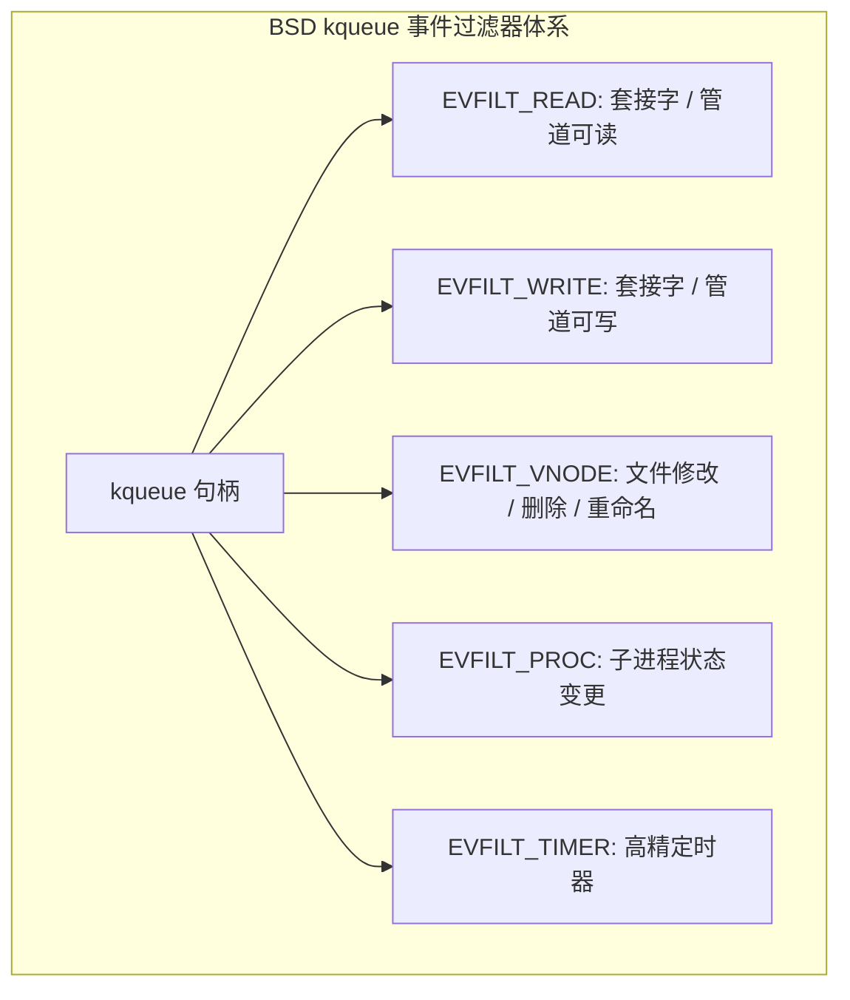
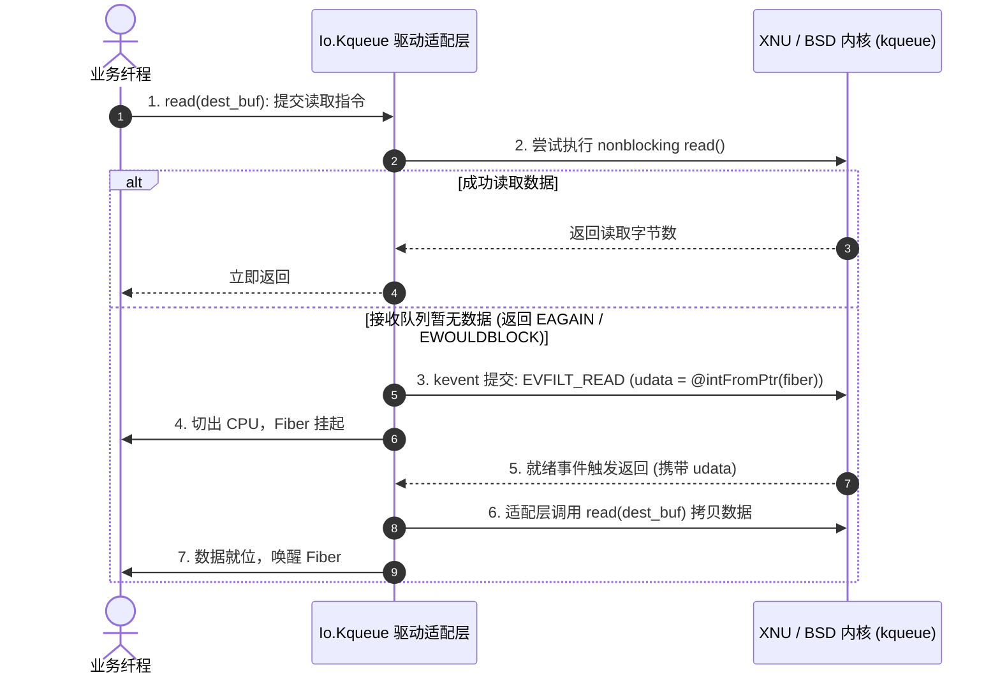
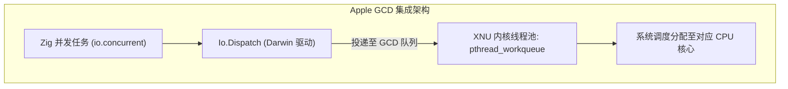

# macOS 与 BSD 事件集成：Dispatch 与 Kqueue 底层适配机制

在 BSD 系列（FreeBSD, NetBSD, OpenBSD）以及 Apple 体系（macOS, iOS, Darwin）中，系统提供了 **`kqueue`** 以及 Apple 的 **`libdispatch` (GCD / Grand Central Dispatch)**。

由于此类内核原生基于就绪通知模型，Zig 0.17 在标准库层面实现了适配驱动：[`Io.Kqueue`](https://codeberg.org/ziglang/zig/src/tag/0.17.0/lib/std/Io/Kqueue.zig) 与 [`Io.Dispatch`](https://codeberg.org/ziglang/zig/src/tag/0.17.0/lib/std/Io/Dispatch.zig)。

本章分析标准库如何在就绪型（Readiness）内核机制上提供完成型（Proactor）接口。

---

## BSD `kqueue` 与 `struct kevent` 的模型

`kqueue` 将网络套接字、文件系统变更、子进程状态、定时器、系统信号等统一抽象为 **过滤器（Filters）**。

查看源码 [`lib/std/Io/Kqueue.zig`](https://codeberg.org/ziglang/zig/src/tag/0.17.0/lib/std/Io/Kqueue.zig)：

```zig
pub const kevent = extern struct {
    ident: usize,      // 事件标识 (文件描述符 fd、进程 PID 等)
    filter: i16,       // 过滤器类型: EVFILT_READ, EVFILT_WRITE, EVFILT_VNODE, EVFILT_PROC
    flags: u16,        // 动作标志: EV_ADD, EV_DELETE, EV_ENABLE, EV_ONESHOT, EV_CLEAR
    fflags: u32,       // 过滤器专有标志
    data: isize,       // 过滤器专有数据
    udata: usize,      // 透传的用户上下文指针 (Zig 中记录挂起 Fiber 的地址)
};
```



### `kevent(2)` 批处理
`kevent` 系统调用接口如下：
```c
int kevent(int kq, const struct kevent *changelist, int nchanges,
           struct kevent *eventlist, int nevents, const struct timespec *timeout);
```
单次调用可同时提交变更项（`changelist`）并拉取已就绪事件（`eventlist`），合并了注册与等待步骤。

---

## 适配层：基于就绪内核提供完成模型接口

上层业务代码统一采用“提供缓冲区 -> 提交任务 -> 等待完成”的语义，`Io.Kqueue` 后端在底层进行状态转换：



### 处理逻辑：
- **优先非阻塞直读**：若缓冲区已有数据，先尝试非阻塞读取，无需经过 `kqueue` 注册；
- **就绪后代理读取**：若返回 `EAGAIN`，在 `kqueue` 中注册监听并切走 Fiber。事件触发唤醒时，由驱动代为执行 `read` 读取数据到用户缓冲区，再唤醒 Fiber，使其在逻辑上呈现完成模型的效果。

---

## Apple Darwin `libdispatch` (GCD) 集成

在 macOS 与 iOS 等 Darwin 平台上，系统提供了 `libdispatch`。

源码见 [`lib/std/Io/Dispatch.zig`](https://codeberg.org/ziglang/zig/src/tag/0.17.0/lib/std/Io/Dispatch.zig)：



### 特点：
1. **对接内核工作队列**：
   GCD 底层由 XNU 内核的 `pthread_workqueue` 支持，内核可根据系统负载动态管理工作线程数量；
2. **QoS 支持**：
   `Io.Dispatch` 支持映射系统的 QoS 标记（如 `QOS_CLASS_USER_INTERACTIVE`、`QOS_CLASS_UTILITY`），便于操作系统按任务优先级进行调度。
