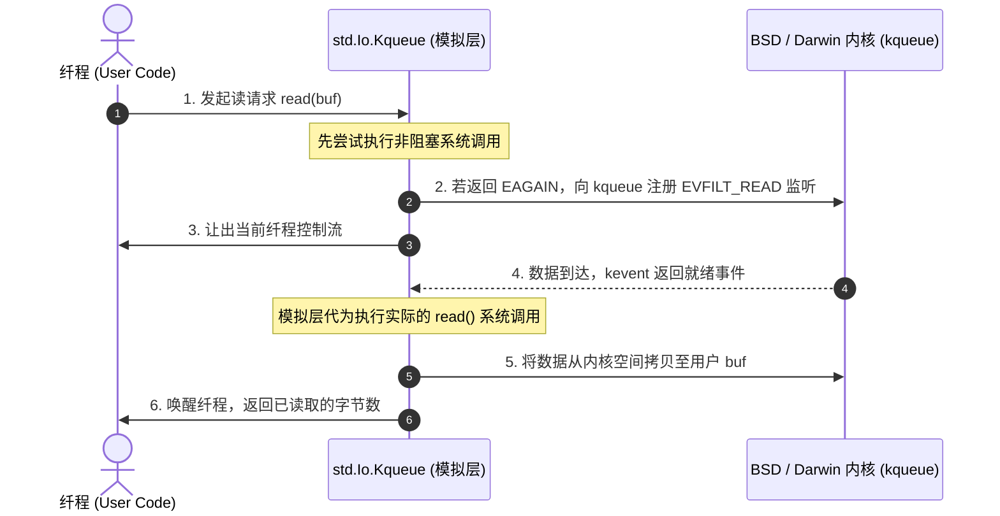

# macOS 与 BSD 事件集成：Dispatch 与 Kqueue

在 macOS 与 BSD 系统中，内核的主要 I/O 复用机制为 **`kqueue`** 以及苹果特有的 **libdispatch (Grand Central Dispatch)**。

由于这些系统原生缺乏类似 Linux `io_uring` 的通用完成型异步接口，Zig 在标准库中构建了模拟层：[`Io.Dispatch`](https://codeberg.org/ziglang/zig/src/tag/0.17.0/lib/std/Io/Dispatch.zig) 与 [`Io.Kqueue`](https://codeberg.org/ziglang/zig/src/tag/0.17.0/lib/std/Io/Kqueue.zig)。

---

## 模拟层工作原理

当应用在 macOS 或 BSD 上调用完成型 API（如发起一次带内存缓冲的读取）时，[`Kqueue.zig`](https://codeberg.org/ziglang/zig/src/tag/0.17.0/lib/std/Io/Kqueue.zig) 会将其转换为就绪型操作进行处理：

这一层模拟使编写在 `std.Io` 上的代码能够在不同操作系统间保持一致的 API 行为。

---

## 苹果生态的 Dispatch 特化

在 macOS 与 iOS 等 Darwin 平台上，系统提供了 `libdispatch`（GCD）。

[`lib/std/Io/Dispatch.zig`](https://codeberg.org/ziglang/zig/src/tag/0.17.0/lib/std/Io/Dispatch.zig) 结合了系统级线程池机制：
- 利用 GCD 的 QoS 优先级队列管理底层多线程任务；
- 与内核的 `pthread_workqueue` 配合，由操作系统根据系统整体负载动态调节物理线程数量，避免自建线程池产生的超额调度开销。
