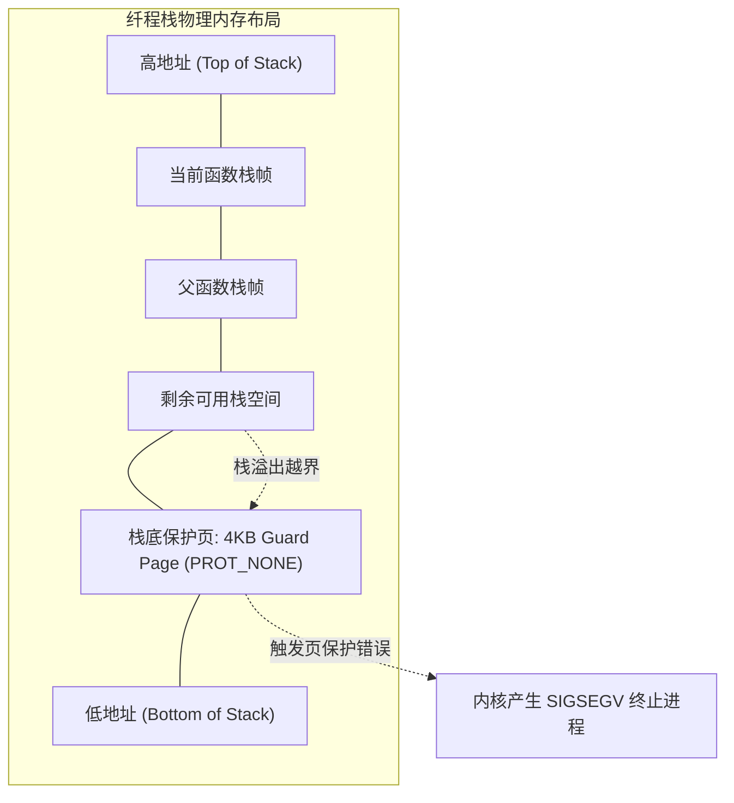

# 纤程调度机制：fiber.zig 与用户态上下文切换底层剖析

在不依赖垃圾回收（GC）与复杂并发运行时的前提下，Zig 通过轻量有栈纤程（Fiber）实现了同步语法的并发。

其核心支撑组件位于源码 [`lib/std/Io/fiber.zig`](https://codeberg.org/ziglang/zig/src/tag/0.17.0/lib/std/Io/fiber.zig)。本章分析其内联汇编上下文切换、栈内存页保护以及与 Go `gogo` 调度的差异。

---

## 寄存器快照：`Context` 与 ABI 约定

查看源码 [`lib/std/Io/fiber.zig#L7-L24`](https://codeberg.org/ziglang/zig/src/tag/0.17.0/lib/std/Io/fiber.zig#L7-L24)：

```zig
pub const Context = switch (builtin.cpu.arch) {
    .aarch64 => extern struct {
        sp: u64, // 硬件栈指针 (Stack Pointer)
        fp: u64, // 帧基址指针 (Frame Pointer: x29)
        pc: u64, // 程序计数器 (Program Counter)
    },
    .x86_64 => extern struct {
        rsp: u64, // 硬件栈指针
        rbp: u64, // 栈基址指针
        rip: u64, // 指令指针 (Instruction Pointer)
    },
    ...
};
```

### 为什么上下文只包含 3 个寄存器？
x86-64 拥有 16 个通用寄存器以及向量寄存器，Zig 的纤程上下文只保存 `rsp`、`rbp`、`rip` 三个字段（共 24 字节），原因在于其对 **调用约定（Calling Convention）与编译器 Clobber 列表** 的配合：
1. **调用者保存（Caller-saved）寄存器**：
   `contextSwitch` 是作为一个内联函数被调用的。根据 System V AMD64 ABI 约定，调用者保存的寄存器（如 `RAX`, `RCX`, `RDX`, `RSI`, `RDI`, `R8`~`R11`）在发起调用前，若包含活跃数据，已由编译器在外部压入当前栈；
2. **Clobber 寄存器污染声明**：
   在 [`fiber.zig#L63-L126`](https://codeberg.org/ziglang/zig/src/tag/0.17.0/lib/std/Io/fiber.zig#L63-L126) 中，内联汇编通过破坏列表（Clobber List）告知编译器所有可能被修改的寄存器，编译器在生成外围代码时会自动处理必要数据的暂存；
3. **切换动作**：
   因此，硬件层面的切换动作仅需替换栈指针、帧指针并将指令计数器跳转到恢复点。

---

## 汇编级上下文切换：机器指令拆解

### 1. x86_64 内联汇编分析
查看源码 [`lib/std/Io/fiber.zig#L244-L255`](https://codeberg.org/ziglang/zig/src/tag/0.17.0/lib/std/Io/fiber.zig#L244-L255)：

```x86asm
# 寄存器输入: RSI 指向 Switch 结构体 { old: *Context, new: *Context }

movq 0(%rsi), %rax       # 1. RAX = s.old 指针
movq 8(%rsi), %rcx       # 2. RCX = s.new 指针
leaq 0f(%rip), %rdx      # 3. 将标签 0: 的地址载入 RDX (恢复点)
movq %rsp, 0(%rax)       # 4. 保存当前 RSP 到 old.rsp
movq %rbp, 8(%rax)       # 5. 保存当前 RBP 到 old.rbp
movq %rdx, 16(%rax)      # 6. 保存恢复地址 RDX 到 old.rip

movq 0(%rcx), %rsp       # 7. 切换为 new.rsp
movq 8(%rcx), %rbp       # 8. 切换为 new.rbp
jmpq *16(%rcx)           # 9. 跳转至 new.rip 执行新 Fiber

0:                       # 10. 未来该 Fiber 被恢复时的执行入口
```

### 2. AArch64 (ARM64) 内联汇编分析
查看源码 [`lib/std/Io/fiber.zig#L31-L41`](https://codeberg.org/ziglang/zig/src/tag/0.17.0/lib/std/Io/fiber.zig#L31-L41)：

```armasm
# 寄存器输入: X1 指向 Switch { old: *Context, new: *Context }

ldp x0, x2, [x1]         # 1. 成对加载: X0 = s.old, X2 = s.new
ldr x3, [x2, #16]        # 2. 读取新 Fiber 入口: X3 = new.pc
mov x4, sp               # 3. 读取当前栈指针到 X4
stp x4, fp, [x0]         # 4. 成对存储: 将当前 SP 与 FP 存入 old.sp 和 old.fp
adr x5, 0f               # 5. 读取恢复标签 0: 的地址到 X5
ldp x4, fp, [x2]         # 6. 从 new 恢复新的 SP 与 FP
str x5, [x0, #16]        # 7. 保存恢复地址 X5 到 old.pc
mov sp, x4               # 8. 更新栈指针 SP
br x3                    # 9. 跳转至 X3 (new.pc)

0:                       # 10. 恢复点
```

切换过程在用户态执行，由数条 CPU 指令完成。

---

## 纤程栈内存管理与保护页（Guard Page）



### 保护页机制：
1. **栈向下生长**：在 x86-64 与 ARM64 架构中，函数压栈向低地址生长；
2. **设置 `PROT_NONE`**：分配纤程栈时，通常将栈底部的 4KB 页面通过 `mprotect` 标记为不可读写访问；
3. **防止越界踩踏**：
   若 Fiber 递归过深或分配了过大的局部数组导致栈指针越界触碰该保护页，硬件 MMU 触发缺页异常（Page Fault），操作系统向进程发送 `SIGSEGV`，便于及时定位栈溢出问题。

---

## 上下文切换对比（Zig vs Go）

| 对比项 | Go 语言 Goroutine (`runtime.gogo`) | Zig 纤程 (`Io.fiber.contextSwitch`) |
| :--- | :--- | :--- |
| **执行路径** | 用户态调度循环 | 内联汇编 |
| **寄存器处理** | 保存 Callee-saved 寄存器及 TLS 指针 | 置换 `SP`、`FP`、`PC`，其余由编译器调度管理 |
| **运行时结构体** | 维护 `g`、`m`、`p` 状态及栈边界信息 | 仅进行寄存器状态切换 |
| **栈溢出检查** | 函数序言包含 `morestack` 探测指令 | 依赖硬件保护页（Guard Page）捕获越界 |
