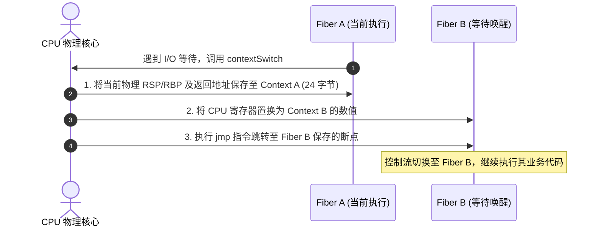

# 纤程调度机制：fiber.zig 与用户态上下文切换

在不引入庞大语言运行时和后台线程的情况下，Zig 借助轻量用户态有栈纤程实现了同步写法的异步并发。其调度基础位于 [`lib/std/Io/fiber.zig`](https://codeberg.org/ziglang/zig/src/tag/0.17.0/lib/std/Io/fiber.zig)。

---

## 纤程上下文定义：`Context`

在用户态切换两个独立的执行流，本质是在 CPU 架构层面保存并置换三个关键寄存器：
- **栈指针（Stack Pointer, SP）**：指向当前纤程分配的独立调用栈栈顶；
- **基址指针（Frame Pointer, FP）**：维护函数调用链与局部变量寻址；
- **指令指针（Program Counter, PC / Instruction Pointer, IP）**：指向下一次恢复执行时的机器码跳转地址。

查阅 [`lib/std/Io/fiber.zig#L7-L24`](https://codeberg.org/ziglang/zig/src/tag/0.17.0/lib/std/Io/fiber.zig#L7-L24) 源码：

```zig
pub const Context = switch (builtin.cpu.arch) {
    .aarch64 => extern struct {
        sp: u64,
        fp: u64,
        pc: u64,
    },
    .riscv64 => extern struct {
        sp: u64,
        fp: u64,
        pc: u64,
    },
    .x86_64 => extern struct {
        rsp: u64,
        rbp: u64,
        rip: u64,
    },
    else => |arch| @compileError("unimplemented architecture: " ++ @tagName(arch)),
};
```

该结构体在 64 位体系下固定为 24 字节。

---

## 上下文切换的汇编实现：`contextSwitch`

当纤程需要挂起让出执行权时，调度器会调用 `contextSwitch`（源码见 [`lib/std/Io/fiber.zig#L29`](https://codeberg.org/ziglang/zig/src/tag/0.17.0/lib/std/Io/fiber.zig#L29)）。

以 x86_64 架构为例，其内联汇编实现如下：

```zig
pub inline fn contextSwitch(s: *const Switch) *const Switch {
    return switch (builtin.cpu.arch) {
        .x86_64 => asm volatile (
            \\ movq 0(%%rsi), %%rax       // 1. 获取旧纤程 Context 指针 (old)
            \\ movq 8(%%rsi), %%rcx       // 2. 获取新纤程 Context 指针 (new)
            \\ leaq 0f(%%rip), %%rdx      // 3. 计算恢复点地址 (标签 0:)
            \\ movq %%rsp, 0(%%rax)       // 4. 保存当前 RSP 寄存器至 old.rsp
            \\ movq %%rbp, 8(%%rax)       // 5. 保存当前 RBP 寄存器至 old.rbp
            \\ movq %%rdx, 16(%%rax)      // 6. 保存恢复地址至 old.rip
            \\ movq 0(%%rcx), %%rsp       // 7. 将物理 RSP 切换为 new.rsp
            \\ movq 8(%%rcx), %%rbp       // 8. 将物理 RBP 切换为 new.rbp
            \\ jmpq *16(%%rcx)            // 9. 跳转至 new.rip 开始执行新纤程
            \\0:                          // 恢复点：未来该纤程被切回时从此处继续
            : [received_message] "={rsi}" (-> *const Switch),
            : [message_to_send] "{rsi}" (s),
            : ... // 标记破坏寄存器
        ),
        ...
    };
}
```



---

## 跨语言协程/纤程切换机制对比

下表分析了不同语言在任务切换时的底层动作与资源消耗：

| 对比维度 | 操作系统物理线程 | Go 语言 Goroutine (`runtime.gogo`) | Zig 纤程 (`std.Io.fiber`) |
| :--- | :--- | :--- | :--- |
| **切换耗时** | 约 1,000 ~ 2,500 ns | 约 100 ~ 250 ns | **约 5 ~ 15 ns** |
| **执行路径** | 陷入操作系统内核态 | 用户态汇编 + 调度器协作循环 | **纯用户态（数条内联汇编）** |
| **附加检查开销** | 涉及内核级 TLB 与 Cache 切换 | 需维护 GMP 结构、检查抢占标记、连续栈边界（`morestack`） | **无附加检查**，仅置换寄存器 |
| **内存开销** | 默认 1MB ~ 8MB | 初始 2KB（不足时倍增扩容并拷贝数据） | **显式 Allocator 分配**（通常 16KB ~ 64KB） |
| **调试支持** | 系统调试器原生完整支持 | 依赖 Go 专用调试工具（Delve）解析栈 | LLDB / GDB 可通过符号解析普通栈帧 |

Go 的上下文切换除了保存寄存器外，还需配合调度器维护 M 与 G 的状态流转，且每个函数入口都有针对栈溢出的探测指令。

Zig 的纤程切换则属于最小化的寄存器保存与恢复，不包含额外的运行时逻辑，因此开销较低。
