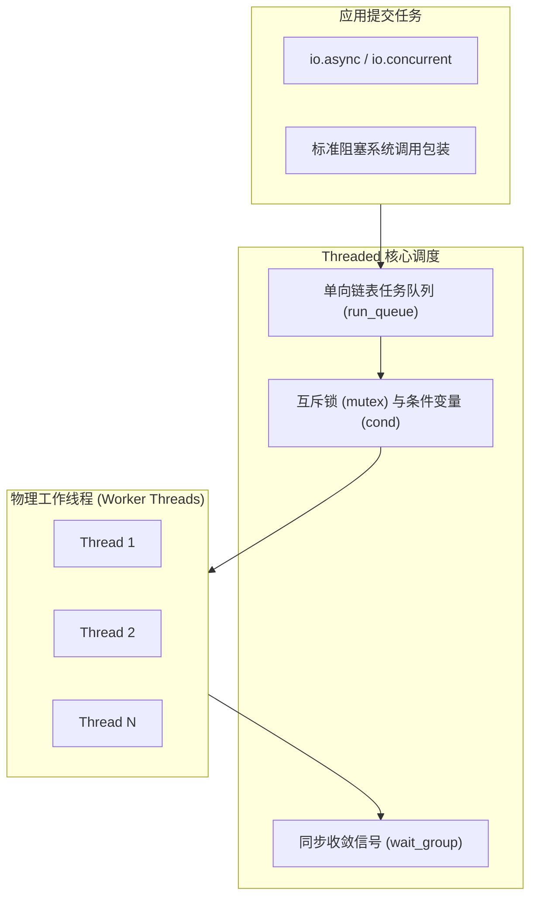

# 通用线程池降级：Threaded 后端机制

在不支持新一代异步驱动的系统环境（例如老旧 Linux 发行版、单线程目标平台 `builtin.single_threaded`）或测试套件中，系统需要一个无特定内核依赖的通用驱动：[`Io.Threaded`](https://codeberg.org/ziglang/zig/src/tag/0.17.0/lib/std/Io/Threaded.zig)。

---

## 运行机制与线程池组织

查阅 [`lib/std/Io/Threaded.zig`](https://codeberg.org/ziglang/zig/src/tag/0.17.0/lib/std/Io/Threaded.zig)，`Threaded` 维护了一套基础的工作线程池：



- **任务队列**：通过 `std.SinglyLinkedList` 维护等待执行的任务闭包；
- **并发控制**：依据 `std.Thread.getCpuCount()` 动态决定最佳工作线程数量；
- **资源回收**：在 `Threaded.deinit()` 时，通过内部 `wait_group` 同步等待所有工作线程安全退出，避免资源残留。

---

## 为什么 std.testing.io 使用 Threaded 后端？

在 Zig 标准库中，单元测试驱动 `std.testing.io` 基于 `Io.Threaded` 构建（见源码 [`lib/std/testing.zig#L24`](https://codeberg.org/ziglang/zig/src/tag/0.17.0/lib/std/testing.zig#L24)）：

```zig
pub var io_instance: Io.Threaded = undefined;
pub const io = if (builtin.is_test) io_instance.io() else @compileError("not testing");
```

采用 `Threaded` 作为默认测试驱动的原因在于：
1. **环境兼容性**：完全基于通用的 POSIX / Windows 系统调用构建，无需依赖特定内核版本（如高版本 Linux 内核对 `io_uring` 特性的支持程度），可以在绝大多数 CI 运行环境中稳定执行；
2. **调试调用栈保持完整**：在测试发生断言失败或崩溃时，线程的调用栈能够直接被系统调试器（如 LLDB 或 GDB）捕获与解析，不会因纤程寄存器置换而造成调试器退栈中断。
