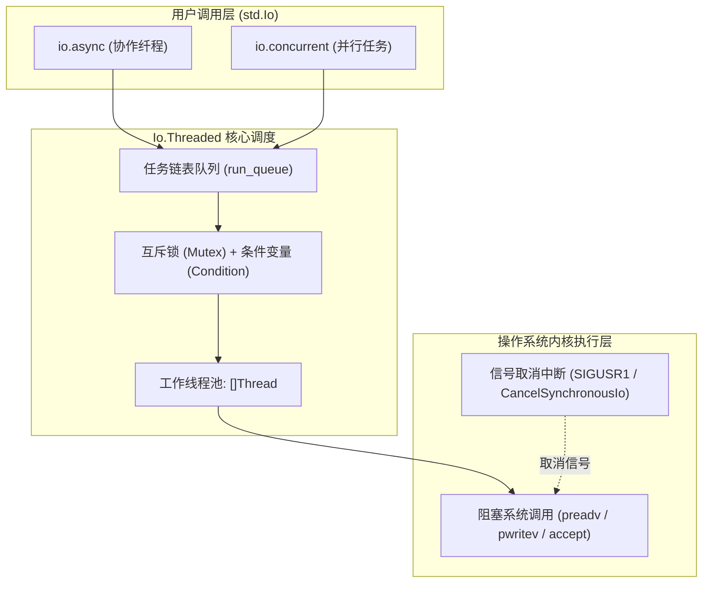

# 通用线程池降级：Threaded 后端机制与阻塞系统调用取消底层剖析

在缺乏 `io_uring` 或 `kqueue` 等异步驱动的环境中（如老旧内核、受限沙箱或单线程目标），系统需要一个通用的兜底实现：[`Io.Threaded`](https://codeberg.org/ziglang/zig/src/tag/0.17.0/lib/std/Io/Threaded.zig)。

该文件封装了阻塞系统调用包装、工作线程池分发以及可取消机制。

---

## 线程池拓扑与任务分发

查看源码 [`lib/std/Io/Threaded.zig`](https://codeberg.org/ziglang/zig/src/tag/0.17.0/lib/std/Io/Threaded.zig)，`Threaded` 将异步任务映射到底层工作线程池：



### 1. 线程组织与调度
- **核心数适配**：初始化时调用 `std.Thread.getCpuCount()`，根据可用 CPU 核心数建立工作线程池；
- **任务唤醒**：新任务推入队列时，通常使用 `cond.signal()` 唤醒单个休眠中的 Worker 线程，批量下发时调用 `cond.broadcast()`。

---

## 阻塞系统调用的可取消包装：`Syscall.start()` 机制

在阻塞系统调用中，线程陷入内核睡眠时若外部发起取消，需要机制打断阻塞。

`Io.Threaded` 实现了相应的取消包装：

查看源码逻辑：
```zig
const syscall: Syscall = try .start();
while (true) {
    const rc = posix.pwritev(file.handle, iovecs, offset);
    switch (posix.errno(rc)) {
        .SUCCESS => {
            syscall.finish();
            return rc;
        },
        .INTR => {
            // 系统调用被打断，检查是否收到取消信号
            if (try syscall.interrupted()) continue;
        },
        ...
    }
}
```

```mermaid
sequenceDiagram
    autonumber
    actor Controller as 取消控制方
    participant Worker as 工作线程
    participant Kernel as 操作系统内核

    Worker->>Worker: 1. 执行 Syscall.start(): 记录当前线程 TID
    Worker->>Kernel: 2. 进入阻塞系统调用: pwritev(...)
    Note over Kernel: Worker 线程在内核等待队列中休眠
    
    Controller->>Worker: 3. 外部触发取消: future.cancel(io)
    Controller->>Kernel: 4. 向 Worker 线程发送取消信号 (POSIX: pthread_kill; Windows: CancelSynchronousIo)
    Kernel-->>Worker: 5. 内核中断休眠，系统调用返回 EINTR
    Worker->>Worker: 6. 捕获 EINTR，调用 syscall.interrupted() 确认取消并抛出 error.Canceled
```

### 取消实现方式：
- **POSIX 环境**：进入系统调用前通过 `Syscall.start()` 记录线程 ID。发生取消时，通过 `pthread_kill(tid, SIGUSR1)` 向目标线程发送信号，使系统调用返回 `EINTR`，进而检查状态抛出 `error.Canceled`；
- **Windows 环境**：调用 Win32 API `CancelSynchronousIo(thread_handle)` 打断阻塞中的同步 I/O。

---

## 单元测试使用 Threaded 的原因

在 Zig 标准库中，单元测试环境 `std.testing.io` 默认使用 `Io.Threaded`（源码见 [`lib/std/testing.zig#L24`](https://codeberg.org/ziglang/zig/src/tag/0.17.0/lib/std/testing.zig#L24)）：

```zig
pub var io_instance: Io.Threaded = undefined;
pub const io = if (builtin.is_test) io_instance.io() else @compileError("not testing");
```

### 考虑因素：
1. **环境兼容性**：
   `Io.Threaded` 基于通用的 POSIX 与 Win32 接口，不依赖特定内核版本的异步特性（如高版本 `io_uring`），可在各种 CI 容器环境中稳定执行；
2. **调试调用栈解析**：
   在纤程模式下，寄存器置换可能影响某些调试器对父函数栈帧的解析。`Threaded` 运行在操作系统标准线程栈上，断言失败时 LLDB 或 GDB 可直接打印完整的调用栈回溯。
