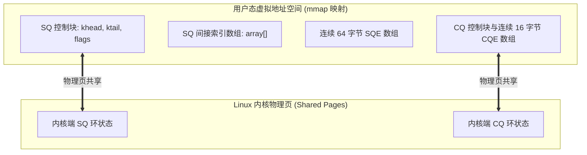
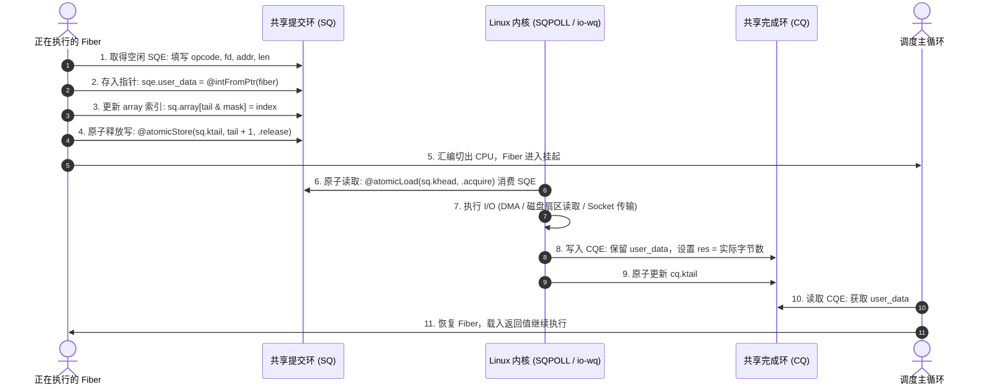

# Linux 完成型驱动：Uring (io_uring) 共享内存环与内核交互底层剖析

在 Linux 平台上，`Io.Uring` 是 `std.Io` 的原生异步驱动后端。

它将内核的 **`io_uring`** 框架与 Zig 的轻量有栈纤程结合，支持共享内存队列提交与事件唤醒。

---

## 物理内存映射：`io_uring_setup` 与 `mmap`

为了减少特权级切换开销，`io_uring` 初始化时通过共享虚拟内存建立数据通道。

查看源码 [`lib/std/Io/Uring.zig`](https://codeberg.org/ziglang/zig/src/tag/0.17.0/lib/std/Io/Uring.zig)：

### 初始化步骤：
1. **创建 Ring 描述符**：
   驱动调用系统调用 `sys_io_uring_setup(entries, &params)`，在内核创建控制块，返回文件描述符 `ring_fd`；
2. **第一段 `mmap`：SQ 环控制块**：
   使用偏移量 `IORING_OFF_SQ_RING` 映射 SQ 环元数据（`khead`、`ktail`、`ring_mask`、`dropped`）以及**间接索引数组（`array`）**；
3. **第二段 `mmap`：SQE 实体数组**：
   使用偏移量 `IORING_OFF_SQES` 映射存放 64 字节 `struct io_uring_sqe` 的连续内存空间；
4. **第三段 `mmap`：CQ 环队列**：
   使用偏移量 `IORING_OFF_CQ_RING` 映射 CQ 环（`khead`、`ktail` 以及存放 16 字节 `struct io_uring_cqe` 的环形数组）。

> [!NOTE] 为什么 SQ 需要间接数组 `array`？
> SQE 数组支持乱序或批量申请，应用程序可以以任意物理顺序填充 SQE，随后在 `array` 中按逻辑顺序记录物理下标，无需在环中移动 64 字节结构体。

---

## 环形缓冲区推移与原子内存顺序

在向 SQ 提交请求时，用户态为生产者，内核为消费者；在 CQ 收割结果时，内核为生产者，用户态为消费者。双方通过原子操作通信：

### 内存顺序：
应用层写入 SQE 时，需确保结构体数据写入后才更新 `tail` 指针。标准库在更新 `sq.ktail` 时使用 **Release 内存顺序**，防止重排序导致内核读取到尚未写完的 SQE。

---

## 内核轮询模式：`IORING_SETUP_SQPOLL`

默认情况下，`io_uring` 生产完 SQE 后可通过 `sys_io_uring_enter` 告知内核。

在支持的配置下，`Io.Uring` 支持内核轮询模式（`IORING_SETUP_SQPOLL`）：
1. **内核轮询线程**：内核在后台派生 `io_uring-sq` 线程；
2. **免系统调用提交**：该线程轮询共享内存中的 `sq.ktail`，应用层更新后内核线程可直接处理，减少提交阶段的系统调用。

---

## Zig 与 `io_uring` 的配合设计

1. **切片借用与安全屏障**：
   Zig 允许直接传递 `[]u8` 切片，通过底层的 `CancelProtection` 握手保证在内核归还完成事件前不展开栈帧，兼顾借用语法与生命周期安全；
2. **指针直存与唤醒**：
   Zig 将当前有栈 Fiber 的内存地址 `@intFromPtr(current_fiber)` 直接存入 `sqe.user_data`。CQE 返回后，调度器可通过该数值恢复 Fiber 引用并加入运行队列。
