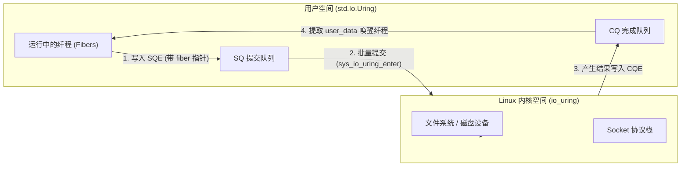

# Linux 完成型驱动：Uring (io_uring) 运行机制

在 Linux 系统上，`Io.Uring` 是 `std.Io` 的主要事件驱动后端。它将内核原生完成型接口 **`io_uring`** 与 Zig 的轻量纤程调度结合，构成了直接面向完成模型的运行体系。

---

## 环形队列机制：SQ 与 CQ

`io_uring` 的核心结构是应用层与内核空间通过共享内存映射（mmap）建立的两个无锁环形队列：
- **提交队列（Submission Queue, SQ）**：应用层向队列中写入请求描述条目（SQE: Submission Queue Entry）；
- **完成队列（Completion Queue, CQ）**：内核后台执行完毕后，向队列中写入完成状态条目（CQE: Completion Queue Entry）。

---

## 纤程挂起与 CQE 唤醒流程

在源码 [`lib/std/Io/Uring.zig`](https://codeberg.org/ziglang/zig/src/tag/0.17.0/lib/std/Io/Uring.zig) 中，一个 I/O 请求的具体执行过程如下：

1. **准备 SQE**：
   当某个纤程调用读写接口时，`Uring` 后端从 SQ 环中分配一个空闲的 SQE，填入目标文件描述符、操作类型（如读、写、accept）以及目标缓冲区内存切片；
2. **记录用户数据（user_data）**：
   在 SQE 的 `user_data` 字段中，**直接写入当前挂起纤程的结构体内存地址**；
3. **协作让出**：
   当前纤程调用 `contextSwitch` 将控制权交还给事件循环主纤程；
4. **内核执行与结果回传**：
   内核完成物理传输后，生成一个 CQE 条目写入 CQ 环。该条目保留了原请求提交的 `user_data`，并附带传输字节数或错误码；
5. **精准唤醒**：
   事件循环遍历 CQ 队列，直接读取 `cqe.user_data` 恢复出对应纤程的指针，再次调用 `contextSwitch` 切回该纤程继续执行。

---

## 与 Rust Tokio 的架构演进对比

Rust 生态中的 Tokio 运行时最初紧密围绕 `epoll` 设计：
- 其抽象层 `mio` 本质是一个 Reactor，所有上层 API（如 `AsyncRead::poll_read`）假设“先等待事件就绪，再由用户空间执行同步拷贝”。
- 当 Linux 引入 `io_uring` 后，Tokio 若要完全迁移至完成模型，需要颠覆 `mio` 的核心就绪语义，并解决前文所述的缓冲区借用安全冲突。因此，Tokio 仍以 `epoll` 为主，`io_uring` 仅作为独立的实验性项目（`tokio-uring`）演进。

Zig 从重新设计 `std.Io` 开始，直接将完成模型作为一级抽象：
- 接口原生采用“提交请求并在未来消费完成结果”的语义；
- 纤程的栈由应用层显式持有，在 CQE 确认返回前通过屏障防范提前释放，使 `io_uring` 能与语言标准库自然衔接。
