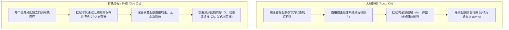

# 语言异步机制的二维空间：推进模型与栈模型

操作系统内核暴露的就绪或完成通知，最终需要由编程语言的并发机制承接。分析主流语言的异步抽象，可以从两个正交的技术维度切入：
1. **推进模型（Progression Model）**：任务的执行进度由谁驱动？（Pull 还是 Push）
2. **栈模型（Stack Model）**：当并发任务挂起时，其执行状态与局部变量存储在何处？（有栈还是无栈）

---

## 推进模型：Pull 与 Push

### 1. Pull 模型（轮询驱动）
- **代表机制**：Rust 的 `Future::poll`。
- **运行流程**：任务本身不主动推进，它是一个被动的状态机。执行器（Executor）通过调用 `poll` 接口驱动任务运行，任务返回 `Poll::Ready(val)` 表示完成，或者返回 `Poll::Pending` 表示当前无法推进。任务内部在遇到挂起点时，需负责注册唤醒通知（`Waker`），底层事件发生时通过 `Waker.wake()` 通知执行器重新对该任务执行 `poll`。
- **特点**：不需要额外的任务间消息通道，取消任务时只需停止 `poll` 并销毁该 `Future` 即可；缺点是由于需要外部重复调用 `poll`，复杂的层级嵌套可能产生多次无效的状态探测。

### 2. Push 模型（事件驱动）
- **代表机制**：Go 的 Goroutine、C# 的 `async/await` 回调延续、Zig 的 Fiber。
- **运行流程**：任务挂起后，控制权交还给调度器或事件循环。当底层事件完成时，调度器直接将数据或控制流“推送”给对应的处理上下文，唤醒任务从挂起指令处继续向下顺序执行。
- **特点**：控制流符合顺序编程习惯，数据直接投递；缺点是需要严密管理取消信号的下发，避免任务在后台脱离控制。

---

## 栈模型：有栈（Stackful）与无栈（Stackless）

栈模型的选择直接决定了语言的内存占用、调试体验以及是否存在“函数颜色（Function Coloring）”。

### 1. 无栈协程的实现机制与函数颜色
在 Rust 等语言中，`async fn` 本身不拥有独立的运行栈，执行时使用的是当前操作系统的物理线程栈。

- **编译期状态机重写**：
  编译器将函数内部跨越 `.await` 点的所有局部变量提取出来，打包生成一个匿名的 `enum` 结构体。每一个状态分支代表两次 `await` 之间的代码片段。
- **退栈（Unwind）的要求**：
  由于协程自身没有独立栈，当底层的 I/O 无法完成需要挂起时，当前物理线程必须能够解脱出来去处理其他并发任务。线程要离开当前函数，唯一合法的机器码行为就是执行 `ret`（返回指令）。因此，未完成的信号必须顺着函数调用链逐层向上 `return` 退出，直到回到事件循环。
- **函数颜色（Function Coloring）的本质**：
  为了支持逐层 `return` 传递未完成状态，调用链路上所有的中间函数，无论其内部是否有异步操作，都必须被标记为 `async` 并配合 `await` 调用。普通同步函数无法在不修改签名的前提下透传该状态机，因而产生了“有颜色”与“无颜色”函数的隔离。

### 2. 有栈协程的实现机制
在 Go 和 Zig 的纤程模型中，每个并发任务都分配了独立的栈内存空间。

- **上下文直接切换**：
  无论函数嵌套调用有多深，一旦最底层的网络或文件读取操作需要等待，代码直接执行数条汇编指令，将物理 CPU 的寄存器（如栈指针 SP、指令指针 PC、基址指针 FP）写入当前任务的上下文字段中，并将下一个就绪任务的寄存器载入物理 CPU，立即转移控制流。
- **消除函数颜色**：
  调用链中间的各层函数就是标准的普通函数，不需要改变签名或返回值，底层挂起对上层完全透明。

---

## Go、Rust 与 Zig 的栈管理对比

| 语言 | 机制类型 | 栈分配与扩容方式 | 上下文切换成本 | 优势 | 局限 |
| :--- | :--- | :--- | :--- | :--- | :--- |
| **Rust** | 无栈 (Stackless) + Pull 轮询 | 无独立栈。按需分配状态机结构体（大小在编译期确定） | 状态机方法调用，无物理寄存器置换 | 内存占用小，无运行时开销，类型安全 | 函数颜色传染，与完成型 I/O 借用模型冲突 |
| **Go** | 有栈 (Stackful) + Push 推进 | 初始 2KB 动态连续栈。栈空间不足时触发连续栈扩容（Copystack）并调整指针 | 调度器汇编置换（`gogo`/`mcall`），由运行时调度 | 编码体验平滑，支持抢占与动态扩容 | 栈扩容引发内存拷贝与指针重写，运行时体积较大 |
| **Zig** | 有栈 (Stackful) + Push 推进 | 显式 Allocator 分配固定大小栈（如 16KB/64KB），不隐式动态扩容 | 8 条平台汇编指令切换 CPU 寄存器（`fiber.zig`） | 纯同步代码，零函数染色，无隐式内存分配与 GC 介入 | 栈大小需根据业务场景提前预估，防止栈溢出 |

### Go 的动态栈成本说明
Go 在早期的分段栈（Segmented Stack）容易在循环中引起“栈分裂抖动”（Hot Split），后改为连续栈（Contiguous Stack）：当检测到栈空间不足时，运行时会分配一块两倍大的新内存，将旧栈数据完整拷贝至新空间，并由垃圾回收器遍历栈帧重写所有指向旧栈的指针。这一机制简化了开发者的心智负担，但当高并发服务同时面临大量深度调用栈扩展时，会产生瞬时的 CPU 与内存抖动。

Zig 则坚持“显式控制”，不引入后台监控线程与指针重写，将栈的分配权与大小交由调用者通过 `Allocator` 显式指定。
