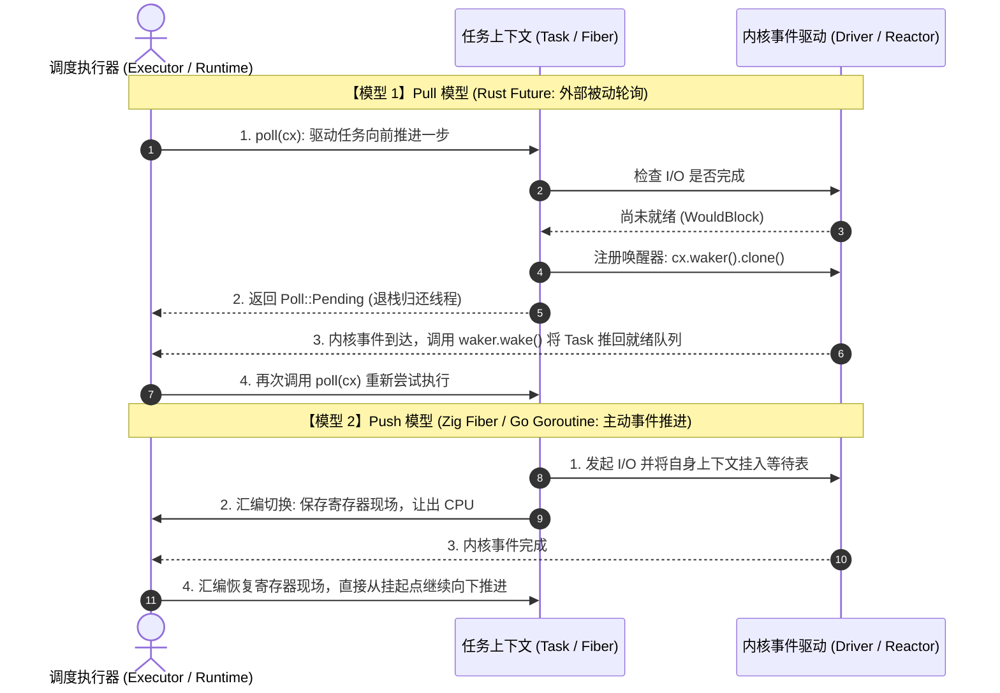
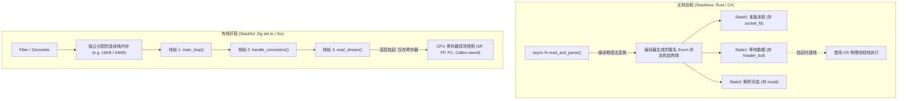
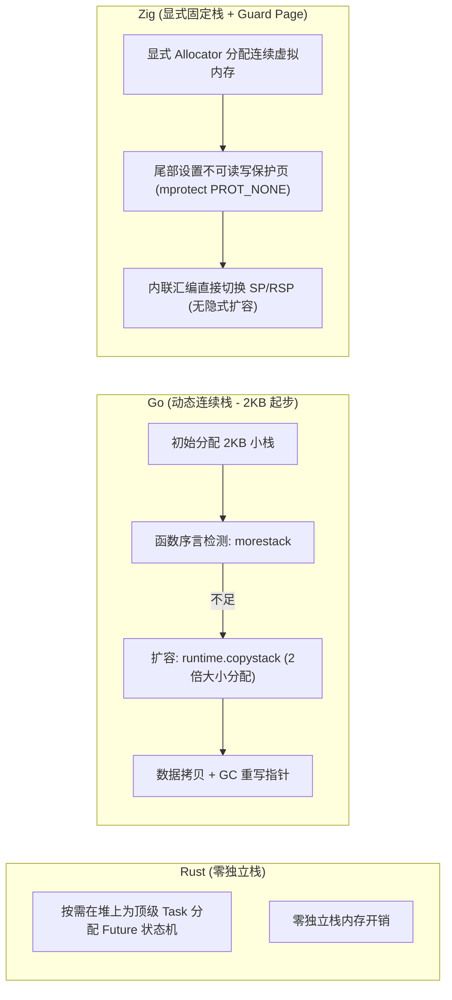

# 推进模型与栈模型：底层调度与内存布局深度剖析

操作系统内核暴露的就绪（epoll）或完成（io_uring）通知，最终需要由编程语言的并发机制承接。

分析主流系统级语言（Zig、Rust、Go）的并发架构，通常可以从两个技术维度切入：
1. **推进模型（Progression Model）**：任务执行由谁驱动？是被动轮询（Pull），还是主动事件推送（Push）？
2. **栈模型（Stack Model）**：并发任务挂起时，CPU 寄存器现场与局部变量保存在何处？是保存在编译器生成的状态机结构体中（无栈 Stackless），还是保存在独立的连续内存栈空间中（有栈 Stackful）？

---

## 推进模型：Pull 轮询驱动 vs Push 事件推送



### 1. Pull 模型（Rust `Future`）的工作原理

在 Rust 的标准库与 Tokio 中，`Future` 本身不包含独立调度线程，而是一个被动的状态机接口：

```rust
pub trait Future {
    type Output;
    fn poll(self: Pin<&mut Self>, cx: &mut Context<'_>) -> Poll<Self::Output>;
}
```

- **底层调用链**：
  1. 执行器从任务队列取出一个 Task，调用其顶层的 `poll` 方法；
  2. 任务内部执行业务逻辑，直到最底层的叶子节点（如 `TcpStream` 读取）；
  3. 若系统调用返回 `EWOULDBLOCK`，该节点获取 `cx.waker()`，克隆其引用计数并注册到底层事件监听表中；
  4. 函数返回 `Poll::Pending`。未就绪状态顺着调用栈一层层向上传递并退栈，直到返回给调度器；
  5. 当底层网络套接字就绪时，操作系统唤醒 Reactor 线程，Reactor 调用 `waker.wake()` 将 Task 重新放入调度运行队列；
  6. 调度器从顶层再次调用 `poll`，重新进入状态机执行。
- **开销特征**：
  - **重复探测（Re-polling）**：嵌套较深时，外层调用 `poll` 需沿状态机逐层下探；
  - **状态机体积**：跨越 `.await` 的局部变量保存在编译器生成的 `enum` 中，分支较多时状态机体积由最大字段对齐决定。

### 2. Push 模型（Zig Fiber / Go）的工作原理

在 Push 模型中，任务执行流程与普通顺序代码一致。当底层 I/O 无法推进时，任务主动通过调度原语切出 CPU；当 I/O 完成时，调度器直接将执行权交还给该任务，从上次切出的位置恢复执行。

- **控制流的连续性**：无需逐层向上返回 `Pending`，也没有自顶向下的重复轮询；
- **与完成模型（Proactor）的契合**：在 Linux `io_uring` 中，内核完成 I/O 并写入 CQE。CQE 的 `user_data` 字段保存了挂起 Fiber 的内存指针。调度器读取该值后，即可将该 Fiber 重新放入就绪队列恢复执行。

---

## 栈模型：无栈协程 vs 有栈纤程

栈模型的区别在于：**当并发任务被挂起时，当前执行点的物理 CPU 寄存器（指令指针、栈指针、通用寄存器）和尚未释放的局部变量存放在何处。**



### 1. 无栈协程与“函数颜色”

- **执行方式**：
  无栈协程自身没有独立的调用栈，执行时使用的是当前物理线程的栈。遇到 I/O 阻塞需要让出物理线程时，通过执行汇编 `ret` 返回指令退出当前函数。
- **函数颜色（Function Coloring）成因**：
  普通同步函数以 `call` 压栈、以 `ret` 弹栈。若深层函数是一个异步状态机，调用它的所有父级函数都必须能够保存状态并逐层返回状态机。
  因此，调用链上的函数通常都需要标记为 `async` 并配合 `await`，形成了异步函数与普通同步函数的区分。

### 2. 有栈纤程的执行机制

- **独立栈空间**：
  每个 Fiber 拥有专属的连续内存作为执行栈。CPU 执行该 Fiber 代码时，硬件栈指针寄存器（x86-64 的 `RSP`，AArch64 的 `SP`）指向该内存区域。
- **深层挂起的上下文切换**：
  无论函数嵌套调用层次多深，当底层 I/O 需要等待时，通过汇编指令完成切换：
  1. 将当前的 CPU 寄存器（`RSP`、`RBP`、`RIP` 等）写入当前 Fiber 结构体；
  2. 从下一个待执行 Fiber 结构体中读取其保存的寄存器并载入 CPU；
  3. 控制流转移到下一个 Fiber，而前一个 Fiber 的调用栈保留在其专属内存栈中。
- **无函数颜色**：
  上层业务逻辑函数保持普通函数签名，不需要特殊标记。

---

## 跨语言栈内存管理机制对比（Zig vs Go vs Rust）



### 1. Go：动态连续栈

Go 的 Goroutine 兼顾了低初始内存与有栈体验：

- **连续栈机制**：
  每个 Goroutine 初始分配 2KB 栈空间。Go 编译器在函数序言中插入检查代码（`runtime.morestack`）。当检测到栈空间不足时：
  1. 触发 `runtime.copystack`，分配原栈两倍大小的新连续内存；
  2. 将旧栈中的栈帧数据拷贝到新栈；
  3. 垃圾回收器遍历新栈，将指向旧栈内部的指针修正为新栈的对应地址。
  高并发场景下，大量 Goroutine 集中扩容可能引起短时的 CPU 开销与内存波动。

### 2. Rust：编译期状态机与零栈开销

Rust 放弃了独立栈，`Task` 的内存大小在编译期确定：
- **特点**：内存占用小，没有栈溢出风险，无需为任务预留固定栈空间；
- **限制**：局部变量跨越 `.await` 点时受借用规则约束，在接入完成模型时通常需借助拥有所有权的缓冲区（如 `Vec<u8>`）规避生命周期问题。

### 3. Zig 0.17：显式栈控制与硬件保护

Zig 坚持显式内存管理：

- **显式分配**：
  Fiber 栈空间由用户通过 `std.mem.Allocator` 显式分配，大小可根据业务场景指定（如 16KB 或 64KB），标准库不执行隐式扩容；
- **内存保护页（Guard Page）**：
  分配纤程栈时，通常在栈底通过 `mprotect`（POSIX）或 `VirtualProtect`（Windows）设置一页带有 `PROT_NONE` 属性的保护页。一旦调用深度超出边界触发越界写入，CPU 触发段错误中断，防止静默覆盖相邻内存；
- **汇编切换**：
  在 [`lib/std/Io/fiber.zig`](https://codeberg.org/ziglang/zig/src/tag/0.17.0/lib/std/Io/fiber.zig) 中，Zig 通过数条内联汇编指令完成寄存器保存与恢复。
