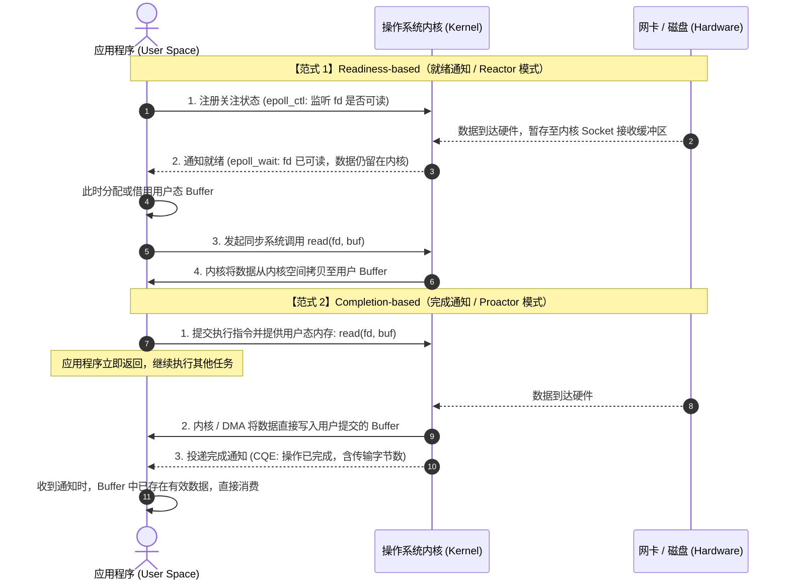

# I/O 模型的演进与两大范式：Readiness 与 Completion

在非阻塞 I/O 领域，操作系统的底层通知机制主要分为两种范式：
- **Readiness-based（基于就绪通知 / Reactor 模式）**：以 Linux `epoll`、macOS `kqueue` 为代表；上层系统如 Nginx、Redis、Node.js、Rust Tokio 以及 Go `netpoller` 均构建在就绪模型之上。
- **Completion-based（基于完成通知 / Proactor 模式）**：以 Windows `IOCP`、Linux `io_uring` 为代表；C# 异步运行时、ScyllaDB 以及 Zig `std.Io` 则基于完成模型构建。

---

## 核心机制与时序差异

在异步数据传输过程中，操作可以分解为两个阶段：
1. **等待数据就绪**：网卡接收网络报文写入内核套接字缓冲区，或磁盘控制器完成物理寻道与扇区读取；
2. **搬运数据**：在操作系统内核空间与用户空间内存缓冲区之间拷贝数据。

两种范式的核心区别在于**第二阶段“搬运数据”由谁触发、在何时执行**。

### 阶段对照

| 交互阶段 | Readiness-based (就绪通知 / Reactor) | Completion-based (完成通知 / Proactor) |
| :--- | :--- | :--- |
| **初始注册 / 提交** | 告诉内核对特定 fd 的状态感兴趣；无需提前提供读写内存地址 | 告诉内核执行具体操作（如读取或写入），必须提前提供内存切片指针 |
| **硬件数据到达** | 暂存在内核空间的套接字接收队列中 | 由内核或 DMA 直接写入应用层提前指定的内存地址 |
| **事件通知内容** | 通知应用“数据已准备好，需调用接口读取” | 通知应用“数据已搬运完成，直接读取内存即可” |
| **数据搬运时机** | 应用收到通知后，通过显式系统调用（如 `read`、`write`）同步拷贝 | 异步完成，无需进行二次系统调用 |
| **系统调用开销** | 每个 I/O 周期至少两次系统调用（等待就绪 + 读写系统调用） | 通过批量提交队列与完成队列，可减少系统调用次数 |
| **内存占用特征** | **按需分配**：未就绪前不需要分配读取内存，便于维持大量空闲连接 | **内存锁定**：在操作未完成前，提交的内存切片不能被释放或移作他用 |

---

## 磁盘常规文件的异步支持差异

在 Linux 虚拟文件系统（VFS）中，常规磁盘文件被设计为“始终处于就绪状态”。如果将一个普通文件描述符注册到 `epoll` 中，`epoll_wait` 会立即返回该文件可读。随后的 `read()` 调用在遇到缺页或物理磁盘 I/O 阻塞时，仍会阻塞当前物理线程。

各大语言为了在就绪模型下处理常规文件，采取了不同的妥协方案：

### 1. Go 的处理机制
Go 的 `netpoller` 仅接管网络套接字。遇到普通磁盘文件读写时，工作线程会在进入系统调用前触发 `runtime.entersyscall`。如果该调用在特定时间内未返回，调度器会解绑逻辑处理器 P，并临时派生新的操作系统线程（M）去处理其他 Goroutine。在密集磁盘 I/O 场景下，这可能导致操作系统线程数量快速上升，增加线程上下文切换负担。

### 2. Rust Tokio 的处理机制
Rust 的 Tokio 运行时针对普通文件提供了 `tokio::fs` 模块。其内部并没有将磁盘文件纳入 `epoll` 事件驱动，而是通过 `spawn_blocking` 将文件读写任务投递到一个专属的阻塞线程池中（默认上限 512 个线程）。这实际上是依靠线程池模拟异步。

### 3. Zig 与 `io_uring` 的处理机制
在 Linux `io_uring` 中，内核通过统一的请求结构体（SQE）支持文件读取、写入、`fsync`、目录操作以及网络套接字传输。`std.Io` 的底层可以直接使用相同的事件环处理网络连接与磁盘文件，因此不需要为文件 I/O 维护独立的阻塞线程池，消除了网络与磁盘之间的抽象差异。

---

## 内存生命周期带来的设计约束

尽管完成模型在系统调用次数与多设备统一性上具备优势，但它在语言层面引入了严格的内存约束：

在就绪模型下，`read(buf)` 在调用返回时即完成，调用未发生前内存不会被内核访问。因此即使异步任务被丢弃，缓冲区也可以安全释放。

在完成模型下，应用提交请求后，内存切片的地址已被注册在内核任务中。如果应用因超时或逻辑跳转提前退出了包含该缓冲区的函数栈帧，随后内核完成数据传输并执行写入时，就会覆盖已经失效的内存地址（即 Use-After-Free）。

不同的语言对此给出了不同的设计取舍：
- **Rust 的方案**：由于 Rust 的 `Future` 可以被外部任意 `drop`，为了防止内核向已失效的引用写入数据，在接入 `io_uring` 时（如 `tokio-uring`、`monoio`），社区放弃了传统的 `&mut [u8]` 借用接口，改为强制要求传入 `Vec<u8>` 等拥有独立所有权的缓冲区（Owned Buffer），在 I/O 完成后再归还所有权。
- **Zig 的方案**：Zig 保留了平实的内存切片切分方式，但在标准库底层引入了 `CancelRegion` 与取消屏障机制，确保在内核完全解除对缓冲区的操作之前，纤程不会提前退出或释放栈帧。
