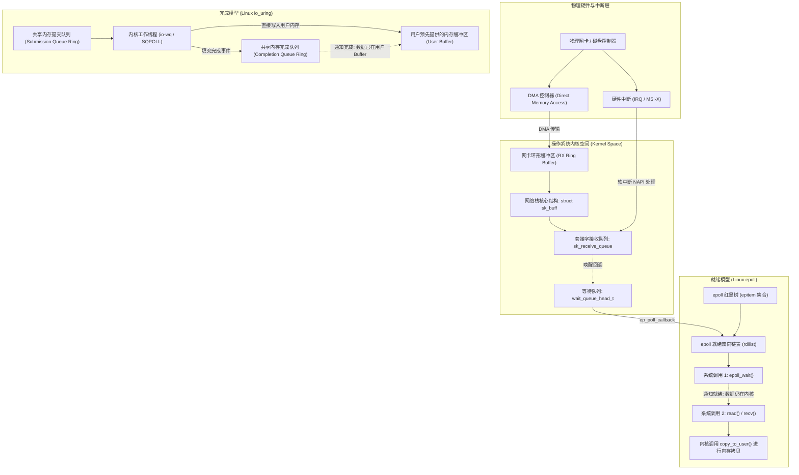

# I/O 模型的演进与底层剖析：Readiness 与 Completion

在操作系统中，网络通信与存储读写涉及慢速外部设备与 CPU 之间的数据协调。

围绕“数据何时就绪”以及“数据由谁负责读入内存”，操作系统衍生出了两种常见的通知机制：
- **Readiness-based（基于就绪通知 / Reactor 模式）**：以 Linux `select`/`poll`/`epoll`、BSD/macOS `kqueue` 为代表；
- **Completion-based（基于完成通知 / Proactor 模式）**：以 Windows `IOCP`（I/O Completion Ports）、Linux `io_uring` 为代表，Zig 0.17 的 `std.Io` 采用这一范式。

---

## 操作系统内核视角的物理交互全景

数据从外部物理介质到达用户空间内存，需要跨越物理硬件、设备驱动、内核网络栈/文件系统以及系统调用边界。



---

## Readiness（就绪通知）的内核工作原理与代价

### 1. 内核数据结构与就绪链路

以 Linux `epoll` 为例，内核通过以下核心数据结构支撑就绪通知机制：

- **`struct eventpoll`**：每个 `epoll` 实例在内核中的控制块，包含两处关键索引：
  - **红黑树（`rbr`）**：存放所有通过 `epoll_ctl(EPOLL_CTL_ADD)` 注册的被监控文件描述符（封装为 `struct epitem`）；
  - **就绪双向链表（`rdllist`）**：存放所有已经触发关注事件的 `epitem`。
- **注册与回调注入**：调用 `epoll_ctl` 监控套接字时，内核调用该驱动的 `poll` 方法，将等待项（`wait_queue_entry_t`）挂载到该套接字的等待队列 `sk_sleep` 上，回调指针设置为 `ep_poll_callback`。
- **硬件中断到就绪链表**：
  1. 远端数据包到达网卡，网卡通过 DMA 将数据写入主存中的 RX Ring Buffer，并发起硬件中断；
  2. CPU 响应中断，调度 NAPI 软中断（`NET_RX_SOFTIRQ`）读取环形缓冲区，将数据包组装为内核的 `struct sk_buff`；
  3. 内核网络协议栈（IP/TCP）处理校验和、握手状态与重组后，将 `sk_buff` 挂入该套接字的 `sk_receive_queue`；
  4. 触发套接字唤醒链表上的 `ep_poll_callback`，内核将该套接字对应的 `epitem` 链接到 `eventpoll` 的就绪链表 `rdllist` 中；
  5. 唤醒阻塞在 `epoll_wait` 上的用户态进程。

### 2. 就绪模型的开销特征

在就绪模型下，一次完整的 I/O 生命周期存在几项固定开销：

1. **系统调用频次**：
   - 应用程序先通过 `epoll_wait()` 获取“哪些 fd 已经可读”；
   - 随后再发起系统调用（如 `read()` 或 `recv()`）读取数据。高并发下，较多的系统调用会带来相应的上下文切换开销。
2. **内核到用户空间的内存拷贝**：
   - 在应用发起 `read()` 调用前，内核无法预知用户空间缓冲区的位置；
   - 网卡通过 DMA 到达的数据先暂存在内核分配的 `sk_buff` 缓冲区中；
   - 应用调用 `read(fd, user_buf, len)` 时，CPU 同步将数据从内核空间拷贝至用户空间的 `user_buf`（通过内核函数 `copy_to_user`）。
3. **多线程分发竞争**：
   - 多个工作线程监听同一个 `epoll` 句柄时，事件唤醒可能引起线程争用，需要通过 `EPOLLEXCLUSIVE` 等机制缓解竞争。

---

## Completion（完成通知）的内核工作原理

完成模型的时序相反：应用程序预先提交读写指令和目标内存地址，内核完成数据搬运后，再投递完成通知。

### 1. Linux `io_uring` 的共享内存环

Linux 5.1 引入的 `io_uring` 采用双环形队列机制：

- **双环形缓冲区（Ring Buffers）**：
  `io_uring` 初始化时，通过 `mmap` 系统调用将内核分配的两段环形缓冲区映射到用户态虚拟内存地址空间：
  - **SQ（Submission Queue，提交队列）**：应用程序为生产者，写入操作请求（`struct io_uring_sqe`）；内核为消费者；
  - **CQ（Completion Queue，完成队列）**：内核为生产者，写入完成事件（`struct io_uring_cqe`）；应用程序为消费者。
- **物理结构布局**：
  ```zig
  // SQE 结构体固定为 64 字节，对齐 CPU 缓存行（Cache Line）
  pub const io_uring_sqe = extern struct {
      opcode: u8,         // 操作码：如 IORING_OP_READV, IORING_OP_WRITE, IORING_OP_ACCEPT
      flags: u8,          // 链式执行 (IOSQE_IO_LINK) 等标志
      ioprio: u16,
      fd: i32,            // 目标文件描述符
      off: u64,           // 文件偏移量 (Positional I/O)
      addr: u64,          // 目标内存切片指针 (应用层预先提供的缓冲地址)
      len: u32,           // 缓冲区长度
      rw_flags: u32,
      user_data: u64,     // 透传标记 (Zig 中通常直接存 Fiber 上下文指针)
      ...
  };

  // CQE 结构体固定为 16 字节
  pub const io_uring_cqe = extern struct {
      user_data: u64,     // 对应 SQE 传入的 user_data
      res: i32,           // 系统调用实际结果：>= 0 为传输字节数；< 0 为 -errno 错误码
      flags: u32,
  };
  ```

### 2. 完成模型的性能特征

1. **批量与免系统调用提交**：
   - 用户态向 SQ 环中写入多个 SQE，使用原子操作更新 `tail` 指针；
   - 在 `IORING_SETUP_SQPOLL` 模式下，内核线程（`io_uring-sq`）轮询该队列，用户态提交请求无需触发系统调用。
2. **减少内存中继拷贝**：
   - 应用在提交 SQE 时已指定目标缓冲区地址 `addr`；
   - 存储设备或支持的网卡可通过 DMA 将数据直接写入用户态缓冲区对应的物理页；
   - 应用程序收到 CQE 时，数据已经在目标内存中，无需二次调用 `read()` 拷贝。
3. **统一网络与常规文件接口**：
   - 常规磁盘文件在 `epoll` 中通常被视为始终就绪，无法通过 `epoll_wait` 异步等待磁盘寻道；
   - `io_uring` 将常规文件读写、网络套接字、目录遍历统一抽象为 SQE 请求，纳入同一个异步事件环。

---

## 跨语言运行时底层架构对比

各语言根据底层 I/O 模型的特征，采用了不同的运行时设计：

```mermaid
graph TB
    subgraph GoRuntime ["Go 运行时 (Netpoller + GMP)"]
        G1["Goroutine (G)"]
        G_Read["g.Read(buf)"]
        Netpoller["Netpoller 线程 (epoll_wait)"]
        M_Pool["物理线程池 (M)"]
        Sysmon["监控线程 (sysmon)"]
        
        G1 --> G_Read
        G_Read -->|遇到 EAGAIN| BlockG["修改 G 状态为 _Gwaiting 并解绑 M"]
        Netpoller -->|fd 就绪| WakeG["置 G 为 _Grunnable 并推入 runq"]
        G_Read -.->|常规文件阻塞| Sysmon
        Sysmon -.->|超时剥离 P 派生新 M| M_Pool
    end

    subgraph RustTokio ["Rust Tokio 运行时 (Reactor + Work-Stealing)"]
        T_Future["Task (Future 状态机)"]
        T_Poll["Future::poll(cx)"]
        MIO["Mio (epoll / kqueue 封装)"]
        Waker["Waker (RawWakerVTable)"]
        BlockingPool["专属阻塞线程池 (tokio::fs 专用)"]
        
        T_Future --> T_Poll
        T_Poll -->|返回 Poll::Pending| RegWaker["注册 Waker 至 Mio 兴趣表"]
        MIO -->|事件触发| CallWake["调用 waker.wake() 将任务重入调度队列"]
        T_Poll -.->|磁盘 I/O: spawn_blocking| BlockingPool
    end

    subgraph ZigIo ["Zig std.Io (统一完成模型 + 轻量 Fiber)"]
        Z_Fiber["轻量 Fiber (独立栈空间)"]
        Z_VTable["Io.VTable (统一擦除接口)"]
        Z_Backend["后端驱动: Io.Uring / Io.Dispatch / Io.Threaded"]
        
        Z_Fiber -->|调用 io.vtable.xxx| Z_VTable
        Z_VTable --> Z_Backend
        Z_Backend -->|直接投递 SQE 携带 Fiber 指针| Ring["内核 / 驱动完成通知"]
        Ring -->|CQE 归还唤醒| Z_Fiber
    end
```



### 1. Go：就绪网络与文件阻塞补偿

- **网络套接字**：Go 网络库基于非阻塞就绪模型。在 `src/runtime/netpoll_epoll.go` 中，Goroutine 读取遇到 `EAGAIN` 时调用 `runtime.netpollblock`：
  - 将当前 G 的状态由 `_Grunning` 改为 `_Gwaiting`，挂入该 fd 的 `pollDesc` 结构中；
  - 调度器让出物理线程 M，去执行其他就绪的 G；
  - `sysmon` 或后台网络轮询线程调用 `epoll_wait` 收集就绪事件，将对应的 G 重新标记为 `_Grunnable` 放入运行队列。
- **常规文件处理**：由于 Linux `epoll` 不支持磁盘文件，Go 对普通文件仍使用阻塞系统调用。
  - 调用前执行 `runtime.entersyscall`；
  - 若系统调用阻塞时间较长，`sysmon` 监控线程将逻辑处理器 P 与当前 M 解绑，唤醒或创建新的 M 继续执行其他 Goroutine。
  - 在高并发磁盘读写场景下，操作系统线程数会随之增加。

### 2. Rust Tokio：无栈状态机与阻塞线程池

- **异步模型**：Rust 采用基于无栈状态机的拉取模型（Pull-based），`async fn` 被编译为实现 `Future` 的状态机。
- **调度机制**：
  - 执行器调用 `Future::poll(cx)`。若套接字无法立即读取，返回 `Poll::Pending`；
  - 运行时构造包含 `RawWakerVTable` 的唤醒器，注册进底层的 Mio（封装了 `epoll`/`kqueue`）；
  - 就绪事件触发后调用 `waker.wake()`，将任务重新加入工作窃取调度队列。
- **文件 I/O 方案**：由于 `epoll` 的限制，`tokio::fs` 通过 `spawn_blocking` 将文件操作交由专属的阻塞线程池（默认上限 512 个线程）处理。

### 3. Zig 0.17：统一完成模型与纤程结合

Zig 的 `std.Io` 采用完成模型语义：

1. **统一抽象**：Linux 上直接对接 `io_uring`，macOS 上利用 `Dispatch`，其他平台降级至 `Io.Threaded`。文件读写与网络传输均按异步请求提交；
2. **无需独立文件阻塞线程池**：在 `io_uring` 环境下，文件与网络操作共享相同的提交队列，避免了为磁盘 I/O 单独维护阻塞线程池；
3. **Fiber 与完成通知衔接**：发起 I/O 时，标准库将当前 Fiber 结构体的内存指针存入 SQE 的 `user_data` 字段；CQE 返回时，调度器根据该地址恢复挂起的 Fiber。

---

## 范式对比与开销矩阵

| 评估维度 | Readiness-based (Linux epoll) | Completion-based (Linux io_uring / Zig) | 说明 |
| :--- | :--- | :--- | :--- |
| **单次 I/O 系统调用频次** | 通常需要 2 次（`epoll_wait` + `read`/`write`） | **0 ~ 1 次**（批量提交或 SQPOLL 轮询） | 减少用户态与内核态的上下文切换 |
| **数据搬运方式** | CPU 执行内核到用户缓冲区的内存拷贝（`copy_to_user`） | **直接写入**：由内核或 DMA 写入用户预先指定的缓冲区 | 减少内存拷贝步骤 |
| **磁盘常规文件异步支持** | 不支持（通常需要借助阻塞线程池模拟） | **原生异步**（与网络套接字使用相同通道） | 避免磁盘 I/O 导致物理线程数扩张 |
| **用户态缓冲区生命周期** | **按需借用**：系统调用前无需长期锁定内存 | **调用期间锁定**：提交后在收到完成通知前，内存不能释放或复用 | 需要语言层面的生命周期管理或取消屏障配合 |
| **高并发空闲连接开销** | **较低**：维持空闲连接无需为每个连接预留读缓冲区 | **需搭配缓冲池**：预挂过多读请求会占用内存，通常配合 `IORING_OP_PROVIDE_BUFFERS` 使用 | 两种模型在连接管理策略上的取舍不同 |
