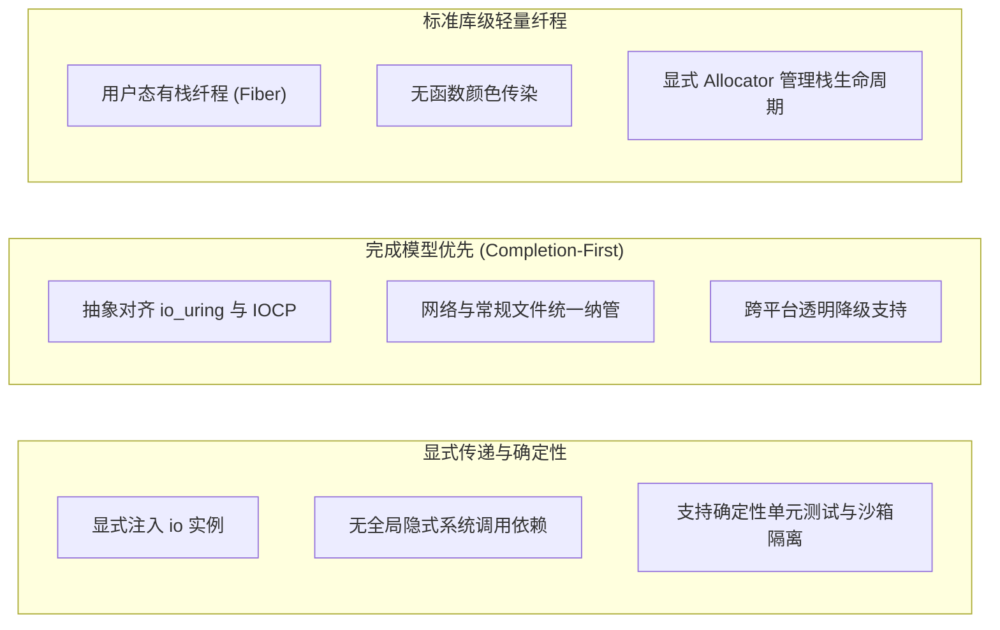

# Zig I/O 的设计抉择：统一抽象与有栈纤程

在 Zig 语言的发展过程中，异步并发的设计经历了从“编译器内置语言特性”向“标准库一等公民抽象”的转变。

早期版本中，Zig 曾内置了无栈异步语法（`async`、`await`、`suspend`、`resume`），由编译器在编译阶段分析异步调用栈帧（Async Frame）的大小。然而在实际工程中，这一方案遇到了如下困难：
- **编译期分析受限**：当程序涉及动态函数指针调用、递归或外部 C ABI 桥接时，编译器无法在编译期静态推导完整的 Frame 尺寸；
- **编译器复杂度上升**：状态机变换与控制流重写使编译器后端的维护成本显著增加；
- **与操作系统底层机制脱节**：该设计主要针对传统就绪通知，难以有效利用现代内核的完成型接口（如 Linux `io_uring`）。

因此，Zig 最终废除了语言内置的异步关键字，转为在标准库层面构建统一的运行时抽象：**`std.Io`**。

---

## 现代 std.Io 的三个设计支柱



### 1. 显式传递：I/O 作为一等公民实例
在 Zig 中，涉及堆内存分配的函数通常要求显式接收 `allocator: std.mem.Allocator` 参数。这种设计确保了内存行为透明可控。

`std.Io` 延续了这一思想：**涉及外部环境交互（文件读写、套接字通信、时间等待、进程派生）的函数，需显式传入 `io: std.Io` 实例**。

```zig
pub fn fetchConfiguration(allocator: std.mem.Allocator, io: std.Io, path: []const u8) !Config {
    var cwd = std.Io.Dir.cwd();
    var file = try cwd.openFile(io, path, .{ .mode = .read_only });
    defer file.close(io);

    var buf: [4096]u8 = undefined;
    var reader = file.reader(io, &buf);
    const content = try reader.interface.allocRemaining(allocator, .limited(1024 * 1024));
    defer allocator.free(content);

    return parseConfig(content);
}
```

显式传递带来两个直接收益：
- **测试确定性**：在单元测试中可以传入 Mock 驱动或标准测试驱动（`std.testing.io`），无需启动真实的外部网络环境即可验证故障逻辑；
- **能力安全（Capability-based Security）**：可以向子模块传递权限受限的 `Io` 包装实例（例如只允许访问特定目录或禁用网络连接）。

### 2. 完成模型优先（Completion-First）
许多语言在早期设计 I/O 抽象时以 BSD Socket 或 `epoll` 的就绪语义为基准，导致常规磁盘文件无法纳入事件循环。Zig 的 `std.Io` 从接口层面采用完成型语义：
- 底层优先对接 Linux `io_uring`；
- 普通磁盘文件与网络套接字在抽象上处于同等地位，均通过操作提交与完成通知驱动；
- 在缺乏原生完成机制的平台（如 macOS 或 BSD），通过模拟层实现相同的完成语义接口。

### 3. 标准库级纤程消除函数颜色
为了避免无栈协程带来的函数颜色问题，同时避免引入不可裁剪的运行时，Zig 采用轻量有栈纤程：
- **汇编切换上下文**：仅用数条汇编指令保存并置换 CPU 寄存器；
- **显式栈生命周期**：栈内存由开发者传入的 `Allocator` 分配，不依赖后台垃圾回收；
- **同步写法**：在纤程内部，读写操作使用同步顺序调用方式，中间层函数无需标记特殊关键字。

---

## 现代系统编程语言并发机制对比矩阵

下表横向对比了 Zig、Rust 与 Go 在处理高并发与 I/O 时的架构选型：

| 维度 | Go (`netpoller` + Goroutine) | Rust (`tokio` + `Future`) | Zig (`std.Io` + Fiber) |
| :--- | :--- | :--- | :--- |
| **异步范式** | 基于就绪通知 (`epoll`/`kqueue`) | 基于就绪通知 (`epoll`/`kqueue`) | 基于完成通知 (`io_uring`) 为先 |
| **栈模型** | 有栈：初始 2KB 动态连续栈 | 无栈：编译器生成状态机结构体 | 有栈：显式 Allocator 分配固定栈 |
| **调度驱动** | Push 事件驱动（调度器主动唤醒） | Pull 轮询驱动（执行器调用 `poll`） | Push 完成驱动（事件环切回纤程） |
| **函数颜色** | 无函数颜色，纯同步语法 | **存在函数颜色**（需标注 `async`/`.await`） | **无函数颜色**，纯同步语法 |
| **常规文件 I/O** | `epoll` 不支持，阻塞时派生 OS 线程 | 丢给阻塞线程池（`spawn_blocking`） | 原生支持，网络与文件共享统一事件环 |
| **运行时开销** | 较重：GMP 调度器 + GC + 动态栈扩容 | 极小：编译期内联，零运行时开销 | 较轻：标准库汇编切换，无 GC，无后台线程 |
| **内存所有权** | 缓冲区由 GC 追踪，无 UAF 风险 | `io_uring` 下借用冲突，需转移所有权 | 显式生命周期，借由 `CancelRegion` 防御 UAF |
| **C ABI 交互** | 需经由 CGO，存在跨栈调用成本 | 零成本交互，可直接调用 C 函数 | 零成本交互，纤程内可直接执行 C 函数 |
