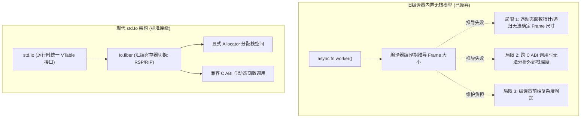
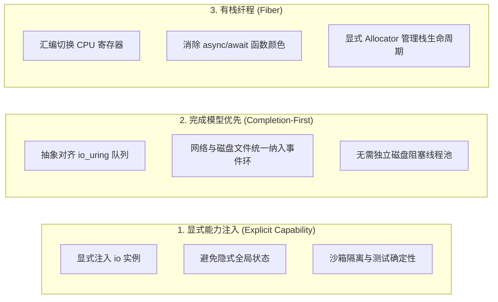

# Zig I/O 的设计抉择：统一抽象与有栈纤程

在系统级编程语言中，I/O 与并发抽象的设计直接影响代码组织与性能。Zig 经历了多次架构调整，在 0.17 确立了以 **`std.Io`** 为核心的设计。

这一抉择主要针对两个历史问题：
1. 废弃早期编译器内置的无栈协程语法（`async`/`await` 关键字）；
2. 重构旧标准库中基于编译期泛型宏的 `std.io.Reader` 与 `std.io.Writer`。

---

## 历史回溯：语言级无栈协程的实际局限

在早期 Zig 版本中，语言内置了无栈异步机制（包含 `async`、`await`、`suspend`、`resume` 关键字），由编译器推导异步帧尺寸（Async Frame Size）。在实际工程中，该方案遇到了以下困难：



1. **编译期 Frame 尺寸推导困难**：
   编译器需要在编译阶段静态计算出异步函数的状态机帧大小。当程序涉及**函数指针动态调用、递归或外部 C 动态库**时，编译器无法静态推导出最大栈深。
2. **底层 I/O 驱动对接限制**：
   编译器内置的状态机主要针对就绪模型（Readiness），难以自然地利用 Linux `io_uring` 或 Windows IOCP 等内核完成模型。

因此，Zig 移除了语言层面的 `async` 关键字与栈帧变换，转为在标准库层面使用显式 `std.Io` 与轻量有栈纤程（Fiber）实现并发抽象。

---

## 为什么重构旧版泛型 Mixin 宏（`std.io.Reader`/`Writer`）？

在 Zig 之前的版本中，流式读写是通过 `std.io.Reader` / `std.io.Writer` 泛型 Mixin 模式实现的：

```zig
// 旧版本设计：基于 comptime 宏混入
pub fn Reader(
    comptime Context: type,
    comptime ReadError: type,
    comptime readFn: fn (context: Context, buffer: []u8) ReadError!usize,
) type {
    return struct {
        context: Context,
        pub const Error = ReadError;
        pub fn read(self: @This(), buffer: []u8) Error!usize {
            return readFn(self.context, buffer);
        }
        // 结构体内部混入数十个泛型工具方法
    };
}
```

这种设计存在几项工程缺点：

1. **代码膨胀与编译耗时**：
   每一种不同的底层数据源（`File`、`Socket`、`FixedBufferStream`），都会让编译器针对其上下文重新单态化（Monomorphize）生成一套工具函数代码，增加了二进制体积与编译开销。
2. **缺乏类型擦除，难以统一纳管**：
   由于不同 Reader 的类型签名不同（包含不同的 `Context` 与 `ReadError` 参数），无法直接放入同一个数组或任务队列中进行统一管理。
3. **难以适应完成模型**：
   旧的泛型 Reader 是同步且基于拉取的，假设每次 `read()` 会立即返回字节数，无法自然表达提交给内核环、挂起并等待完成通知的时序。

### 0.17 标准库的设计：类型擦除与具体结构体

在全新架构中，标准库进行了相应调整：
- **`std.Io` 成为顶层接口**：内部通过 `userdata: ?*anyopaque` 和不可变的 `vtable: *const VTable` 实现类型擦除，I/O 操作通过显式传递 `io: std.Io` 完成；
- **`Io.Reader` 与 `Io.Writer` 成为具体结构体**：固定包含内部缓冲区（`buffer: []u8`、`seek: usize`、`end: usize` 和具体的 `vtable: *const VTable`），避免了泛型单态化膨胀，便于进行向量短读（`readVec`）优化。

---

## 现代 std.Io 的设计原则



### 1. 显式能力注入

I/O 操作往往涉及外部环境。Zig 延续了内存分配器的显式传递原则：**需要与操作系统交互的操作，显式接收 `io: std.Io` 参数**。

```zig
pub fn syncLocalDatabase(allocator: std.mem.Allocator, io: std.Io, path: []const u8) !void {
    var cwd = std.Io.Dir.cwd();
    var file = try cwd.openFile(io, path, .{ .mode = .read_write });
    defer file.close(io);

    try file.sync(io);
}
```

- **权限控制**：可以向子模块传递权限受限的 `Io` 包装实例（如限制文件路径或网络权限）；
- **测试确定性**：单元测试中可以使用 `std.testing.io` 或虚拟驱动，无需真实连接外部网络即可验证边界逻辑。

### 2. 完成模型优先（Completion-First）

`std.Io` 的接口设计基于完成模型语义：
- 顶层接口基于“提供缓冲区 -> 提交请求 -> 接收完成通知”构建；
- 磁盘文件读写与网络套接字使用统一的提交机制；
- 缺少原生完成机制的环境下，由 `Io.Threaded` 或 `Io.Dispatch` 提供兼容层，保持上层 API 一致。

### 3. 有栈纤程与顺序语法

为了保持异步并发能力并避免函数颜色传染，Zig 在标准库实现了轻量有栈纤程：
- **汇编切换**：底层使用内联汇编保存并载入 CPU 寄存器（[`lib/std/Io/fiber.zig`](https://codeberg.org/ziglang/zig/src/tag/0.17.0/lib/std/Io/fiber.zig)）；
- **显式栈管理**：栈内存由调用方传入的 `Allocator` 分配，不依赖后台垃圾回收；
- **顺序书写**：在 Fiber 内部，代码按顺序方式编写，遇到 I/O 等待时由标准库自动切出 CPU。
