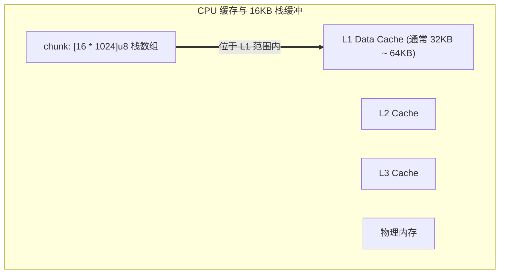

# 实战一：高性能 CLI 文本统计引擎底层实现与 CPU 缓存优化

在命令行工具开发中，行数、单词数与字节数的统计（类似 Unix `wc -lwc`）是典型的数据流处理场景。

实现时常见的开销来源包括：
1. **频繁小内存分配**：如使用高级语言的 `readLine()`，单行切分带来较多内存分配与回收；
2. **读取粒度过小**：单字节读取会增加系统调用频次。

本章利用 `std.Io.File` 与 `Io.Reader` 的滑动窗口短读机制，构建一个固定栈内存分配的文本分析工具。

---

## 逐块扫描与固定缓冲区实现

```zig
const std = @import("std");
const Io = std.Io;

pub const TextStats = struct {
    lines: usize = 0,
    words: usize = 0,
    bytes: usize = 0,
};

pub fn countStream(r: *Io.Reader) !TextStats {
    var stats = TextStats{};
    var in_word = false;

    // 在当前线程栈上开辟 16KB 缓冲区
    var chunk: [16 * 1024]u8 = undefined;

    while (true) {
        // 短读：填满 chunk，无需中间中继
        const n = try r.readSliceShort(&chunk);
        if (n == 0) break; // 到达流末尾 EOF

        stats.bytes += n;

        // 内层循环：逐字节统计
        for (chunk[0..n]) |byte| {
            if (byte == '\n') {
                stats.lines += 1;
            }

            const is_space = switch (byte) {
                ' ', '\t', '\n', '\r' => true,
                else => false,
            };

            if (is_space) {
                in_word = false;
            } else if (!in_word) {
                in_word = true;
                stats.words += 1;
            }
        }
    }

    return stats;
}
```



---

## 实现细节说明

### 1. 缓冲区大小选择
现代处理器的单核心 L1 数据缓存通常在 32KB 到 64KB 之间。将缓冲区设定为 16KB，有助于使其常驻在 L1 缓存中，循环扫描时的访存延迟较低。

### 2. `readSliceShort` 向量直读
当 Reader 内部就绪数据耗尽时，`readSliceShort` 将栈上的 `chunk[i..]` 包装为 I/O 向量 `data[0]` 传给底层的 `readVec`，系统调用直接将数据写入栈上的 `chunk` 内存中，无需二次拷贝。

### 3. 内存占用确定性
整个函数在栈上运行，堆内存分配为 0，内存占用相对稳定。

---

## 单元测试验证（内存切片驱动）

得益于 `Io.Reader` 的统一接口设计，可以使用内存切片构造纯内存流进行单元测试：

```zig
test "统计纯内存文本流的指标" {
    const sample = "Zig is a modern systems programming language.\nSimple, fast and safe.\n";

    var stream: Io.Reader = .fixed(sample);
    const stats = try countStream(&stream);

    try std.testing.expectEqual(@as(usize, 2), stats.lines);
    try std.testing.expectEqual(@as(usize, 10), stats.words);
    try std.testing.expectEqual(sample.len, stats.bytes);
}
```
测试完全在内存中执行，无需依赖外部文件。
