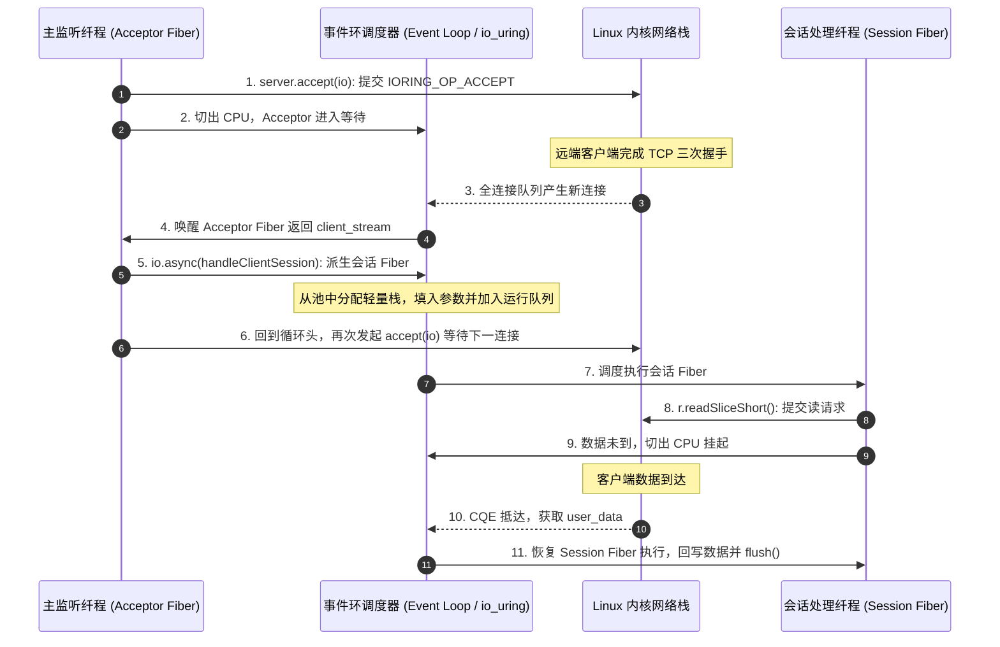

# 实战三：高并发异步 Echo 服务器架构与 Fiber 调度微观时序

构建网络服务是检验并发模型在多连接场景下行为的典型方式。

本章利用 `std.Io.net` 与轻量有栈纤程（Fiber），构建一个采用同步语法编写的 Echo 服务器，分析其系统调用与栈帧分配情况。

---

## 交互时序与 Fiber 状态流转



---

## Echo 服务器实现代码

```zig
const std = @import("std");
const Io = std.Io;
const net = Io.net;

pub fn serveEcho(io: Io, port: u16) !void {
    const bind_addr = try net.IpAddress.parse("127.0.0.1", port);
    
    // 1. 建立监听套接字，设置全连接队列大小为 512
    var server = try bind_addr.listen(io, .{
        .kernel_backlog = 512,
    });
    defer server.deinit(io);

    std.debug.print("Echo server is active on port {d}...\n", .{port});

    // 2. 主 Accept 循环
    while (true) {
        // 等待新连接：无连接时让出 CPU
        const client_stream = try server.accept(io);

        // 为该连接派生轻量有栈纤程 (Fiber)
        _ = io.async(handleClientSession, .{ io, client_stream });
    }
}

// 客户端会话处理函数：顺序语法书写
fn handleClientSession(io: Io, stream: net.Stream) void {
    defer stream.close(io);

    // 在当前 Fiber 栈上分配聚合读写缓冲区
    var rx_buf: [2048]u8 = undefined;
    var tx_buf: [2048]u8 = undefined;

    var stream_reader = stream.reader(io, &rx_buf);
    var stream_writer = stream.writer(io, &tx_buf);

    const r = &stream_reader.interface;
    const w = &stream_writer.interface;

    while (true) {
        var temp: [512]u8 = undefined;
        // 短读：客户端无数据时当前 Fiber 挂起，有数据时唤醒
        const bytes_read = r.readSliceShort(&temp) catch break;
        if (bytes_read == 0) break; // 客户端断开连接 (EOF)

        w.writeAll(temp[0..bytes_read]) catch break;
        w.flush() catch break;
    }
}
```

---

## 运行机制解析

### 1. `io.async` 派生 Fiber 的步骤
当主循环执行 `io.async(handleClientSession, .{ io, client_stream })` 时：
1. **获取栈空间**：从当前线程预备的 Fiber 自由链表（Free List）中获取上下文对象；
2. **上下文拷贝**：将入参元组 `.{ io, client_stream }` 写入该 Fiber 栈顶；
3. **设置寄存器**：将 `Context.pc` 指向 `handleClientSession` 入口，将 `Context.sp` 设置为对齐后的栈顶；
4. **加入运行队列**：将该 Fiber 插入事件环的就绪链表。在用户态完成调度准备。

### 2. 并发连接内存对比

| 评估项目 | Go 语言 (Goroutine) | Rust (Tokio) | Zig 0.17 (std.Io Fiber) |
| :--- | :--- | :--- | :--- |
| **单连接栈/状态机占用** | 初始 2KB 动态连续栈 + 运行时结构体 | 仅 `Future` 状态机枚举（根据状态按需分配） | 显式分配栈（如 4KB） |
| **栈扩容行为** | 递归深层调用时可能触发 `copystack` 扩容与指针重写 | 零栈扩容 | 零栈扩容，由保护页（Guard Page）防范越界 |
| **函数语法** | 同步书写，无函数颜色 | 需标注 `async`/`await` | 同步书写，无函数颜色 |
| **C 动态库交互** | 需经由 CGO 桥接 | 需通过 FFI 处理生命周期 | 在纤程内可直接调用 C 函数 |
