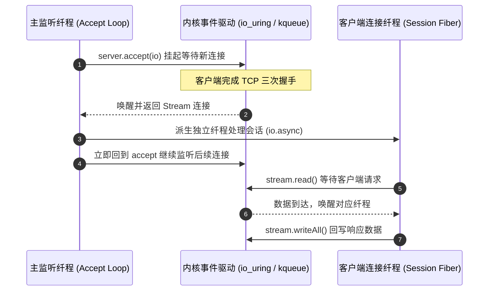

# 实战三：高并发网络服务与 Fiber 调度

构建高并发网络服务是检验 I/O 并发体系的重要场景。

本章利用 `std.Io.net` 与轻量纤程，构建一个异步 Echo 服务器，展示如何以顺序语法处理并发网络连接。

---

## 交互时序



---

## 核心实现代码

```zig
const std = @import("std");
const Io = std.Io;
const net = Io.net;

pub fn serveEcho(io: Io, port: u16) !void {
    const bind_addr = try net.IpAddress.parse("127.0.0.1", port);
    var server = try bind_addr.listen(io, .{
        .kernel_backlog = 512,
        .reuse_address = true,
    });
    defer server.deinit(io);

    std.debug.print("Echo server is active on port {d}...\n", .{port});

    while (true) {
        // 阻塞等待连接；当无客户端请求时，当前纤程挂起，不占用 CPU 周期
        const client_stream = try server.accept(io);

        // 为该连接派生独立的轻量纤程任务
        _ = io.async(handleClientSession, .{ io, client_stream });
    }
}

fn handleClientSession(io: Io, stream: net.Stream) void {
    defer stream.close(io);

    var rx_buf: [2048]u8 = undefined;
    var tx_buf: [2048]u8 = undefined;

    var stream_reader = stream.reader(io, &rx_buf);
    var stream_writer = stream.writer(io, &tx_buf);

    const r = &stream_reader.interface;
    const w = &stream_writer.interface;

    while (true) {
        var temp: [512]u8 = undefined;
        const bytes_read = r.readSliceShort(&temp) catch break;
        if (bytes_read == 0) break; // 客户端关闭连接 EOF

        w.writeAll(temp[0..bytes_read]) catch break;
        w.flush() catch break;
    }
}
```

---

## 跨语言对比与实现权衡

- **Go 方案**：
  ```go
  for {
      conn, _ := listener.Accept()
      go handle(conn)
  }
  ```
  Go 的每个连接对应一个 Goroutine，初始分配 2KB 动态栈。当连接数达到数十万时，大量空闲连接依然会占用显著内存。遇到深层调用时可能触发连续栈动态扩容。
- **Rust Tokio 方案**：
  ```rust
  loop {
      let (socket, _) = listener.accept().await?;
      tokio::spawn(async move {
          handle(socket).await;
      });
  }
  ```
  Rust 的无栈状态机在空闲状态下内存占用极小。但代码存在函数颜色传染，如果需要将 `socket` 传递给第三方黑盒同步函数，必须考虑跨线程传递与所有权问题。
- **Zig 方案**：
  采用轻量有栈纤程（Fiber）。开发者可以通过显式配置 `stack_size` 精准设定纤程栈的上限（如 16KB 或 64KB）。业务代码保持同步顺序结构，无函数颜色传染；由于不存在垃圾回收器，P99 调度延迟相对平稳。
