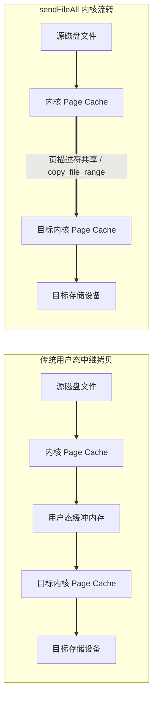

# 实战二：零拷贝流式传输管道底层剖析与降级状态机

在大文件传输、备份工具或代理服务中，减少数据在用户态与内核态之间的拷贝有助于提升传输吞吐。

传统方式通常需经历“磁盘 -> 内核页缓存 -> 用户态临时数组 -> 内核 Socket/目标文件页缓存 -> 磁盘”的多步中继。

本章利用 `Io.Writer` 体系中的 `sendFile` 虚表机制，构建带有自动降级支持的文件传输管道。

---

## 零拷贝管道设计与数据路径



---

## 传输实现代码

查看源码 [`lib/std/Io/Writer.zig#L1074`](https://codeberg.org/ziglang/zig/src/tag/0.17.0/lib/std/Io/Writer.zig#L1074)，传输实现如下：

```zig
const std = @import("std");
const Io = std.Io;

pub fn copyFileZeroCopy(io: Io, src_file: Io.File, dst_file: Io.File) !u64 {
    // 1. 获取源文件大小
    const total_size = try src_file.length(io);

    // 2. 构造源端 Reader
    var read_buffer: [4096]u8 = undefined;
    var file_reader = src_file.reader(io, &read_buffer);

    // 3. 构造目标端 Writer（传入非空 write_buffer 用于降级中继）
    var write_buffer: [4096]u8 = undefined;
    var file_writer = dst_file.writer(io, &write_buffer);
    const w = &file_writer.interface;

    // 4. 执行文件流转传输
    // 优先调用底层 copy_file_range / sendfile；若返回 error.Unimplemented，
    // 自动利用 write_buffer 进行降级缓冲拷贝
    const bytes_copied = try w.sendFileAll(&file_reader, .limited(total_size));

    // 5. 冲刷目标端残留缓冲
    try w.flush();
    return bytes_copied;
}
```

---

## 降级机制分析

在异构文件系统与网络环境下，零拷贝系统调用可能受限：
- 源与目标位于跨网络的卷（如 NFS、CIFS）；
- 容器安全策略限制了部分系统调用。

### `sendFileAll` 的降级流程：
1. **底层调用返回错误**：
   查阅源码 [`lib/std/Io/Writer.zig#L1100`](https://codeberg.org/ziglang/zig/src/tag/0.17.0/lib/std/Io/Writer.zig#L1100)，底层的 `w.vtable.sendFile` 在内核不支持时返回 `error.Unimplemented`；
2. **上层拦截与降级**：
   高层方法 `w.sendFileAll` 捕获该错误后，调用备用方法 `sendFileReadingAll`：
   ```zig
   while (remaining > 0) {
       const n = w.vtable.sendFile(w, file_reader, limit) catch |err| switch (err) {
           error.Unimplemented => {
               assert(w.buffer.len > 0);
               return sendFileReadingAll(w, file_reader, limit);
           },
           else => |e| return e,
       };
       remaining -= n;
   }
   ```
3. **缓冲回退**：
   `sendFileReadingAll` 自动借用调用方提供的 `write_buffer`，使用 `readSliceShort` 与 `drain` 进行常规中继读写。

---

## 跨语言对比（Zig vs Go vs Rust）

| 维度 | Go 语言 (`io.Copy`) | Rust Tokio (`tokio::io::copy`) | Zig 0.17 (`w.sendFileAll`) |
| :--- | :--- | :--- | :--- |
| **底层系统调用** | Linux `splice` / `sendfile` | 默认通用用户态缓冲拷贝 | Linux `copy_file_range` / `sendfile`，macOS `fcopyfile` |
| **分发方式** | 运行时接口断言（`ReaderFrom` / `WriterTo`） | 需引入特定平台 crate 支持 | VTable 虚表方法 |
| **内存分配** | 断言失败时在堆上分配 32KB 临时 slice | 依赖外部传入或动态结构 | 栈上显式分配缓冲 |
| **降级处理** | 内部处理系统错误 | 需应用层编码判断 | 标准库内部捕获错误并自动降级 |

---

## 单元测试验证

```zig
test "零拷贝流式文件复制与数据完整性校验" {
    const io = std.testing.io;

    var tmp = std.testing.tmpDir(.{});
    defer tmp.cleanup();

    const src_name = "source.txt";
    const dst_name = "target.txt";
    const content = "Zero-copy streaming pipeline verification.";

    // 1. 初始化源文件
    {
        var src = try tmp.dir.createFile(io, src_name, .{});
        defer src.close(io);
        var fw = src.writer(io, &.{});
        try fw.interface.writeAll(content);
        try fw.interface.flush();
    }

    // 2. 执行传输
    {
        var src = try tmp.dir.openFile(io, src_name, .{});
        defer src.close(io);

        var dst = try tmp.dir.createFile(io, dst_name, .{});
        defer dst.close(io);

        const copied = try copyFileZeroCopy(io, src, dst);
        try std.testing.expectEqual(content.len, copied);
    }

    // 3. 校验目标文件内容
    {
        var dst = try tmp.dir.openFile(io, dst_name, .{});
        defer dst.close(io);

        var read_buf: [128]u8 = undefined;
        var fr = dst.reader(io, &read_buf);
        const actual = try fr.interface.allocRemaining(std.testing.allocator, .limited(1024));
        defer std.testing.allocator.free(actual);

        try std.testing.expectEqualStrings(content, actual);
    }
}
```
通过该测试验证文件内容的一致性与降级路径的稳定性。
