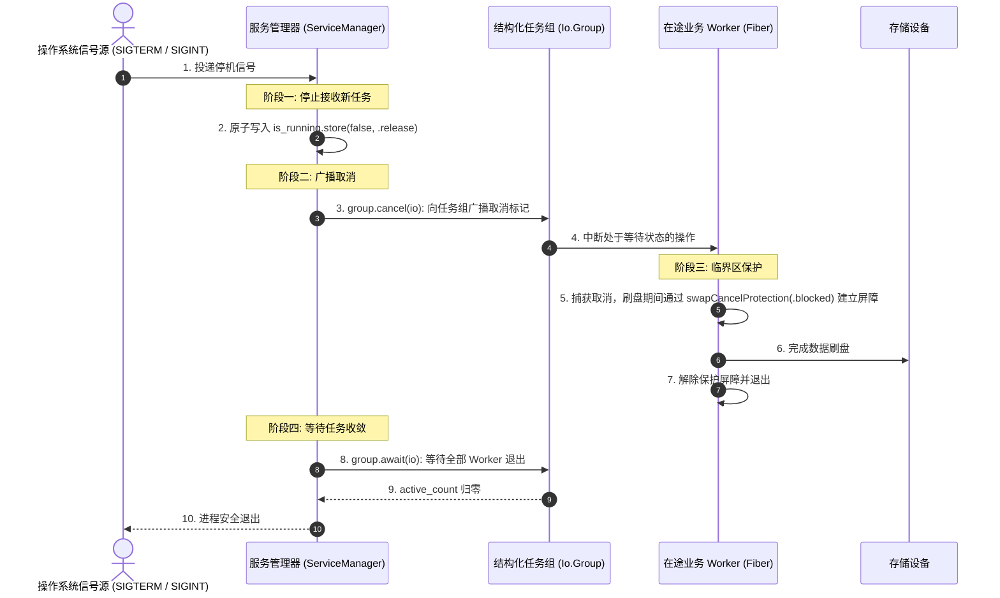

# 实战四：结构化并发、事务临界区与优雅停机（Graceful Shutdown）底层机制

在常驻守护进程与网络服务中，服务的有序退出（Graceful Shutdown）有助于保证在途数据落盘与连接正常关闭。

若进程在接收到终止信号后直接退出，可能导致正在写入的数据处于未完成状态。

本章利用 `Io.Group`、`CancelProtection` 临界区屏障与 `checkCancel`，构建一个具备状态保护的优雅停机流程。

---

## 优雅停机交互流程



---

## 服务协调器实现代码

```zig
const std = @import("std");
const Io = std.Io;

pub const ServiceManager = struct {
    io: Io,
    group: Io.Group = .init,
    // 原子布尔值：控制新请求的接入闸门
    is_running: std.atomic.Value(bool) = .{ .raw = true },

    pub fn init(io: Io) ServiceManager {
        return .{ .io = io };
    }

    /// 派发受控后台工作任务
    pub fn spawnWorker(self: *ServiceManager, worker_id: usize) !void {
        try self.group.concurrent(self.io, workerLoop, .{ self, worker_id });
    }

    /// 触发停机并保证所有在途任务收敛
    pub fn shutdown(self: *ServiceManager) !void {
        std.debug.print("Initiating graceful shutdown sequence...\n", .{});

        // 1. 切断新任务流入 (采用 Release 内存序)
        self.is_running.store(false, .release);

        // 2. 通知当前在途 Fiber 尽快结束
        self.group.cancel(self.io);

        // 3. 等待 Group 内所有 Worker 退出
        try self.group.await(self.io);

        std.debug.print("All background workers have cleanly exited. Safe to terminate.\n", .{});
    }
};

fn workerLoop(mgr: *ServiceManager, worker_id: usize) Io.Cancelable!void {
    std.debug.print("Worker {d} initialized.\n", .{worker_id});

    while (mgr.is_running.load(.acquire)) {
        // 主动探测取消安全点
        try mgr.io.checkCancel();

        // 关键操作保护：进入 .blocked 保护区，不被中断信号打断
        {
            const prev = mgr.io.swapCancelProtection(.blocked);
            defer _ = mgr.io.swapCancelProtection(prev);

            // 模拟不可被拆分的写盘操作
        }
    }

    std.debug.print("Worker {d} finished gracefully.\n", .{worker_id});
}
```

---

## 优雅停机的关键点解析

### 1. 内存序同步（Release-Acquire）
- `is_running.store(false, .release)`：使用 Release 语义写入，保证此前的写操作对其他核心可见；
- `is_running.load(.acquire)`：Worker 在循环开始时以 Acquire 语义读取，与主控线程形成跨核心同步。

### 2. 临界区取消屏障：`swapCancelProtection(.blocked)`
将取消保护等级设为 `.blocked` 后，调度器会暂扣取消请求。离开临界区并将状态还原后，累积的取消请求才会在下一个安全点抛出 `error.Canceled`，保护了写盘过程的完整性。

### 3. `Io.Group` 的任务计数
- 任务启动时自增 `active_count`；
- 任务退出时（无论正常结束还是抛出错误），运行外壳的 `defer` 递减 `active_count` 并释放栈内存；
- `group.await(io)` 在 `active_count == 0` 时返回，确保父作用域退出前子任务已全部停止。

---

## 跨语言停机机制对比

| 维度 | Go 语言 (`context.WithCancel`) | Rust Tokio (`CancellationToken`) | Zig 0.17 (`Io.Group` + `CancelProtection`) |
| :--- | :--- | :--- | :--- |
| **信号传递方式** | 通过函数形参显式透传 `ctx: context.Context` | 克隆 `CancellationToken` 传入闭包 | 携带在 Fiber 上下文中 |
| **临界区防打断** | 需使用带超时的独立 `context.Background()` 组织逻辑 | 依赖各组件自行设计标志位 | 原生支持 `swapCancelProtection(.blocked)` |
| **任务收敛等待** | 通常外挂 `sync.WaitGroup` | 通常借助 `JoinSet` 容器管理 | `Io.Group` 在作用域退出前收敛 |
| **资源释放时机** | 任务结束后由 GC 统一回收 | 任务丢弃时同步析构 | 任务函数体返回时即释放独立栈 |
