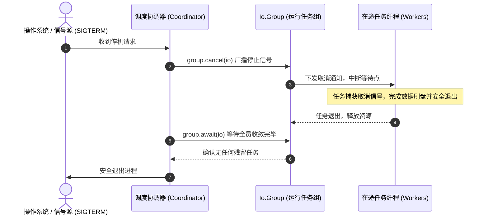

# 实战四：结构化并发与优雅停机（Graceful Shutdown）

在长时间运行的守护进程与网络服务中，服务的平稳关闭与启动同等重要。直接强制退出进程可能导致进行中的事务中断或写盘损坏。

本章通过 `Io.Group` 与取消安全机制，构建结构化并发与优雅停机流程。

---

## 优雅停机流程设计



---

## 核心实现代码

```zig
const std = @import("std");
const Io = std.Io;

pub const ServiceManager = struct {
    io: Io,
    group: Io.Group = .init,
    is_running: std.atomic.Value(bool) = .{ .raw = true },

    pub fn init(io: Io) ServiceManager {
        return .{ .io = io };
    }

    /// 启动后台工作任务
    pub fn spawnWorker(self: *ServiceManager, worker_id: usize) !void {
        try self.group.concurrent(self.io, workerLoop, .{ self, worker_id });
    }

    /// 触发停机并等待所有任务完成收敛
    pub fn shutdown(self: *ServiceManager) !void {
        std.debug.print("Initiating graceful shutdown...\n", .{});

        // 1. 标记服务停止接收新任务
        self.is_running.store(false, .release);

        // 2. 向所有在途任务广播取消信号
        self.group.cancel(self.io);

        // 3. 阻塞等待所有已派生的工作任务退出
        try self.group.await(self.io);

        std.debug.print("All workers converged safely. Exiting.\n", .{});
    }
};

fn workerLoop(mgr: *ServiceManager, worker_id: usize) Io.Cancelable!void {
    std.debug.print("Worker {d} started.\n", .{worker_id});

    while (mgr.is_running.load(.acquire)) {
        // 主动探测是否已收到取消信号
        try mgr.io.checkCancel();

        // 执行关键临界区操作：通过 swapCancelProtection 保护写盘逻辑不受中断破坏
        {
            const prev = mgr.io.swapCancelProtection(.uncancelable);
            defer _ = mgr.io.swapCancelProtection(prev);

            // 执行不可分割的刷盘或持久化逻辑...
        }
    }

    std.debug.print("Worker {d} finished cleanly.\n", .{worker_id});
}
```

---

## 跨语言对比与实现权衡

- **Go 方案**：
  通常依赖 `context.Context` 的 `WithCancel` 传递取消信号，并在业务循环中通过 `select { case <-ctx.Done(): ... }` 监听。若需等待收敛，必须搭配 `sync.WaitGroup` 或 `errgroup.WithContext`。开发者需保证所有下游函数均正确透传 `ctx` 参数。
- **Rust 方案**：
  通常使用 `tokio_util::sync::CancellationToken` 广播取消事件，配合 `tokio::select!` 宏监听。若任务直接被 `abort()` 中断，局部变量的 `Drop` 虽然会被触发，但在有途 I/O 下仍需注意底层资源清理状态。
- **Zig 方案**：
  通过 `Io.Group` 原生聚合任务生命周期。任务中可主动调用 `checkCancel()` 响应取消；在不可中断的关键阶段，通过 `swapCancelProtection(.uncancelable)` 建立保护屏障，保证资源交付与状态落盘的完整性。
